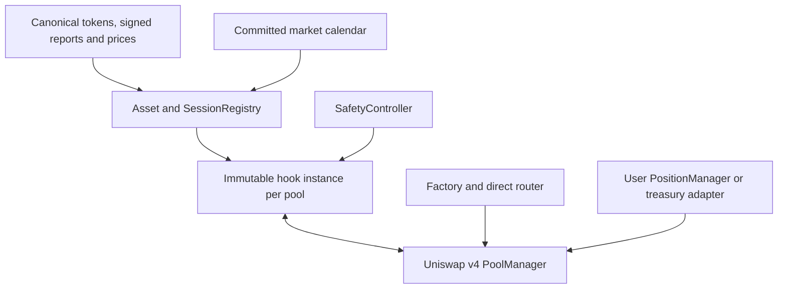

# BELL — Developer Brief Final

**Finalisasi scope:** 24 Oktober 2026 · **Pemilik produk:** @ronald  
**Mandat:** produk pool saham lintas pasangan dan semua sesi, termasuk weekend; terpisah penuh dari token platform.  
**Status dokumen:** spesifikasi produk penuh dan persyaratan implementasi ditetapkan.  
**Status deployment:** belum mendapat persetujuan mainnet; kode produksi, fork tests dan audit belum tersedia.

Dokumen ini menggantikan seluruh brief sebelumnya. Pembatasan REGULAR-only dan satu pool USDG/NVDA **tidak lagi menjadi batas produk**. Pilot merupakan tahap pengujian, sedangkan implementasi wajib mencakup pasangan beragam, pre/post/overnight, weekend/libur, LP publik dan factory. Fitur tersebut tidak boleh dianggap selesai hanya karena pilot reguler berjalan.

Dokumen ini menetapkan perilaku yang harus dibangun; ia tidak menyatakan kode yang belum ada sudah aman. Angka kebijakan adalah konfigurasi yang dipilih untuk diuji, bukan hasil backtest atau rekomendasi Chainlink. Source primer R1–R45 ada di bagian 17. Bagian 19–20 mengunci 40 gap engineering beserta API, state machine dan kriteria buktinya; source model executable ada di bagian 18, 21 dan 23. Bagian 22 mengunci operasional free-tier, source discovery dan penutupan keputusan biaya berdasarkan klarifikasi pengguna.

## 1. Produk penuh dan pemisahan tanggung jawab

BELL (*Bourse-Event Liquidity Layer*) adalah infrastruktur Uniswap v4 untuk pool yang memiliki sedikitnya satu Robinhood Stock Token canonical. Hook menentukan fee dan batas arus berdasarkan sesi saham dan kesehatan data; AMM v4 menentukan eksekusi harga.

Contoh yang termasuk scope: **USDG/AAPL, WETH/TSLA, MEME/NVDA, dan Stock Token/Stock Token** dengan kedua aset canonical. Native ETH di UI dibungkus menjadi WETH melalui router; dukungan native currency core tidak dicampur dengan jalur ERC-20 pertama.

| Komponen | Deliverable produk |
|---|---|
| BellHook | Template immutable dengan konfigurasi per pool; fee sesi, budget rolling dan budget penutupan, corporate/reopen guard |
| Asset/SessionRegistry | Identitas saham, mapping feed/schema, session capability, laporan terverifikasi dan health checkpoint |
| CalendarRegistry | Interval UTC sesi/penutupan terjadwal, libur dan early close; provenance serta aturan publikasi |
| SafetyController | Pause terbatas, delayed resume; tidak mengakses principal LP |
| BellPoolFactory | Deploy hook template, initialize dan seed atomik; biaya layanan 49 USDG |
| Router/SDK | Exact-input/output, quote mode/risk, deadline, slippage dan settlement |
| LP interface | Posisi noncustodial via PositionManager, tambah/kurangi/collect in-kind |
| Treasury adapter | Hanya untuk pilot milik project; tidak memegang posisi pelanggan |
| Keeper/indexer/web | Clock per aset, proof/health, budget, LP PnL, Create Pool dan direct swaps |

Tidak termasuk: kontrak token platform, Pons, creator fee, burn/buyback, staking, token gating, pinjaman/leverage, rebase/fee-on-transfer support, jaminan LP untung, atau public managed vault ERC-4626. Menyediakan posisi LP publik berbeda dari mengoperasikan vault deposit publik.

**Pemisahan $BELL:** tidak ada CA platform yang wajib, ABI Pons, signature wallet launch, atau konfigurasi creator fee dalam core. Jika tim token memberi CA kemudian, integrasi awal hanya metadata. CA itu dapat mengikuti factory umum bila transfer behavior dan profile cocok; nama $BELL tidak memberi izin khusus. Project tidak perlu mengetahui tokenomics atau mengubah launch configuration. Seluruh pendapatan layanan project tidak dialokasikan otomatis ke token.

**Janji ketersediaan:** swap dapat diminta setiap waktu, termasuk weekend, tetapi hanya dieksekusi dalam batas data, band dan budget profile. “24/7” bukan janji unlimited liquidity, oracle saham selalu live, atau tidak pernah revert.

## 2. Temuan riset yang menutup gap weekend dan pasangan beragam

| Temuan primer | Keputusan implementasi BELL |
|---|---|
| Saat market closed, feed ekuitas dapat membawa harga lama; Chainlink menjelaskan bounded trading sebagai salah satu penanganan [R6] | Ada CLOSED mode berbasis last-valid close dan budget total penutupan; harga tersebut tidak dilabeli live |
| Robinhood token feed tidak menjanjikan heartbeat selama off-hours [R8] | Ketidakbaruan yang memang diharapkan saat penutupan dibedakan dari outage ketika sesi seharusnya aktif |
| v10 memiliki tokenizedPrice dari pasar sekunder, tetapi keberadaan field tidak membuktikan feed untuk canonical Robinhood token tersedia [R12] | Tidak memakai token lain/issuer lain sebagai harga substitusi; feed 24/7 hanya dipakai jika mapping identitas dan field freshness dibuktikan |
| Ekuitas menggunakan stream fase yang terpisah; halt individual tidak selalu terflag [R6][R7] | Pilih Regular/Extended/Overnight sesuai mapping dan periksa timestamp harga, bukan marketStatus saja |
| Long-tail DEX price methodology tersedia, tetapi bukan berarti setiap meme punya feed atau independensi dari pool yang dilindungi [R21] | Token tanpa oracle tetap didukung lewat SESSION_ONLY, tanpa badge proteksi harga |
| Hooks dapat melayani pool dengan satu hook yang dipilih saat initialize [R23] | Factory memakai satu template dengan instance immutable per pool untuk mengisolasi konfigurasi dan budget; bukan proxy upgradeable |
| Dynamic LP fees dapat berbeda per swap [R20] | Fee 0,05/0,30/0,50/1,00% tetap bagian produk semua sesi |

Keberadaan mekanisme di dokumentasi bukan bukti feed ID, account access, source mapping atau kontrak BELL telah berhasil diuji. Riset tidak dapat menciptakan harga pasar saham yang tidak diperdagangkan saat weekend. Kontrol yang dipilih mengakui keterbatasan itu, bukan menghapus weekend dari produk.

## 3. Dua kelas pool dengan batas klaim yang jelas

| Profile class | Pasangan | Proteksi yang diberikan |
|---|---|---|
| PRICE_GUARDED | Kedua aset mempunyai sumber harga independen yang disetujui; contoh USDG/AAPL, WETH/TSLA, saham/saham | Session fee, gross-flow limits, close-episode budget, band terhadap reference yang provenance-nya jelas |
| SESSION_ONLY | Sedikitnya satu Stock Token terverifikasi, counterasset ERC-20 biasa tanpa harga independen; contoh MEME/NVDA | Session fee, gross raw-unit limits, close-episode budget dan corporate guard; **tidak menjamin fair price counterasset** |

Kelas dikunci di deployment dan ditampilkan sebelum signature deposit LP atau swap. Tidak ada promosi SESSION_ONLY menjadi PRICE_GUARDED melalui admin toggle. Jika kemudian ada oracle layak, deploy profile/pool baru dan migrasi sukarela.

Untuk SESSION_ONLY, stock-side identity dan data sesi tetap harus terverifikasi. Harga/likuiditas MEME bukan input yang dipercaya. Spot atau TWAP pool BELL sendiri tidak dipakai untuk mengarang oracle independen atau denominator keamanan. DEX oracle yang mengandung pool BELL dalam sumbernya harus ditolak untuk badge PRICE_GUARDED kecuali analisis ketergantungan/manipulasi secara eksplisit telah disetujui dalam audit profile.

Tidak ada klaim “semua token ERC-20 aman”. Intake memeriksa chain/code, interface, decimals, transfer/approval actual balances dan kemampuan redeem posisi. Token yang diketahui fee-on-transfer/rebase ditolak. Proxy/admin dapat mengubah perilaku setelah onboarding; risiko itu ditampilkan dan dipantau, bukan dianggap hilang oleh satu simulasi. Token blacklisting/pause issuer dapat menghalangi exit.

CA $BELL dapat masuk SESSION_ONLY sebagaimana token eksternal lain, tanpa akses wallet launch dan tanpa mengetahui setting Pons. Jika kompatibilitas tidak terbukti, hanya tampilkan metadata sampai pemeriksaan transaksi selesai.

## 4. Arsitektur, pool isolation dan kewenangan



Satu code template diaudit, lalu instance hook terpisah mengunci PoolKey, profile hash, source adapters, controller, calendar binding, policy dan budget per currency. Ini mengubah asumsi satu alamat singleton di brief awal untuk menghindari lintas-pool accounting dan konfigurasi mutable. Tidak menggunakan clone proxy/delegatecall. Instance berbeda berarti PoolId berbeda; direct router wajib mengindeksnya dan routing allowlist dinilai sesuai alamat aktual.

CREATE2 salt di-namespace terhadap creator dan hash konfigurasi. Factory menyediakan preview alamat/PoolId dan nonce request; orang lain tidak dapat mengganti config dengan memakai salt yang sama. Kode/template dan constructor harus dapat diverifikasi publik. Budget satu pool tidak membatasi arus seluruh project atau pool tiruan; klaim perlindungan selalu per posisi/pool yang benar.

| Pihak | Boleh | Tidak boleh |
|---|---|---|
| Submitter siapa pun | Submit laporan sah, sync health/corporate, finalisasi closure context dengan bukti | Menulis harga/sesi arbitrer |
| Registry governance 2-dari-3, timelock 48 jam | Menambahkan canonical asset/adapters yang ditinjau dan kalender masa depan | Mengganti dependency/profile immutable pool existing atau mengklaim verifikasi tanpa bukti |
| Guardian project 2-dari-3 | Pause segera, jadwalkan resume 48 jam | Sweep dana LP, mereset budget, memaksa price invalid jadi valid |
| Creator pool | Memilih pasangan, class yang memenuhi syarat, fixed raw caps lebih ketat, initial price dan recipient posisi | Mengubah fee/caps/sources pool existing, mengakses posisi LP lain |
| LP | Tambah/kurangi/collect posisi miliknya dan menerima risiko profile | Mengubah policy pool tanpa deployment baru |
| Treasury | Menyetor/menarik modal project sendiri | Mengelola dana tim token atau menganggap dana LP sebagai treasury |

Controller tidak punya arbitrary call/approval, fungsi sweep atau proxy upgrade. Resume memakai pause nonce dan tidak mengalahkan guard lain. Guardian dapat menyensor trading; tidak dapat mengunci removal melalui guard BELL. Dependency eksternal seperti token, proxy feed/verifier, chain dan multisig masih membawa trust/operational risk. Immutable hook tidak berarti semua pihak eksternal immutable.

## 5. Sesi, fee dan pemilihan stream

Waktu onchain UTC Unix seconds; ET menggunakan America/New_York, WIB Asia/Jakarta. Tabel jam normal tidak mengalahkan libur, early close, kapabilitas per aset atau laporan valid. [R15][R16][R22]

| Sesi efektif | Jam normal ET | LP fee v4 units | Kondisi eksekusi |
|---|---|---:|---|
| REGULAR | 09:30–16:00 | 500 = 0,05% | Laporan/harga stock aktif sehat |
| PRE | 04:00–09:30 | 3.000 = 0,30% | Extended stream sehat dan kapabilitas aset sesuai |
| POST | 16:00–20:00 | 3.000 = 0,30% | Extended stream sehat dan kapabilitas aset sesuai |
| OVERNIGHT | 20:00–04:00 sesuai minggu trading | 5.000 = 0,50% | Overnight stream sehat dan kapabilitas aset sesuai |
| CLOSED | Weekend/libur/unsupported session yang terbukti | 10.000 = 1,00% | Valid closure context, anchor, cap rolling dan episode |
| UNKNOWN / UNEXPECTED_STALE | Tidak dapat membuktikan state/data aktif | Tidak ada swap | Halt; bukan izin masuk weekend mode |
| ISSUER_PAUSE / MANUAL_PAUSE / INVALID | Kegagalan kritis | Tidak ada swap | Halt, exit in-kind tetap terpisah |

Mapping v11 24/5: 0 unknown, 1 pre, 2 regular, 3 post, 4 overnight, 5 closed. v10 memakai 0 unknown, 1 closed, 2 open; ia tidak mengidentifikasi lima sesi. Adapter berbeda tidak boleh memakai decoder/mapping sama. Stream IDs per Regular, Extended dan Overnight diikat pada underlying yang benar. Sesi yang diklaim didukung harus mempunyai stream/schema/kapabilitas yang benar; bila tidak, session mask memperlakukannya sebagai closure terjadwal yang lebih berisiko, bukan mengarang extended feed.

Pool dua saham mengevaluasi keduanya: bila keduanya open, gunakan fee terbesar di antara sesi aktifnya; bila salah satunya closed, pool CLOSED; bila salah satunya unknown/invalid/paused, pool HALTED. Quote crypto/stablecoin tidak mengubah sesi bursa tetapi sumber harganya tetap harus sehat untuk PRICE_GUARDED.

`effectiveLPFee = max(baseSessionFee, bellFee, corporateFee, repricingFee)` pada state yang mengizinkan swap. Tidak ada biaya hook $BELL, delta fee BELL atau potongan pendapatan LP. Native protocol fee Uniswap tetap dihormati; quote total pengguna mengikuti perhitungan core, tidak disamakan dengan LP fee. [R13][R20]

## 6. Data sehat, freshness dan pembukaan kembali

### 6.1 Aturan umum

Verify full signed payload lewat verifier resmi chain, kemudian decode verified response. Bind feedId, schema, quote units, underlying/token identity, source class dan decimals. `validFrom <= observations <= now`, `expiresAt > now`, harga positif dan timestamp tidak nol/tidak masa depan. Reports lama/duplikat tidak memperpanjang validUntil, health timer atau budget.

Simpan observations high-water mark per feed, dan effective state timestamp profile. v11 lastSeenTimestampNs dinormalisasi /1e9 dan dapat nonmonotonik; tidak disyaratkan selalu naik. Umur input mid tetap dicek, terpisah dari umur report. Bid/ask tidak otomatis fresh karena timestamp mid fresh. [R5][R7]

Pada sesi aktif, batas dasar: report age 120 detik dengan expiry dan boundary lebih ketat; mid age REGULAR 60 detik, PRE/POST 120 detik, OVERNIGHT 300 detik; direct token feed min(600 detik, heartbeat resmi bila ada); quote crypto/stable feed min(600 detik, heartbeat resmi bila ada). Ini batas kebijakan untuk pengujian, bukan SLA provider. Jika feed aktual tidak memenuhi, jangan diam-diam memperlonggar saat runtime; profile baru harus diuji/direview sebelum deploy.

Untuk PRICE_GUARDED, normalized underlying × live multiplier dibanding direct token feed yang sudah adjusted; jangan mengalikan direct feed dua kali. Perbedaan maksimal 100 bps; di atasnya halt. Sumber dapat berbagi provider sehingga bukan verifikasi ekonomi independen penuh. Semua harga skala 1e18, decimals dibuktikan, FullMath/safe casts dan domain overflow diterapkan.

Untuk SESSION_ONLY, feed harga counterasset tidak dibutuhkan. Kesehatan Stock Token, mid/kapabilitas sesi dan pause/multiplier tetap dibutuhkan untuk membedakan sesi nyata dari outage.

### 6.2 Runtime dan recovery

BeforeSwap membaca pause/multiplier live dan feed yang relevan melalui staticcall, memeriksa state registry dan kalender. Verifier tidak dipanggil di hot path. Health checkpoint diperbarui lewat transaksi permissionless `refreshHealth`; unhealthy outcome yang sah disimpan tanpa merevert seluruh checkpoint. Report palsu tetap ditolak.

Saat menerima data baru, bandingkan terhadap deadline state **lama sebelum overwrite**. Gap saat pasar seharusnya buka memicu RECOVERING; dua checkpoint benar-benar baru berjarak minimal 60 detik dan tanpa expiry yang terlewati sebelum update berikutnya diperlukan untuk membuka kembali. Refresh timestamp lokal atau report duplikat tidak dihitung sebagai pemulihan.

Sumber aktif basi/unknown di jam seharusnya buka → HALT segera. Tidak ada aturan “anggap tutup lalu tetap trading 24 jam”. Expected closed mempunyai jalur tersendiri pada bagian 7, sehingga harga saham yang memang berhenti pada weekend tidak diperlakukan sebagai outage yang menutup seluruh fitur weekend.

Halt individual bisa tidak terflag marketStatus; latency deteksi dan harga yang salah tetapi signed valid adalah residual risk. Dua RPC tidak membuat oracle salah menjadi benar.

### 6.3 Bell dan corporate guard

Bell moment 300 detik setelah pembukaan REGULAR setiap hari, pembukaan mingguan ke sesi pertama yang didukung, dan pemulihan dari closure. Start dibuktikan boundary kalender + laporan; bila ambigu gunakan report open pertama yang diterima. Duplikat tidak reset timer.

`bellFee = baseFee + ceil((10000-baseFee) × max(0,300-elapsed) / 300)`.

REGULAR: 0 detik=10.000; 150 detik=5.250; 300 detik=500. Jika kembali ke OVERNIGHT, turun ke 5.000, bukan 500. Episode CLOSED belum berakhir hanya karena ada report open tunggal; recovery dan bukti active-input sehat harus lulus.

Multiplier berubah atau issuer pause → transaksi sync terpisah melatch event. Swap berhenti sampai direct token feed dan active input setelah boundary corporate konservatif tersedia; report dengan waktu sama/lebih tua tidak dianggap pulih. Sesudah sehat, corporate fee minimum 1% selama 1.800 detik dari deteksi pertama; perubahan baru memperpanjang, duplikat keadaan sama tidak.

Perubahan multiplier saat weekend membatalkan close anchor lama. Tidak menskalakan anchor secara buta ketika underlying dan multiplier mungkin belum sinkron. Bila belum ada harga yang konsisten, pause dapat bertahan sampai harga pulih. Fitur weekend tetap tersedia dalam keadaan normal, bukan melewati corporate-action inconsistency.

## 7. Weekend/libur: closed reference dan provenance

### 7.1 Pembuktian expected closure

Ada `ClosureContext` terikat pool/profile yang berisi interval `[start,end)`, calendar/schedule commitment, stock capabilities, anchor yang ditangkap saat data masih valid, multiplier saat capture, serta budget episode. Seluruh interval/sumbernya dapat diverifikasi onchain sebelum dipakai.

Kalender berasal dari jadwal feed/venue dan kalender holiday/early close yang dipublikasikan; bukan hanya “hari Sabtu/Minggu” atau mengasumsikan NYSE regular calendar menjelaskan semua venue overnight. Root interval canonical yang sudah aktif tidak dapat diganti. Root masa depan harus non-overlap dengan interval yang telah dikomit, bertimelock 48 jam dan diumumkan minimal 7 hari sebelum coverage dimulai. Jika coverage tidak ada, hasil UNKNOWN; tidak memberi izin kalender rekaan. Governance kalender adalah trust assumption yang diungkapkan.

Fresh signed status open yang bertentangan dengan closure terjadwal → CONFLICT/HALT sampai direkonsiliasi, bukan memilih mode yang termurah. Jika kalender menyatakan sesi aktif tetapi report berhenti, itu UNEXPECTED_STALE, bukan weekend. **Unexpected closure selalu HALT dalam release ini.** Report CLOSED ketika kalender mengatakan sesi aktif bukan izin membuat anchor atau budget baru. Jalur trading CLOSED hanya untuk planned closure/unsupported-session yang sudah dikomit, dengan anchor yang sah. Ini keputusan final, bukan fallback yang dipilih developer.

### 7.2 Capture anchor sebelum penutupan

Untuk setiap Stock Token, simpan last-valid multiplier-adjusted token/USD reference melalui `captureClose` permissionless pada lima menit terakhir sesi yang didukung sebelum close, dengan underlying/report fresh menurut batas sesi dan direct feed konsisten. Timestamp data dan capture tidak boleh melewati close. Anchor diberi label historical, bukan fresh market price. State yang hanya diperbarui setelah pasar tutup tidak boleh berpura-pura merupakan capture tepat sebelum tutup.

Jika data capture yang memenuhi syarat tidak ada, weekend trading pool tersebut berhenti sampai context yang benar tersedia; tidak mengarang harga close dari spot AMM. Kegagalan ini terukur dalam monitoring dan pengujian availability, bukan alasan menghapus fitur dari scope.

Anchor maximum age 96 jam dan berlaku hanya selama closure intervalnya. Holiday/penutupan lebih panjang memerlukan sumber 24/7 yang layak atau pool berhenti setelah batas tersebut. Pengguna dapat menambah LP atau mengeluarkan LP sesuai mode liquidity, tetapi itu tidak memperpanjang anchor atau mereset budget.

Urutan branch runtime penting: jika expected-closure context dan anchor sah, evaluasi jalur CLOSED **sebelum** menerapkan batas umur 120/600 detik jalur active stock. Hanya kewajiban fresh report/mid/direct-price bagi stock yang memang closed yang dikecualikan; expiry report lama tidak dipoles menjadi report fresh. Cross-source deviation 100 bps diperiksa pada capture, tidak dibandingkan ulang dengan mid aktif yang memang berhenti. Live pause/multiplier/getter integrity, calendar validity, anchor age, batas episode dan seluruh live quote/stock lain tetap wajib. Jawaban invalid/masa depan, getter gagal atau corporate mismatch tetap halt. Tanpa pengecualian yang spesifik ini, common freshness guard akan menonaktifkan weekend secara tidak sengaja.

Untuk pool dua saham, capture masing-masing stock pada closure boundary-nya; context mencatat closed stock mana memakai frozen reference dan stock mana masih mempunyai live reference. Jika salah satu anchor invalid/expired atau multiplier berubah, PRICE_GUARDED halt. SESSION_ONLY juga tidak melewati corporate invalidity hanya karena tidak memiliki quote oracle.

### 7.3 Reference weekend PRICE_GUARDED

Default weekend mode **FROZEN_CLOSE**: harga USD Stock Token yang closed dibekukan pada anchor; aset lain yang masih diperdagangkan menggunakan harga live. Contoh ETH/TSLA menggunakan frozen TSLA/USD dibagi live WETH/USD, bukan frozen rasio ETH/TSLA. USDG tetap memakai feed aktual, bukan asumsi peg $1.

Band normal ±200 bps dari live reference menjadi ±500 bps dari reference dengan frozen stock pada CLOSED mode. Band adalah kebijakan pembatas pergerakan relatif anchor, bukan bukti fair value saham hari Sabtu. Flow/repricing tetap dibatasi budget rolling dan budget seluruh closure.

Jika ada feed sekunder 24/7 untuk **token canonical yang sama**, schema/unit/source dan field-level freshness-nya dibuktikan, creator dapat memilih profile immutable SECONDARY_REFERENCE sebelum deploy. Jika feed yang dipilih gagal, halt; tidak berpindah otomatis ke sumber/frozen reference lain. Field v10 tokenizedPrice untuk token issuer lain atau harga ticker saham yang sama tidak cukup. Mode ini optional dependency; weekend default tidak bergantung padanya. [R12]

### 7.4 Weekend SESSION_ONLY

Factory menerima counterasset biasa seperti MEME. Sesi dan fee berasal dari Stock Token. Tidak ada band “harga wajar MEME/NVDA” tanpa oracle MEME. Trading CLOSED berlangsung dengan anchor/closure provenance saham yang sah, raw-unit caps kedua currency dan budget seluruh closure; harga ditentukan AMM serta slippage pengguna.

UI wajib mengatakan: **“Session controls only; no independent price protection for the counterasset.”** Tidak ada USD APR/NAV atau klaim fair-price untuk MEME. Budget denominasi MEME ditampilkan sebagai unit MEME, tidak dikonversi memakai spot pool yang sama. Ini dukungan produk yang eksplisit dengan proteksi lebih sempit, bukan disamakan dengan PRICE_GUARDED.

## 8. Budget swap kumulatif dan seluruh closure

### 8.1 Fixed raw-unit policy

Untuk currency i, profile mengunci normal per-trade cap `Ti`, rolling budget `Wi`, serta close-episode budget `Ci`. Semua dalam raw token units, positif, dengan `Ti <= Wi` dan `Ci <= min(2×Ti, Wi)`. Nilai lower cap lebih ketat tidak boleh diubah admin setelah pool dibuat.

Saat setup, `Ci` juga tidak boleh melebihi 10% jumlah principal currency i yang benar-benar di-seed dalam transaksi tersebut, dengan pembulatan turun. Setelah setup, budget tetap absolut; funding LP baru, flash liquidity, withdrawal atau donation tidak menambahnya. Budget tidak berarti 10% inventory yang tersisa; jika inventory berubah, proteksi relatif inventory ikut berubah. Penambahan modal baru bisa membuat policy terlalu ketat dan memerlukan pool/profile baru jika pemilik ingin volume lebih besar.

Default example priced pool: T setara $250/leg, W setara $1.000/leg pada valid setup reference; C maksimal $500/leg dan batas 10% seed aktual. Itu **nilai konfigurasi saat setup**, bukan dollar cap live selamanya. Untuk SESSION_ONLY, creator memasukkan jumlah unit counterasset dan seed; tidak mengisi valuasi USD rekaan. Stock-side default dapat dihitung dari valid stock reference, tanpa membuktikan harga MEME.

Konversi price-known: raw cap `floor(D × 1e18 × 10^decimals / price18)`. Verifikasi unit/harga pada setup, safe rounding dan batas decimals/domain implementasi. Semua constructor/request values ditampilkan sebelum signature seed.

### 8.2 Faktor per sesi

| State yang mengizinkan swap | Per-trade limit | Rolling limit | Tambahan |
|---|---|---|---|
| REGULAR | T | W | — |
| PRE/POST | floor(T/2) | floor(W/2) | — |
| OVERNIGHT | floor(T/4) | floor(W/4) | — |
| CLOSED | floor(T/5) | floor(W/4) | Gross seluruh episode <= C |
| Bell/corporate/repricing | minimum limit sesi dan floor(T/5) | minimum limit sesi dan floor(W/4) | Budget episode tetap berlaku jika closed |

Limit yang membulat ke nol menolak swap nonnol. Ketika berpindah ke limit lebih ketat, histori counter tidak dihapus; mungkin perlu menunggu arus lama kedaluwarsa. Tidak menurunkan budget counter untuk memberi lompatan volume pada boundary.

### 8.3 Rolling window dan actual delta

Gunakan epoch=floor(timestamp/300) dengan currentGross dan previousGross per currency. Bergeser satu epoch memindahkan current lama ke previous, lebih dari satu epoch mengosongkan histori lama. Sebelum commit swap, `abs(actualDelta_i) <= effectiveTi` dan `previousGross_i+currentGross_i+abs(actualDelta_i) <= effectiveWi` untuk kedua currency.

Actual BalanceDelta dari afterSwap dipakai untuk exact-input/output, partial fill dan tick crossing. Widen int128 ke int256 sebelum abs. Input fee yang tercakup delta dihitung; swap balik tetap menambah gross, tidak memberikan refund budget. Kandidat kedua currency diuji sebelum commit. Revert core/router/settlement mengembalikan counter dan transaksi seluruhnya.

Dua bucket meliputi rolling 300 detik terakhir dan kadang memasukkan histori lebih tua: konservatif, bisa menolak lebih banyak transaksi, tidak memberikan dua kali budget pada pergantian waktu. Mengganti jumlah wallet/router tidak menambah budget. Mengubah L/TVL tidak menjadi denominator keamanan.

### 8.4 Closure episode tidak refill

C berlaku sepanjang episode penutupan, bukan per lima menit/hari. Counter `closureGross[episodeId][currency]` hanya bertambah dan tidak dihapus oleh report, health refresh, midnight, hari Senin, pause/resume, source update, tambahan LP atau window baru. Kedua arah dihitung gross. Budget habis → swap berhenti sampai **episode benar-benar berakhir**.

Untuk planned closure, episode mencakup maximal contiguous interval union ketika setidaknya satu stock pool closed/unsupported. Calendar proof setiap stock harus membuktikan interval aktual pada saat evaluasi, bukan subinterval yang dipilih caller. Untuk stock/stock dengan jam/kapabilitas berbeda, perubahan stock mana yang closed tidak membuat refill selama pool belum memiliki periode keduanya sehat/open.

Implementasi episode memakai latch per pool, bukan ID kalender yang dapat diganti caller: `closedLatched`, `closureNonce`, `reopenCandidateAt`, dan `episodeGross[nonce]`. Masuk pertama ke CLOSED dari state open yang terkonfirmasi mengaktifkan latch/increment nonce. Update kalender/context atau pergantian closed stock mempertahankan nonce itu. `refreshState` dengan seluruh stock open sehat memulai reopenCandidate; baru sesudah checkpoint baru minimal 60 detik, tanpa validity gap, latch boleh dilepas. Unknown/stale/pause selama recovery membatalkan candidate tanpa menghapus latch atau episodeGross. Bila observasi melewatkan suatu periode open, tidak ada refill otomatis berdasarkan jam semata: sistem tetap konservatif sampai reopen benar-benar dibuktikan. Dengan demikian tidak dibutuhkan pencarian union tak berbatas gas di setiap swap atau kepercayaan pada interval gabungan buatan caller.

Episode berakhir hanya setelah semua stock berada pada sesi didukung dengan data valid, kalender konsisten dan recovery 60 detik. UNKNOWN atau report open tunggal tidak mengakhirinya. Gap setelah interval kalender berakhir tetapi data belum pulih tetap mempertahankan episode/latch dan menolak swap; tidak mengubah gap menjadi episode closed baru yang segar.

Unexpected closure mempertahankan latch/counter lama dan HALT; tidak membuat episode trading baru. Episode baru hanya dapat dimulai oleh planned closure setelah pembukaan kembali yang terkonfirmasi, atau sebagai episode pertama sesudah setup pada sesi aktif yang sehat. High-water marks, calendar identity dan latch checks mencegah caller membelah weekend menjadi episode baru untuk refill.

Cap membatasi laju dan total arus yang diizinkan selama closure; bukan asuransi nilai saham, bukan batas total loss USD nyata, dan bukan larangan arbitrase. Budget bisa dihabiskan untuk griefing. Pool lain mempunyai modal/policy sendiri; tidak ada klaim cap agregat seluruh ekosistem.

## 9. Price guard, gap dan repricing yang tetap bisa bergerak

PRICE_GUARDED menghitung rational reference sesuai currency order. Dengan harga Pi skala 1e18 per whole token dan decimals di: reference raw ratio = `(P0×10^d1)/(P1×10^d0)`; AMM raw ratio=`sqrtPriceX96²/2^192`. Perbandingan band memakai full-precision rational math dan conservative rounding, bukan mengalikan seluruh faktor dalam uint256. Kedua currency orders dan extreme tick diuji terhadap bigint independen.

Jika AMM pre-price di dalam band, post-price wajib tetap di dalam band. Jika pre-price sudah di luar band akibat perubahan reference, masuk **REPRICING** alih-alih deadlock semua swap:

- Pre-price di bawah lower bound: post-price harus lebih tinggi dari pre-price dan tidak melewati upper bound.
- Pre-price di atas upper bound: post-price harus lebih rendah dari pre-price dan tidak melewati lower bound.
- Tidak ada zero-progress swap yang diberi pengecualian.
- Fee minimum 1% dan limit ketat bagian 8 berlaku; closure budget tetap terpakai jika CLOSED.

Reference dan bounds dipin pada beforeSwap untuk swap itu; afterSwap tidak boleh memilih reference baru yang lebih menguntungkan setelah melihat hasil. Tidak ada transaksi admin untuk reset harga, flash-denominator exception atau unlimited rescue trade.

Repricing dapat mengizinkan arbitrase dan menyebabkan LP marked loss: itu konsekuensi memperbarui harga AMM. Ia dibatasi arus, bukan dihapus. Jika arus yang dibutuhkan lebih besar dari budget, repricing melambat atau berhenti sampai batas yang sah pulih; LP dapat exit/migrasi. Tidak ada janji harga otomatis konvergen dalam lima menit.

SESSION_ONLY tidak mempunyai reference counterasset sehingga price-guard/repricing proof ini tidak diterapkan atau diiklankan. Harga tetap mengikuti AMM dan batas slippage/deadline pengguna. Spot pool BELL tidak dipakai untuk membuat reference palsu yang kemudian membenarkan swapnya sendiri.

## 10. Hook callbacks, LP publik dan settlement

Template memakai beforeInitialize, beforeAddLiquidity, **afterAddLiquidity**, beforeSwap, afterSwap; semua return-delta flags false. afterAddLiquidity mengukur seed principal aktual sebelum aktivasi dan tidak mengambil delta. Low 14-bit mask **0x2cc0**; diverifikasi dari source dependency yang dipatok. Tidak memakai proxy/delegatecall; prefix 0x91 dihindari tanpa menganggap otomatis lolos routing review.

OnlyPoolManager berlaku pada callbacks; PoolKey/profile harus persis. BeforeInitialize hanya menerima factory immutable, dynamic fee 0x800000, spacing 60 dan config valid. Instance, initialize, seed principal measurement dan aktivasi dibuat atomik. Sebelum LIVE, swap ditolak. Protokol aktivasi rinci ada di bagian 20.B. Untuk PRICE_GUARDED, initial price harus masuk band reference yang sesuai mode; public pool baru hanya dibuat ketika data aktif sehat agar closing context/episode tidak di-bootstrap dari anchor rekaan. SESSION_ONLY initial price adalah keputusan creator yang disetujui secara eksplisit, bukan hasil validasi oracle.

BeforeSwap returns selector, zero BeforeSwapDelta dan `fee | 0x400000`; afterSwap returns selector dan int128 zero. Hook tidak mengambil principal/fee melalui take/settle/mint/burn ERC-6909. Core mengurus swap dan native protocol fee sesuai semantics-nya.

Konteks swap tetap aktif dari before sampai after; guard nonReentrant yang direset pada akhir masing-masing callback tidak cukup. Tolak nested overwrite, callback after tanpa before dan PoolKey berbeda. Baseline memakai storage context yang dibersihkan; transient storage hanya setelah feature test chain dan review implementasi. Revert harus mengembalikan context/debt/budget ke state awal.

`liquidityMode` immutable: PUBLIC atau TREASURY_ONLY. PUBLIC memperbolehkan LP memakai PositionManager/direct core sesuai otorisasi posisi; tidak mengasumsikan sender PositionManager berarti milik treasury. TREASURY_ONLY mensyaratkan sender adapter immutable, yang sendiri hanya menerima treasury multisig. Kedua mode berbeda pada akses deposit, bukan pada legitimasi menerima fee atau principal LP lain.

Factory PUBLIC memberikan NFT/posisi kepada recipient pengguna, bukan menahan custody di treasury. Treasury adapter pilot tidak menerbitkan shares pelanggan. Mengubah TREASURY_ONLY menjadi PUBLIC memerlukan deployment PUBLIC baru; source paths PUBLIC tetap bagian implementasi/test/audit sejak awal, bukan fitur dikeluarkan dari brief.

Tidak ada callback BELL yang menghalangi beforeRemove/afterRemove. Removal/collect in-kind milik LP tidak memerlukan fresh oracle, calendar proof, budget, resume guardian atau swap otomatis. Token issuer/core/chain masih bisa menghalangi transfer; “exit tidak tergantung guard BELL” bukan jaminan transfer selalu berhasil. [R13][R24]

Router/adapter unlockCallback hanya menerima PoolManager dengan active request hash/nonce, payer, recipient, key, max input dan deadline yang benar. Tidak memakai tx.origin, arbitrary call target atau stale allowance untuk menarik dana pihak lain. Semua core deltas diselesaikan dalam unlock. Refund menghitung sisa request, tidak menyapu saldo orang lain yang kebetulan ada di kontrak.

## 11. Factory, onboarding dan manifest deployment

Factory menyediakan preview `chainId, token pair, hook/PoolId, class, policy hash, raw caps, episode budget, price/anchor mode, liquidityMode, initial price, recipient, fee layanan, deadline` sebelum signature. Salt di-namespace creator; request config di-hash dan nonce/replay dicek.

Biaya layanan **49 USDG** untuk setup PUBLIC, dihitung memakai decimals nyata. Seluruhnya ke service recipient project yang dikunci pada factory. Transfer fee, deploy, initialize dan seed berada dalam satu transaksi; gagal salah satu → semua rollback. Tidak ada biaya ulang untuk liquidity increase. Approval minimum, amount minima/maxima dan deadline wajib; final position diberikan ke pengguna.

Factory gratis dapat dibypass lewat core/hook deployment lain; bisnis $49 menjual tooling/validasi, bukan pungutan wajib protokol. Pool tanpa source/class verifikasi yang sesuai tidak boleh mendapat badge resmi hanya karena code template sama.

Canonical stocks memerlukan token→underlying mapping, pause/multiplier interface, source IDs/schema, kapabilitas dan kalender yang ditinjau. Tambahan stock profile masuk governance/timelock, tidak bisa mengubah dependency pool existing. Counterasset SESSION_ONLY tidak wajib mempunyai oracle atau akses tim penerbit; kompatibilitas dan risiko transfer tetap diperiksa. Public onboarding tidak berarti menjamin setiap token issuer aman.

Chain mainnet 4663, testnet 46630. PoolManager mainnet dokumenter `0x8366a39cc670b4001a1121b8f6a443a643e40951`; bytecode/ABI harus diverifikasi melalui authenticated provider. Testnet tidak mewarisi alamat mainnet. [R1][R2]

Stack final: Foundry, core/periphery v4, OpenZeppelin BaseHook dan Solidity/optimizer/EVM target dipatok full commit/config; viem/TypeScript dan Next.js di Vercel; Supabase Postgres, Storage, Cron dan Edge Functions; keeper cadangan Cloudflare Durable Objects Free; indexer batch Supabase Free; semua layanan dalam free allowance. Pembagian tanggung jawab normatif ada di bagian 13. Library/template resmi tidak menjadi audit kode BELL. Jangan memakai path BaseHook lama yang tidak cocok dengan dependency aktual. [R11]

Manifest release wajib berisi commit/hash build, locked dependencies, compiler, chain/fork block/hash, salt/initCode/runtimeCode hash, semua constructor args, class/mode, calendar commitments, feed/verifier identity, units/decimals, valid sample reports, budgets, roles, liquidity policy, service recipient, audit dan test evidence. Tidak ada CA/source hash/feed ID fiktif untuk menutup tabel. Data discovery adalah output build/release yang wajib diverifikasi, bukan tugas user menebak.

## 12. Model bisnis dan pengalaman produk penuh

Hook tidak memerlukan $BELL. Harga target: 49 USDG setup, $1.500/bulan B2B support, $29/bulan analitik turunan. Public managed vault tetap di luar mandat; LP PUBLIC noncustodial sudah termasuk. Tidak ada pendapatan creator fee/burn atau staking token.

Skenario pendapatan setelah layanan aktif: 100 setup dengan asumsi USDG=$1 + 2 B2B + 150 Data Pro = $12.250/bulan. Ini pendapatan hipotetis, bukan profit/traction terbukti. Belanja layanan hosting/infrastruktur ditetapkan nol melalui free allowance; kebutuhan mainnet, testing, deploy, gas dan review dipisahkan menurut bagian 22.A, tanpa menganggap pembelian telah dilakukan. Gas, modal, hak data dan review tetap harus terbukti tersedia sesuai bagian 13 sebelum mainnet; tidak mengklaim pendapatan sebagai pembiayaan yang sudah ada.

Bell Clock menunjukkan setiap pool: class, liquidityMode, sesi setiap stock dan fee efektif, data freshness, CLOSED provenance, timestamp anchor dan usia, active/frozen/secondary source, sisa rolling dan closure budget kedua token, timer bell/corporate/recovery, repricing serta reason revert. Tidak ada satu fee global semua pool atau satu badge “aman” untuk semua class.

Untuk SESSION_ONLY, jangan menampilkan fair-value/LP NAV/USD APR counterasset dari harga pool sendiri. Tampilkan raw inventory, fee per currency, transaksi dan PnL dalam unit yang dapat dipertanggungjawabkan. PRICE_GUARDED dapat menampilkan valuation reference dengan label frozen saat weekend, bukan live NAV saham.

Gap Report membandingkan strategi modal/range sama, volume/routing response, gas, blocked swaps dan risk class; pisahkan histori nyata dari counterfactual. Jangan menjual p95 safety dari empat weekend saja atau mengklaim return tertentu tanpa data cukup.

Public frontend dapat menerima request setiap waktu, tetapi fee bukan janji fill. Jika budget/anchor/health tidak memenuhi, tampilkan alasan spesifik dan exit/collect yang tersedia. Profile baru/fundraise/start-of-week tidak boleh dipromosikan sebagai cara bypass counter pool existing.

## 13. RPC berautentikasi, kalender dan operasi

### Arsitektur hosting final — tanpa layanan berbayar

Seluruh layanan hosting/infrastruktur untuk development, testnet dan mainnet memakai free plan non-trial yang tersedia saat implementasi; provider dapat mengubah plan di masa depan. Tidak membeli VPS, subscription hosting/infrastruktur, paid add-on, dedicated node, domain atau storage berbayar. Kebutuhan mainnet terpisah dijelaskan di 22.A. Tidak mengaktifkan pay-as-you-go, auto-upgrade atau overage berbayar. Jika gratis tidak memenuhi kebutuhan, batasi admission/workload dan tandai dependency unavailable; jangan membeli pengganti atau mengurangi safety guards. Gunakan subdomain gratis provider. Ini keputusan arsitektur final untuk scope produk penuh, bukan janji kapasitas tanpa batas.

| Komponen | Keputusan final | Tanggung jawab |
|---|---|---|
| Frontend | Next.js/React/TypeScript, Vercel Free/Hobby | Dashboard, wallet, swap dan LP; tidak menjalankan cron/daemon |
| API | Supabase Free Edge Functions, TypeScript/viem | Endpoint 20.K, quote/simulasi, rate-limited RPC proxy; jobs singkat |
| Database | Supabase Free Postgres | Derived pool/event index, checkpoint, leases, metadata; chain tetap otoritas dana dan policy |
| Berkas | Supabase Free Storage | Private bounded report archives dan ekspor; akses bertenggat sesuai hak data |
| Keeper A | Supabase Free Cron -> Edge Function tiap 30 detik | Satu tick terpusat per chain, batch pekerjaan yang diperlukan melalui Alchemy Free |
| Keeper B | Cloudflare Workers Free, SQLite-backed Durable Object + Alarms tiap target 30 detik | Cadangan independen melalui Pinax Free; state nonce/pending lokal DO, tanpa dependency Supabase/Vercel |
| Indexer | Supabase Free Cron -> Edge Function tiap 60 detik | Bounded getLogs batch, checkpoint persisten, dedup/reorg; catch-up bertahap |
| CI/CD dan backup | GitHub Actions dalam included free allowance | Standard Linux runners untuk build/test/deploy dan backup terenkripsi, tanpa daemon keeper |
| RPC | Alchemy Free + Pinax Free | API key backend terpisah, tanpa public fallback atau upgrade berbayar |
| Kontrak | Solidity/Foundry, Robinhood Chain dan Uniswap v4 | Enforcement onchain; membutuhkan gas, bukan komputasi gratis provider |

Tidak ada host server persisten, R2, D1, container berbayar atau database aplikasi SQLite terpisah. SQLite internal Durable Object hanya menyimpan coordination/checkpoint keeper B, bukan menggantikan Supabase Postgres. Workers Free mendukung SQLite-backed DO; alarms dihitung dalam kuota dan punya retry/at-least-once semantics. Jadwal 30 detik adalah target, bukan SLA tepat waktu. Alarm berikutnya dipasang secara durable sebelum network work; hanya ada satu alarm per DO, ditambah watchdog Cron per menit yang memanggil ensureAlarm sebagaimana 22.D; tidak memakai setInterval daemon atau HTTP request yang sengaja ditahan. Job idempotent, receipt dipoll pada invocation berikutnya. [R33]

Supabase tick mempunyai application deadline 20 detik dan batch bounded; CPU, memory dan wall-clock mengikuti Free limits. Signer/crypto diuji dalam CPU budget, bukan diasumsikan lolos. Keeper A memakai lease atomik Postgres owner/fencing token expiry 25 detik; pending signed bytes/hash/nonce disimpan sebelum broadcast. B punya signer gas sendiri, serialized per-account state dalam DO dan source credentials sendiri; tidak menunggu lease database. B bertindak bila update yang diperlukan terlambat 45 detik dari jadwal, validUntil tersisa <=45 detik, atau pause/corporate membutuhkan sync segera. Duplikat tidak memperpanjang freshness/recovery atau mengisi ulang budget. Signed transaction yang sama dibroadcast ulang; fee replacement hanya dengan nonce yang sama dan kebijakan eksplisit. [R29][R30][R33]

Bundle B berisi config/source mapping dan kalender/proofs yang telah dikomit, dapat direkonstruksi dari chain. B mengakses signed reports langsung dengan entitlement sumber yang sah; biaya oracle mainnet dipisahkan dari hosting menurut 22.A; Supabase Storage bukan jalur tunggal. Supabase pause/outage tidak mematikan B; Cloudflare outage tidak mematikan A. Keduanya gagal -> expiry guard onchain menghentikan swap sesuai policy, exit in-kind tetap terpisah. Tidak menjanjikan API/index tetap tersedia ketika Supabase mati.

Indexer setiap menit mengambil range block/log yang dibatasi, memakai lease agar tidak tumpang tindih, commits checkpoint hanya setelah batch upsert dan memvalidasi canonical block/hash. Dedup berdasarkan chainId/blockHash/txHash/logIndex. Jika tertinggal, tampilkan indexed-through block dan status lag; quotes selalu disimulasikan pada state onchain yang sesuai, bukan dianggap sehat dari cache lama. Backfill tidak boleh menghabiskan kuota keeper; jika catch-up tidak tercapai, hentikan intake baru dan klaim kelengkapan histori. Tidak memakai GitHub runner berputar sepanjang hari.

Supabase Free envelope: database 500 MB, Storage 1 GB, 500.000 function invocations/bulan serta egress/CPU/memory limits aktual. Tick A 30 detik maksimal 89.280 invocation/bulan 31 hari; indexer 60 detik maksimal 44.640. Alokasi internal A<=100.000, indexer<=50.000 dan semua fungsi<=400.000/bulan, termasuk retries/API; jumlah pool bukan jumlah jadwal. Database target<=350 MB, Storage<=700 MB. Alert 70%, hentikan pertumbuhan opsional pada 85%; rate limits dan pagination wajib. Jumlah aset/pool yang memenuhi deadline di dalam envelope ini harus dibenchmark sebelum admission. [R30][R32]

B satu DO aktif per chain dengan target 2.880 alarm/hari; alarm retries, fetch, storage rows, CPU/duration dan seluruh traffic lain tetap dihitung. Internal ceiling 80% dari tiap kuota Free aktual, bukan hanya request count; no busy loop/open socket. Alchemy menggunakan Free allowance, Pinax menggunakan included Free resource allowance; method-specific/chain-specific quota dan archive access harus diverifikasi di akun. Saat quota habis, stop/backoff tanpa public RPC atau paid upgrade. Cross-check dua provider tetap wajib untuk keputusan yang mensyaratkannya; provider unavailable tidak dibaca sebagai setuju. Pinax Free bukan $25 tagihan: halaman pricing menyebut $0/bulan dengan resource allowance; tidak mengaktifkan Pro. [R33][R34][R35]

RLS default-deny; browser hanya mendapat publishable key dan data publik yang disetujui. Service-role, signing keys dan RPC/source secrets hanya di secret store backend, tidak dalam NEXT_PUBLIC, repo, arsip atau log. Cron invocation diautentikasi dan diotorisasi sebelum signing. Signers keeper tidak merangkap guardian/deployer/treasury dan tidak terkait wallet tim launch. Wallet signature cukup untuk swap/LP, Supabase Auth bukan kewajiban transaksi.

Backup harian via GitHub Actions mencakup metadata yang tidak bisa direplay dan bytes objek penting, dengan bundle terenkripsi maksimal 100 MB. Dua backup terverifikasi terakhir dipertahankan; upload kandidat ketiga memakai maksimal 300 MB sebelum salinan tertua dihapus, menyisakan 100 MB untuk artifacts lain dalam batas internal 400 MB. Artifact storage/Packages dan cache adalah allowance berbeda; tidak menyamakan keduanya. Workflow memakai standard Linux, timeout 10 menit, concurrency satu, budget $0/stop usage; retensi artifact maksimal 3 hari. Restore dan ledger ukuran/egress diatur 22.E. Jika backup gagal, dua backup lama tidak dihapus. Data yang belum tersalin tidak dipangkas untuk menyembunyikan overflow. Index chain direplay dan bukan bagian dump penuh harian. [R36][R41]

Supabase Free dapat dipause saat aktivitas rendah. Monitor dari B, tampilkan unavailable, lakukan resume oleh pemilik bila diperlukan; tidak ada fake keepalive atau klaim Free bebas pause. Saat kuota/backup/availability tidak memenuhi, read-only/degraded tidak boleh dilabeli layanan penuh. Seluruh layanan hosting/RPC/CI harus memakai free plan non-trial yang sah; akses oracle mainnet dan biaya eksekusi dipisahkan menurut 22.A. [R31]

Batas nol biaya adalah layanan arsitektur di tabel: hosting, database, storage, scheduler, API runtime, RPC dan CI/CD. Kebutuhan mainnet seperti testing, deploy, gas, source access dan security review merupakan kategori terpisah menurut klarifikasi pengguna; tidak mewajibkan sponsorship/gratis untuk semuanya. Rincian dan larangan menyamarkan subscription oracle sebagai free ada di 22.A. Developer tidak otomatis menjadi pembayar dan tidak memakai wallet tim launch. Akun, hak akses, gas dan audit harus benar-benar tersedia sebelum release; tidak ada purchase, aktivasi subscription atau transaksi mainnet yang telah dilakukan oleh finalisasi dokumen ini.

Keeper A/B memakai provider berbeda, API/key terpisah, idempotency, nonce handling dan retry berbatas. Target update report 30 detik selama sesi aktif, sesuai kuota/biaya yang dibuktikan. Saat closure terjadwal, tidak menuntut underlying feed berhenti menjadi fresh; monitor token pause/multiplier, live quote feed bila relevan, calendar/context dan budget tetap berjalan.

### Kebijakan RPC berautentikasi yang dikunci


Tidak memakai public RPC untuk development chain-connected, testnet, fork, CI, keeper, indexer atau backend produksi. Local Anvil tetap boleh untuk pengujian lokal. Tidak ada silent fallback ke public endpoint saat API key tidak tersedia, kuota habis atau provider gagal; tampilkan status unavailable dan pertahankan fail-closed. Wallet pengguna dapat mempunyai RPC pilihannya sendiri, tetapi tidak menjadi sumber verifikasi backend project.

| Peran | Provider pilihan | Persyaratan yang harus dibuktikan pada akun/plan |
|---|---|---|
| Primary HTTP/WSS dan keeper A | Alchemy | Endpoint Robinhood mainnet/testnet berautentikasi, newHeads/log subscriptions, kuota dan akses historical state yang cukup |
| Independent cross-check, archive/backfill dan keeper B | Pinax | Endpoint berautentikasi, eth_call pada historical block, log backfill, broadcast/receipt; WSS hanya dipakai jika API EVM-nya terbukti tersedia pada plan |
| Jika fitur/kuota gratis tidak lulus | Tidak ada fallback berbayar | Dependency unavailable; hentikan admission/signing yang mensyaratkannya, tanpa public RPC atau upgrade |

Alchemy mendokumentasikan authenticated HTTP/WSS dan archive Robinhood pada akun gratis; Pinax mendokumentasikan RPC/arsip Robinhood dan Free resource allowance. Ketersediaan produk telah ditelusuri pada sumber primer; endpoint akun, SLO dan historical-state probes tetap evidence yang harus dihasilkan. QuickNode pada R19 hanya referensi riset terdahulu dan tidak menjadi dependency atau paid fallback. [R17][R18][R34][R35][R39]

Pinax Firehose/Substreams atau layanan event WebSocket tidak diasumsikan identik dengan Ethereum JSON-RPC `eth_subscribe`. Untuk keeper B, authenticated HTTP polling cukup jika WSS EVM belum dibuktikan. Harga, SLA, cakupan archive, method limits dan ketersediaan region harus dicatat dari plan aktual; penggunaan API key pada shared managed infrastructure juga tidak otomatis berarti dedicated node.

Secret konfigurasi backend: `RH_MAINNET_RPC_PRIMARY`, `RH_MAINNET_WSS_PRIMARY`, `RH_MAINNET_RPC_SECONDARY`, `RH_MAINNET_ARCHIVE_RPC`, dan counterpart testnet. Nilai berasal dari dashboard/secret manager dengan akses sah; tidak dicantumkan di dokumen, source control, log error atau chat. Frontend memakai key terbatas origin/kuota yang terpisah atau backend RPC proxy dengan method allowlist dan rate limit; tidak membocorkan key keeper/deployment.

Sebelum dipilih aktif, lakukan snapshot acceptance terdokumentasi dari region host aplikasi: capability matrix kedua provider, head agreement pada common block (mainnet dan testnet), latency sampel per metode, 429/5xx/timeouts, lag head, reconnect WSS, historical eth_call/getLogs dan fork replay pada block/hash yang sama. Revalidation dipicu perubahan plan/region provider atau incident provider. Tidak menyatakan satu provider “jauh lebih cepat” tanpa pengukuran ini. Snapshot satu hari tidak mencakup overnight/weekend/traffic spikes dan P95 dari sampel pendek lebih bias daripada window panjang. Dua vendor membantu keragaman tetapi tidak membuktikan seluruh infrastruktur upstream independen; sumber konsensus chain tetap sama.

Read failover hanya ke endpoint yang chainId dan health-nya benar. Pembacaan yang saling bergantung memakai block number/hash sama, bukan mencampur beberapa respons `latest`. Jika block hash atau hasil state pada common block berbeda, hentikan signing dan rekonsiliasi; jangan menganggap provider tercepat pasti benar. Head lag sendiri ditangani dengan memilih common block yang cocok dan tetap memenuhi freshness, tanpa melonggarkan guard oracle.

Broadcast failover mengirim **signed raw transaction yang sama** sehingga hash/nonce tetap sama; bukan membuat transaksi baru secara buta saat timeout. Konfirmasi receipt melalui kedua provider. Penggantian transaksi memakai nonce yang sama dan kebijakan fee eksplisit. Keeper A/B memakai nonce coordinator/signer account terpisah agar failover tidak menghasilkan nonce race. Backfill besar memakai archive quota terpisah supaya tidak menghabiskan jatah keeper.

### Kalender dan pengelolaan insiden

Bedakan closure reason `MARKET_CLOSED` dan `ASSET_UNSUPPORTED_SESSION`. Underlying yang fresh/open bertentangan dengan klaim MARKET_CLOSED dan memicu conflict. Underlying yang fresh pada extended session **tidak** otomatis bertentangan dengan ASSET_UNSUPPORTED_SESSION jika immutable capability mask Stock Token memang tidak mendukung fase itu; pool tetap menggunakan CLOSED-risk policy. Sebaliknya mask tidak boleh dipakai untuk menyamarkan outage pada sesi yang seharusnya didukung.

Simpan report hash/ID/timestamps, decoded state, context/anchor/policy hash, tx/block/hash/receipt dan reorg status. Indexer dapat rollback dan memulihkan state dari chain; pending transaction bukan update final. Historical backfill tidak boleh menghabiskan quota keeper.

Kalender menerapkan UTC intervals, DST dua arah, Friday/Sunday reopen, libur/early close dan kapabilitas per asset. Root baru tidak dapat mengubah closure episode yang sudah dimulai, memecah intervalnya, atau memperbarui anchor/counter yang sudah dipakai. Jika masa coverage habis, halt sampai coverage masa depan yang valid tersedia; tidak menjadikan cadence update administratif sebagai oracle harga.

Guardian hanya pause/resume tertunda, tanpa reset budget atau override harga. Drill wajib: oracle outage saat buka versus expected weekend, compromised keeper, provider disagree, rollover calendar, reorg close capture, budget exhaustion, corporate weekend, pause/resume dan withdrawal in-kind. Jika kode immutable bermasalah, pause/migrasi sukarela ke deployment baru setelah retest/audit.

Target operasi internal: alarm <60 detik setelah monitor mendeteksi, acknowledgement on-call <15 menit, saldo gas 7 hari operasi. Ini target, bukan SLA jaminan. Monitor sequencer/L1 dan dua provider; tanpa uptime feed Robinhood resmi yang terkonfirmasi, jangan mengiklankan perlindungan uptime onchain penuh. Tidak melakukan fallback ke public RPC.

Legal review berdasarkan yurisdiksi dan layanan yang benar-benar dibuka; geoblock AS saja tidak membuktikan kepatuhan. Dokumentasi ini tidak menyatakan layanan Stock Token legal untuk setiap negara atau merupakan produk bebas risiko.

## 14. Test matrix produk penuh dan bukti ekonomi

Semua fitur produk berikut termasuk kode, test dan audit scope sebelum public release. Menunda testnet/canary secara bertahap tidak mengubah cakupan implementasi menjadi REGULAR-only.

| Area | Kasus penerimaan wajib |
|---|---|
| Pasangan | USDG/stock, WETH/stock, MEME/stock SESSION_ONLY, stock/stock; kedua currency orders/decimals |
| Sesi | Regular/pre/post/overnight; capability masks; DST, holiday, early close dan minggu lintas UTC/WIB |
| Weekend | Harga saham berhenti normal, quote crypto terus bergerak, closed anchor capture/missing/expired, weekend/libur panjang, secondary source identity mismatch |
| Dua saham | Satu closed/satu open, kedua closed berbeda waktu, closure interval union, salah satu pause/corporate, tidak refill ketika hanya satu stock reopen |
| Oracle | Signature/schema/feed/unit salah, replay, nonmonotonic price timestamps, mid stale walau status open, inactive stream, raw token/underlying double multiplication |
| Episode | Midnight/window tidak refill, partial calendar overlaps/child intervals, report flicker/duplicate, pause/resume/top-up tidak reset, genuine reopen dan closure berikutnya |
| Budget | Actual delta dua arah, split router/wallet, flash liquidity, rolling boundary, zero/overflow/signed minimum, perpindahan limit lebih ketat |
| Price/repricing | Within band, gap keluar band, progress toward ref, overshoot, wrong reciprocal, frozen stock/live ETH dan marked-loss limitations |
| Corporate | Immediate/scheduled update, oracle pause dengan answer positif, late detection, recovery data lama, perubahan weekend membatalkan anchor |
| Factory/LP | PUBLIC NFT recipient benar, seed atomik dan cap <=10% initial seed, unauthorized TREASURY_ONLY add ditolak, remove/collect saat semua pause modes |
| V4/router | Exact-input/output, partial fill, ticks, protocol fee on/off, hookData arbitrer, request replay/substitution, callback/context, full unlock settlement dan refund |
| Isolation | Clone/tiruan, salt namespace, same pair different instances, cross-pool budget tidak tercampur, wrong PoolManager/chain/key |
| RPC/ops | Alchemy/Pinax error/lag/disagree, archive/fork block identity, raw tx rebroadcast, reconnect, reorg invalidating close capture |
| Token separation | Seluruh fitur berjalan tanpa CA $BELL/Pons/wallet launch; CA biasa tidak membuka hak admin atau bypass compatibility |

Tools implementasi: Foundry unit/fuzz/invariant, local Anvil, authenticated mainnet fork pinned block/hash, differential tests pada core source yang dikunci, static analysis, independent math/security review. Library/audit core tidak menggantikan audit BELL.

Minimum awal: 100.000 fuzz cases math dan 10.000 invariant runs depth 100 dengan seed/result CI. Coverage bukan proof; semua guard branch kritis, terutama revert/rollback, wajib diuji. Actual Solidity harus dibandingkan dengan bigint reference untuk batas price/cap/rounding. Private/public liquidity paths, calendar/data adapters dan settlement semuanya termasuk audit.

Invariants: tidak ada arbitrary principal extraction; disallowed state tidak swap; expected closure hanya memperoleh exception untuk freshness stock yang memang berhenti, tidak untuk issuer pause/quote failure; budgets never refill pada refresh/midnight; seluruh cumulative delta committed atomik; episode overlap/flicker tidak memberi budget baru; exit in-kind tidak tergantung oracle guard BELL; SESSION_ONLY tidak menggunakan oracle rekaan; signed reports lama tidak memperbarui state; cross-pool state dan hak LP terisolasi.

Backtest mencakup minimal 30 hari/four weekends dan ketiga kelas pasangan priced stable, priced crypto, unpriced counterasset. Include real data bila tersedia, counterfactual fee/volume response, MEV, flash liquidity, multiwallet, cost gas/provider, false pause, anchor misses, budget exhaustion, delayed repricing dan opportunity cost. Event langka seperti split/holiday/halt disimulasikan dengan label bila tidak ada sample nyata. Empat weekend tidak cukup untuk klaim statistik tail risk yang kuat.

Evaluasi per class: fee net, inventory PnL versus hold, adverse selection, drawdown, eligible fill success, halted duration, source/reference quality dan waktu exit. SESSION_ONLY tidak dibandingkan dengan dollar NAV rekaan. Tidak menetapkan target “pasti 10% lebih aman” sebagai hasil yang sudah ada. Jika profile tidak layak ekonomi/availability, parameter candidate harus direview dan diuji ulang sebelum deploy; kontrak existing tidak dituning diam-diam.

## 15. Acceptance gates tanpa menghapus fitur produk

| Gate | Bukti | Keadaan sekarang |
|---|---|---|
| A — Source identity/access | Canonical stock/quote, verifier/report, ID/schema/units per session, kemampuan calendar/close capture dan authenticated RPC | Belum teruji live pada akun/plan project |
| B — Full implementation | Commit/template/constructor, kedua pool classes, semua sesi/weekend, PUBLIC dan treasury paths, factory/router/indexer | Belum ada kode Solidity produksi |
| C — Full EVM validation | Unit/fuzz/invariants/fork, seluruh matrix bagian 14 termasuk episode/repricing/LP publik | Belum dijalankan |
| D — Independent security | Audit BELL/scoped math/data/calendar/settlement/roles; findings diremediasi dan retest release commit | Belum dilakukan |
| E — Operations | Keys/multisig, two-provider tests, source licensing, on-call/incident/exit drills dan accurate UI | Belum dibuktikan lengkap |
| F — Canary | Setelah A–E: modal treasury <=$10.000 ekuivalen funding, observasi semua sesi dan weekend dengan cap ketat | Belum dimulai; bukan batas fitur codebase |
| G — Public release | A–F lulus; PUBLIC profile paths/audit evidence, fees/terms, pool manifests, per-class disclosures dan staged TVL risk review | Belum disetujui |

Canary boleh dimulai dari satu pool dan sesi reguler untuk verifikasi operasi awal, tetapi **tidak dianggap lulus F sampai extended, overnight dan weekend paths yang diminta juga diuji**. SESSION_ONLY serta stock/stock harus mempunyai bukti EVM/stress masing-masing; bila belum siap, status fitur itu belum lulus, bukan dicoret dari scope. Fase testing membatasi modal dan exposure, bukan mengganti desain produk penuh.

Tidak ada unresolved critical/high. Medium yang menyangkut fund integrity, authorization, source validity, budget/refill atau exit harus diselesaikan. Residual medium lain memerlukan alasan, bounds dan signoff yang dipublikasikan. Public claim menyebut class/profile, commit, constructor, source mode, audit, tanggal dan risks; tidak menggeneralisasi kelulusan satu pool menjadi “semua pasangan aman mainnet”.

Routing review Uniswap tetap manual bagi desain ini. Banyak instance membutuhkan proses allowlist/eligibility menurut alamat/policy aktual; template sama bukan jaminan semua instance ter-route. Direct swap adalah jalur dasar. Tidak ada UniswapX order-flow claim tanpa bukti akses chain/order feed.

Signed approval atas modal hanya diberikan pemilik modal, bukan developer secara pribadi. Tidak ada akses wallet tim launch token diperlukan. Finalnya brief bukan sertifikasi bahwa kode yang belum dibuat sudah aman.

## 16. Hasil nyata pekerjaan dan perubahan dari versi pilot-only

**Yang diperluas secara konkret:** pasangan stable/crypto/meme/stock; class PRICE_GUARDED dan SESSION_ONLY; seluruh lima sesi; frozen close reference versus secondary source; expected closure versus outage; cumulative closure episode; recovery/repricing tanpa blanket deadlock; PUBLIC LP/factory; test/audit coverage penuh. REGULAR-only kini hanya pilihan langkah awal canary, tidak membatasi produk.

**Riset:** sumber primer mendukung bahwa closed equity data bisa berhenti secara normal, bounded trading merupakan pilihan consumer, dan harga pasar sekunder memerlukan pemetaan token yang benar. BELL menetapkan sendiri parameter cap/band/reference modes dan batas klaim, bukan mengatasnamakan rekomendasi vendor.

**Model awal (bagian 18):** 22 pemeriksaan Python lulus, termasuk seluruh fee sesi, expected-closed tanpa fresh underlying report, open outage tetap halt, issuer pause precedence, SESSION_ONLY labeling, closure budget lintas midnight/window, duplikat, overlap/child interval dan rollback model. Seed 20261024; 100.000 usulan randomized rolling-budget, 13.467 accepted dan 86.533 rejected; semua accepted diperiksa terhadap exact rolling-history oracle pada model.

Counterexample lama tetap: 20 transaksi yang masing-masing lolos cap 2% memindahkan 1.651,528014 dari cadangan awal 10.000 pada model constant-product. Itu membantah interpretasi cap per-swap sebagai batas drain kumulatif, bukan bukti exploit actual core v4 yang telah dieksekusi.

**Batas hasil:** model menggunakan Python integers dan abstract state, bukan Solidity/verifier/calendar proofs/AMM v4/LP settlement. Tests label modes tidak membuktikan validitas report provider atau capital safety. ClosureLedger model memakai satu interval gabungan yang sudah dikomit; ia tidak membuktikan implementasi latch/reopen joint-calendar yang dijelaskan di bagian 8. EVM overflow, gas, callbacks, calendar coverage/latch, repricing math dan all-source integration belum diuji dalam kode produksi. Source reproduksi disimpan di bagian 18 agar model dapat diperiksa, bukan dipromosikan sebagai audit. Model engineering tambahan dan hasil gabungan ada di bagian 21; ia menambah pemeriksaan lifecycle/latch/seed/repricing tetapi tetap bukan bukti implementasi EVM.

Workspace belum berisi kode kontrak produksi; belum ada independent audit, deploy hash atau report real yang diverifikasi. Forge/solc tidak tersedia pada runtime yang diperiksa sebelumnya. Tidak ada kredensial Alchemy/Pinax yang telah dikonfigurasi atau diuji dalam pekerjaan ini. Public RPC tidak dipakai lagi sesuai instruksi. Percobaan historis 403 tidak membuktikan chain down dan bukan pengganti uji authenticated providers.

**Keputusan akhir scope:** produk penuh dijelaskan dan masuk mandat implementasi; mainnet acceptance tetap berbasis bukti kode dan audit, bukan label final. Tidak ada fitur weekend atau pasangan MEME yang disembunyikan sebagai “future work” hanya untuk membuat brief terlihat lebih aman.

## 17. Sumber primer


Diakses 24 Oktober 2026. Fakta provider dibatasi pada hal yang tercantum; parameter, pilot scope, algorithms dan acceptance BELL adalah keputusan desain sendiri.

- **[R1] Robinhood — Connecting:** https://docs.robinhood.com/chain/connecting/ — chain IDs, provider dan public endpoint limitations.
- **[R2] Uniswap — v4 Deployments:** https://developers.uniswap.org/docs/protocols/v4/deployments — kontrak Robinhood.
- **[R3] Uniswap — Security Framework:** https://developers.uniswap.org/docs/protocols/v4/security — hook risk, external dependency review, testing, audit dan incident operations.
- **[R4] Uniswap — Routing for hooked pools:** https://support.uniswap.org/hc/en-us/articles/48291859140621-Routing-for-hooked-pools — review rules dan batas endorsement.
- **[R5] Chainlink — Onchain report verification:** https://docs.chain.link/data-streams/reference/data-streams-api/onchain-verification — verifier results, bulk verification, subscription fee metadata dan batas autentisitas.
- **[R6] Chainlink — 24/5 US Equities User Guide:** https://docs.chain.link/data-streams/rwa-streams/24-5-us-equities-user-guide — stream per fase, staleness dan halt yang tidak selalu terflag.
- **[R7] Chainlink — v11 schema:** https://docs.chain.link/data-streams/reference/report-schema-v11 — statuses, timestamps, mid/bid/ask limitations.
- **[R8] Chainlink — Robinhood Tokenized Equities:** https://docs.chain.link/data-feeds/tokenized-equity-feeds/robinhood — adjusted token price, multiplier dan issuer pause.
- **[R9] Chainlink — L2 Sequencer Uptime Feeds:** https://docs.chain.link/data-feeds/l2-sequencer-feeds — supported coverage; bukan bukti ketersediaan Robinhood.
- **[R10] Chainlink — Billing:** https://docs.chain.link/data-streams/billing — subscription; quote biaya memerlukan akses komersial aktual.
- **[R11] OpenZeppelin — BaseHook dan overview:** https://docs.openzeppelin.com/uniswap-hooks/base ; https://docs.openzeppelin.com/uniswap-hooks — scaffold/permissions; dependensi tetap memerlukan review integrasi.
- **[R12] Chainlink — v10 schema:** https://docs.chain.link/data-streams/reference/report-schema-v10 — mapping berbeda dari v11.
- **[R13] Uniswap — Core source:** https://github.com/Uniswap/v4-core/blob/main/src/PoolManager.sol ; https://github.com/Uniswap/v4-core/blob/main/src/libraries/Pool.sol ; https://github.com/Uniswap/v4-core/blob/main/src/libraries/Hooks.sol ; https://github.com/Uniswap/v4-core/blob/main/src/libraries/LPFeeLibrary.sol — core lifecycle, ownership, callback/fee semantics. Build menggunakan commit tetap, bukan branch main.
- **[R14] Uniswap — Access msg.sender Inside a Hook:** https://developers.uniswap.org/docs/protocols/v4/guides/hooks/accessing-msg.sender — callback caller dan router sender.
- **[R15] NYSE — Holidays & Trading Hours:** https://www.nyse.com/markets/hours-calendars — regular session, holidays dan early close.
- **[R16] Robinhood — Stock Tokens:** https://docs.robinhood.com/chain/stock-tokens/ — canonical asset context, kapabilitas dan pembatasan produk.
- **[R17] Alchemy — Robinhood Chain RPC:** https://www.alchemy.com/rpc/robinhood — private HTTP/WSS dan akses archive yang perlu diverifikasi pada akun/plan.
- **[R18] Pinax — Robinhood Chain:** https://pinax.network/chain/robinhood ; https://blog.pinax.network/pinax/pinax-launches-firehose-substreams-and-rpc-support-for-robinhood-chain/ — RPC, archive dan indexing; detail endpoint/auth mengikuti dashboard/dokumentasi akun.
- **[R19] QuickNode — Robinhood Chain:** https://www.quicknode.com/chains/robinhood — managed HTTP/WSS, archive, debug dan trace; fitur/SLA harus sesuai plan aktual.

- **[R20] Uniswap — Dynamic Fees:** https://developers.uniswap.org/docs/protocols/v4/concepts/dynamic-fees — dynamic LP fees berbeda dari protocol/hook fees.
- **[R21] Chainlink — DEX State Price Streams:** https://docs.chain.link/data-streams/concepts/dex-state-price-streams — long-tail methodology dan dependency/manipulation risks; bukan jaminan feed untuk setiap token.
- **[R22] Chainlink — Market Hours:** https://docs.chain.link/data-streams/market-hours — fase, schema mapping dan kalender sesi.
- **[R23] Uniswap — Hooks:** https://developers.uniswap.org/docs/protocols/v4/concepts/hooks — satu hook per pool dan lifecycle callbacks.
- **[R24] Uniswap — Position Manager:** https://developers.uniswap.org/docs/protocols/v4/guides/position-manager — posisi LP dan delta-settling actions.

- **[R25] OpenZeppelin — Governance/Timelock:** https://docs.openzeppelin.com/contracts/5.x/api/governance — scheduling, operation identity, cancellation dan risiko konfigurasi delay.
- **[R26] Uniswap — IHooks/PositionManager source:** https://github.com/Uniswap/v4-core/blob/main/src/interfaces/IHooks.sol ; https://github.com/Uniswap/v4-periphery/blob/main/src/PositionManager.sol — afterAddLiquidity delta/fees, trusted caller context, principal slippage dan explicit-liquidity mint.
- **[R27] OpenZeppelin — Cryptography/MerkleProof:** https://docs.openzeppelin.com/contracts/5.x/api/utils/cryptography — leaf hashing dan domain/replay considerations.
- **[R28] Chainlink — Report Timestamps:** https://docs.chain.link/data-streams/how-report-timestamps-work ; https://docs.chain.link/data-streams/concepts/best-practices — validity window berbeda dari freshness input harga.

- **[R29] Supabase — Cron quickstart:** https://supabase.com/docs/guides/cron/quickstart — sub-minute jobs dan contoh Edge Function setiap 30 detik.
- **[R30] Supabase — Edge Function limits:** https://supabase.com/docs/guides/functions/limits — CPU, memory dan wall-clock limits; bukan worker persisten.
- **[R31] Supabase — Project pausing:** https://supabase.com/docs/guides/platform/free-project-pausing — Free dapat dipause karena aktivitas rendah; paid tidak auto-pause karena inactivity.

- **[R32] Supabase — Billing/Free quotas:** https://supabase.com/docs/guides/platform/billing-on-supabase ; https://supabase.com/docs/guides/functions/pricing — Free database 500 MB, Storage 1 GB, 500.000 function invocations/bulan; usage/resource limits tetap berlaku.

- **[R33] Cloudflare — Durable Objects Free pricing/alarms:** https://developers.cloudflare.com/durable-objects/platform/pricing/ ; https://developers.cloudflare.com/durable-objects/api/alarms/ — SQLite-backed DO tersedia Free; kuota compute/storage dan at-least-once alarms.
- **[R34] Alchemy — Free pricing:** https://www.alchemy.com/pricing — 30 juta CU/bulan pada Free; chain/method access wajib diverifikasi.
- **[R35] Pinax — Free pricing:** https://pinax.network/pricing — $0/bulan, included resource usage; penggunaan lebih memerlukan upgrade yang tidak diizinkan brief ini.
- **[R36] GitHub — Actions billing:** https://docs.github.com/en/billing/concepts/product-billing/github-actions — free allowances dan artifact/minutes accounting; tidak menganggap seluruh usage private repo gratis.

- **[R37] Chainlink — Discovery:** https://docs.chain.link/data-streams/reference/data-streams-api/discovery-endpoint ; https://api.dataengine.chain.link/api/v1/discovery — metadata publik tanpa auth; akses report dan hidden entitlements berbeda.
- **[R38] Robinhood — Verifier dan canonical contracts:** https://docs.robinhood.com/chain/data-streams/ ; https://docs.robinhood.com/chain/contracts/ — mainnet verifier, WETH dan USDG. Chainlink source snapshot: https://github.com/smartcontractkit/documentation/blob/5f4f60df974d0b9db8440be88e5dbc0ab7072702/src/features/feeds/data/StreamsNetworksData.ts — verifier mainnet/testnet.
- **[R39] Alchemy — Robinhood getLogs/CU:** https://www.alchemy.com/docs/chains/robinhood-chain/robinhood-chain-api-endpoints/eth-get-logs ; https://www.alchemy.com/docs/reference/compute-unit-costs — Free range 10 blok dan batch dihitung per metode.
- **[R40] Chainlink — Reference directory:** https://reference-data-directory.vercel.app/feeds-robinhood-mainnet.json ; https://docs.chain.link/data-feeds/tokenized-equity-feeds/robinhood — katalog feed proxy, decimals/heartbeat; metadata bukan pembuktian state onchain.
- **[R41] Supabase — Backup dan GitHub allowances:** https://supabase.com/docs/guides/platform/backups ; https://docs.github.com/en/actions/reference/limits ; https://docs.github.com/en/billing/reference/product-usage-included — DB dump tidak mencakup Storage bytes; quota artifacts/Packages berbeda dari cache.
- **[R42] Chainlink — Rate limits/rights:** https://docs.chain.link/data-streams/rate-limits — entitlement dan larangan redistribusi tanpa hak; limit mengikuti agreement aktual.
- **[R43] Cloudflare — Watchdog/resource bounds:** https://developers.cloudflare.com/workers/configuration/cron-triggers/ ; https://developers.cloudflare.com/workers/platform/limits/ ; https://developers.cloudflare.com/durable-objects/platform/limits/ — Cron menit, CPU Free dan DO berbeda; heavy work berada di DO.
- **[R44] Supabase — Cron history:** https://supabase.com/docs/guides/cron/quickstart — run history perlu cleanup; hapus job tidak otomatis membersihkan histori.

- **[R45] Robinhood — Official assets API:** https://api.robinhood.com/rhj/assets ; https://docs.robinhood.com/chain/stock-tokens/ — canonical deployments, asset IDs, decimals, status dan tradingCapabilities; snapshot metadata bukan verifikasi onchain.

## 18. Source model executable

Jalankan dengan Python 3. Ini model spesifikasi untuk pemeriksaan yang dijelaskan, bukan kontrak produksi atau audit.

```python
"""Executable specification checks, NOT Solidity/Uniswap tests or an audit."""
from collections import deque
from copy import deepcopy
from decimal import Decimal, getcontext
import json
import random
import unittest

WINDOW = 300
SEED = 20261024
getcontext().prec = 60


def bell_fee(base, elapsed):
    if not 0 <= base <= 10000 or elapsed < 0:
        raise ValueError("domain")
    remaining = max(0, 300 - elapsed)
    return base + ((10000 - base) * remaining + 299) // 300


class GrossLimiter:
    def __init__(self, per_trade=(250, 250), per_window=(1000, 1000)):
        self.per_trade = per_trade
        self.per_window = per_window
        self.epoch = None
        self.current = [0, 0]
        self.previous = [0, 0]

    def accept(self, now, delta0, delta1, commit=True):
        """Whole-transition atomicity models EVM rollback, not callback behavior."""
        amounts = [abs(delta0), abs(delta1)]
        epoch = now // WINDOW
        if now < 0 or self.epoch is not None and epoch < self.epoch:
            raise ValueError("time")
        current, previous = self.current[:], self.previous[:]
        if self.epoch is None or epoch > self.epoch:
            previous = current if self.epoch is not None and epoch == self.epoch + 1 else [0, 0]
            current = [0, 0]
        if any(a > p or previous[i] + current[i] + a > self.per_window[i]
               for i, (a, p) in enumerate(zip(amounts, self.per_trade))):
            return False
        if commit:
            self.epoch, self.previous = epoch, previous
            self.current = [current[i] + amounts[i] for i in range(2)]
        return True


class ClosureLedger:
    """Model for non-refillable budgets over a committed closure interval."""
    def __init__(self, limit=(500, 500)):
        self.limit = limit
        self.records = {}

    def register(self, key, start, end):
        if start < 0 or end <= start:
            raise ValueError("interval")
        if key in self.records:
            if self.records[key][:2] != (start, end):
                raise ValueError("immutable closure")
            return
        if any(start < old_end and old_start < end
               for old_start, old_end, _ in self.records.values()):
            raise ValueError("overlapping closure")
        self.records[key] = (start, end, [0, 0])

    def consume(self, key, now, delta0, delta1, commit=True):
        start, end, used = self.records[key]
        amount = [abs(delta0), abs(delta1)]
        if not start <= now < end:
            return False
        candidate = [used[i] + amount[i] for i in range(2)]
        if any(candidate[i] > self.limit[i] for i in range(2)):
            return False
        if commit:
            self.records[key] = (start, end, candidate)
        return True


def full_policy(session, expected_closed=False, close_reference=False,
                runtime_healthy=True, report_fresh=True, corporate=False,
                pair_class="PRICE_GUARDED"):
    if not runtime_healthy:
        return "HALT", None
    if session == "CLOSED":
        if not (expected_closed and close_reference):
            return "HALT", None
        return ("CLOSED_REFERENCE" if pair_class == "PRICE_GUARDED"
                else "CLOSED_SESSION_ONLY"), 10000
    if not report_fresh or session not in {"REGULAR", "PRE", "POST", "OVERNIGHT"}:
        return "HALT", None
    base = {"REGULAR": 500, "PRE": 3000, "POST": 3000, "OVERNIGHT": 5000}[session]
    return "OPEN", max(base, 10000 if corporate else 0)


def old_cap_counterexample():
    r0 = r1 = Decimal(10000)
    total_out = Decimal(0)
    for _ in range(20):
        amount_in = Decimal(100)
        effective_in = amount_in * Decimal("0.99")
        amount_out = r1 * effective_in / (r0 + effective_in)
        assert amount_in <= r0 * Decimal("0.02")
        assert amount_out <= r1 * Decimal("0.02")
        r0 += amount_in
        r1 -= amount_out
        total_out += amount_out
    assert total_out > Decimal(200)
    return {"trades": 20, "each_passes_2_percent_cap": True,
            "initial_output_reserve": 10000,
            "total_output": str(total_out.quantize(Decimal("0.000001"))),
            "note": "constant-product mathematical example, not v4 fork execution"}


class PolicyTests(unittest.TestCase):
    def test_full_session_fee_table(self):
        for session, fee in [("REGULAR", 500), ("PRE", 3000), ("POST", 3000), ("OVERNIGHT", 5000)]:
            self.assertEqual(full_policy(session), ("OPEN", fee))

    def test_expected_weekend_does_not_require_fresh_underlying_report(self):
        self.assertEqual(full_policy("CLOSED", expected_closed=True,
                                    close_reference=True, report_fresh=False),
                         ("CLOSED_REFERENCE", 10000))

    def test_outage_during_open_is_not_weekend_permission(self):
        self.assertEqual(full_policy("REGULAR", report_fresh=False,
                                    expected_closed=True, close_reference=True), ("HALT", None))

    def test_invalid_closure_evidence_halts(self):
        self.assertEqual(full_policy("CLOSED", expected_closed=True), ("HALT", None))
        self.assertEqual(full_policy("CLOSED", close_reference=True), ("HALT", None))

    def test_issuer_pause_overrides_weekend_mode(self):
        self.assertEqual(full_policy("CLOSED", expected_closed=True, close_reference=True,
                                    runtime_healthy=False), ("HALT", None))

    def test_unpriced_pair_has_no_price_guard_badge(self):
        self.assertEqual(full_policy("CLOSED", expected_closed=True, close_reference=True,
                                    pair_class="SESSION_ONLY"), ("CLOSED_SESSION_ONLY", 10000))

    def test_closure_budget_cannot_refill_at_midnight_or_bucket_boundary(self):
        led = ClosureLedger()
        led.register("weekend", 0, 200000)
        for t in [299, 300, 86400, 172800, 199999]:
            self.assertTrue(led.consume("weekend", t, -100, 100))
        self.assertFalse(led.consume("weekend", 199999, -1, 1))

    def test_duplicate_closure_and_report_do_not_reset_budget(self):
        led = ClosureLedger()
        led.register("holiday", 0, 10000)
        self.assertTrue(led.consume("holiday", 1, -500, 500))
        led.register("holiday", 0, 10000)
        self.assertFalse(led.consume("holiday", 2, -1, 1))

    def test_closure_intervals_cannot_be_split_to_refill(self):
        led = ClosureLedger()
        led.register("weekend", 0, 10000)
        with self.assertRaises(ValueError):
            led.register("fake_child", 5000, 10000)
        with self.assertRaises(ValueError):
            led.register("weekend", 0, 9999)

    def test_closed_ledger_uses_gross_and_end_exclusive(self):
        led = ClosureLedger()
        led.register("c", 100, 200)
        self.assertTrue(led.consume("c", 100, -250, 250))
        self.assertTrue(led.consume("c", 199, 250, -250))
        self.assertFalse(led.consume("c", 199, -1, 1))
        self.assertFalse(led.consume("c", 200, 0, 0))

    def test_failed_trade_does_not_spend_closure_budget(self):
        led = ClosureLedger()
        led.register("c", 0, 1000)
        before = deepcopy(led.records)
        self.assertTrue(led.consume("c", 1, -100, 100, commit=False))
        self.assertEqual(led.records, before)

    def test_old_cap_is_not_cumulative(self):
        self.assertTrue(old_cap_counterexample()["each_passes_2_percent_cap"])

    def test_boundary_has_no_double_budget(self):
        lim = GrossLimiter()
        for _ in range(4):
            self.assertTrue(lim.accept(299, -250, 250))
        self.assertFalse(lim.accept(300, -1, 1))
        self.assertFalse(lim.accept(599, -1, 1))
        self.assertTrue(lim.accept(600, -250, 250))

    def test_sign_reversal_does_not_refund_budget(self):
        lim = GrossLimiter(per_window=(250, 250))
        self.assertTrue(lim.accept(1, -250, 250))
        self.assertFalse(lim.accept(2, 250, -250))

    def test_failed_settlement_does_not_charge_budget(self):
        lim = GrossLimiter()
        state = deepcopy(lim.__dict__)
        self.assertTrue(lim.accept(1, -250, 250, commit=False))
        self.assertEqual(state, lim.__dict__)

    def test_rejected_candidate_does_not_mutate(self):
        lim = GrossLimiter()
        self.assertTrue(lim.accept(1, -200, 200))
        state = deepcopy(lim.__dict__)
        self.assertFalse(lim.accept(301, -251, 1))
        self.assertEqual(state, lim.__dict__)

    def test_replay_does_not_create_budget(self):
        lim = GrossLimiter()
        for _ in range(4):
            self.assertTrue(lim.accept(60, -250, 250))
        self.assertFalse(lim.accept(60, -1, 1))

    def test_long_idle_expires_old_buckets(self):
        lim = GrossLimiter()
        self.assertTrue(lim.accept(1, -250, 250))
        self.assertTrue(lim.accept(10000, -250, 250))
        self.assertEqual(lim.previous, [0, 0])

    def test_per_trade_cap_survives_small_second_leg(self):
        self.assertFalse(GrossLimiter().accept(1, -251, 1))
        self.assertFalse(GrossLimiter().accept(1, -1, 251))

    def test_absolute_signed_min_is_representable_after_widening(self):
        self.assertEqual(abs(-(1 << 127)), 1 << 127)
        self.assertFalse(GrossLimiter().accept(1, -(1 << 127), 1))

    def test_fee_is_monotone_and_bounded(self):
        for base in [500, 3000, 5000]:
            fees = [bell_fee(base, t) for t in range(1000)]
            self.assertEqual(fees[0], 10000)
            self.assertEqual(fees[300], base)
            self.assertTrue(all(base <= f <= 10000 for f in fees))
            self.assertTrue(all(a >= b for a, b in zip(fees, fees[1:])))
        self.assertEqual(bell_fee(500, 150), 5250)

    def test_randomized_against_exact_sliding_history(self):
        rng = random.Random(SEED)
        lim = GrossLimiter()
        history = deque()
        now = 0
        accepted = rejected = 0
        for _ in range(100000):
            now += rng.randrange(0, 20)
            while history and history[0][0] <= now - WINDOW:
                history.popleft()
            a0, a1 = rng.randrange(0, 400), rng.randrange(0, 400)
            d0, d1 = (-a0, a1) if rng.randrange(2) else (a0, -a1)
            if lim.accept(now, d0, d1):
                accepted += 1
                history.append((now, a0, a1))
                self.assertLessEqual(sum(x[1] for x in history), 1000)
                self.assertLessEqual(sum(x[2] for x in history), 1000)
                self.assertLessEqual(a0, 250)
                self.assertLessEqual(a1, 250)
            else:
                rejected += 1
        type(self).random_result = {"proposals": 100000, "accepted": accepted,
                                    "rejected": rejected, "seed": SEED}


if __name__ == "__main__":
    suite = unittest.defaultTestLoader.loadTestsFromTestCase(PolicyTests)
    result = unittest.TextTestRunner(verbosity=2).run(suite)
    print(json.dumps({"tests_run": result.testsRun, "passed": result.wasSuccessful(),
                      "randomized": getattr(PolicyTests, "random_result", {}),
                      "old_cap_counterexample": old_cap_counterexample()}, indent=2))
    raise SystemExit(0 if result.wasSuccessful() else 1)

```

## 19. Register 40 gap engineering dan keputusan penutup

Ini inventaris gap yang ditemukan dalam review spesifikasi ini, bukan klaim bahwa seluruh kemungkinan bug masa depan telah diketahui. **CLOSED_SPEC** berarti keputusan dan aturan penerimaan sudah ditetapkan; tidak berarti kode, integrasi atau audit telah lulus. Bagian 20 adalah spesifikasi normatif yang merinci bagian 1–15. Scope semua pasangan/sesi/weekend serta pemisahan dari tim token dipertahankan.

| ID | Gap yang perlu ditutup | Keputusan yang berlaku | Rincian |
|---|---|---|---|
| G01 | API, tipe dan satuan belum lengkap | Struct, enums, function/caller dan domain tipe ditetapkan | 20.A |
| G02 | Event/error dan urutan alasan halt | Reason bitmask, prioritas error dan event schema tetap | 20.A, 20.C |
| G03 | Bagian mutable versus immutable | Config pool/source descriptor append-only; runtime hanya health, calendar coverage dan pause terbatas | 20.A, 20.J |
| G04 | Lifecycle deployment/seed/live | DEPLOYED → SEEDING → LIVE; tidak ada swap sebelum activate | 20.B |
| G05 | Dasar cap 10% seed | Actual principal = delta minus feesAccrued, diukur callback dan diverifikasi setelah settlement | 20.B |
| G06 | Siapa boleh seed pertama | Executor dan initiator diperiksa, bukan alamat PositionManager saja | 20.B |
| G07 | Slippage dan jumlah LP saat mint | Explicit liquidity + input maxima + verifikasi recipient/posisi; tidak memakai mint-from-deltas | 20.B |
| G08 | Permission callback untuk pengukuran seed | Tambah afterAddLiquidity, mask 0x2cc0, semua return-delta false | 20.B |
| G09 | Failure, dust, refund dan fee atomik | Request-bound balance accounting; seluruh setup rollback; tidak menyapu saldo asing | 20.B, 20.I |
| G10 | Bentuk bukti kalender | Typed leaf, domain-separated double hash, indexed neighbours dan bounded proofs | 20.D |
| G11 | Coverage, root baru dan conflict | Partisi UTC, tidak overlap/overwrite; future root +48 jam/+7 hari; conflict halt | 20.D |
| G12 | Pemilihan stream pada transisi | Kalender membatasi eligible phase; report dari stream fase itu harus mengonfirmasi phase yang sama | 20.E |
| G13 | Validasi payload/report dan batch | Bounds ukuran/jumlah, verify-return decode, type/ID/unit/expiry checks | 20.E |
| G14 | Timestamp, replay dan progress | Observation high-water per feed; price timestamp boleh mundur dalam freshness bound; duplicate tidak memperbarui timer | 20.E |
| G15 | Freshness aktif versus weekend | Dua branch terpisah; hanya stock closed yang memperoleh exception historis | 20.C, 20.E |
| G16 | Normalisasi harga dan multiplier | Harga stock live dari adjusted stream; direct feed hanya cross-check, skala/harga dibatasi | 20.E |
| G17 | Anchor saat unexpected closure | Tidak dibuat; unexpected CLOSED selalu halt | 20.C |
| G18 | Anchor dipilih siapa/kapan | Capture sebelum boundary, latest valid observation; freeze pada boundary, tidak overwrite sesudahnya | 20.F |
| G19 | Episode dua saham/overlap | Latch per pool, satu nonce sampai seluruh saham pulih; bukan ID kalender caller | 20.F |
| G20 | Bukti reopen dan recovery | Dua checkpoint baru untuk setiap stock, >=60 detik dan old-deadline continuity | 20.F |
| G21 | ETH bergerak ketika saham closed | Reference stock frozen/quote live, bukan frozen pair ratio | 20.G |
| G22 | Freshness harga sekunder v10 | v10 tokenizedPrice saja tidak memenuhi field-time proof; adapter tanpa bukti ditolak | 20.E |
| G23 | Raw budgets, batas tipe dan initial funding | uint128 caps, uint256 intermediate, cap episode <=10% seed aktual; bukan live loss percentage | 20.B, 20.G |
| G24 | Rolling window/mode change | Current+previous buckets; histori tetap saat limit turun atau pause/resume | 20.G |
| G25 | Closure budget refill | Hanya episode baru setelah confirmed reopen, tidak karena waktu/report/top-up | 20.F, 20.G |
| G26 | Overflow/inverse pada price band | Rational comparison sampai 768-bit; domain serta rounding/error bounds ditetapkan | 20.G |
| G27 | Gap/repricing deadlock | Hanya pergerakan menuju reference, tidak overshoot band lawan; fee/cap ketat | 20.G |
| G28 | Corporate/pending action dan dua stock | Invalidate anchor, event time konservatif, timer maksimum semua stock; no duplicate extension | 20.H |
| G29 | Perbedaan proteksi risk class | SESSION_ONLY tidak memakai oracle counterasset, tidak menerima label fair-price protection | 20.C, 20.K |
| G30 | Prosedur kelayakan token | Admission checklist/evidence dan onchain descriptor; CA cukup untuk memulai, bukan bypass | 20.H |
| G31 | Perubahan code/proxy/admission | Halt/review bila fingerprint berubah; revocation tidak menjadi hak mengambil LP | 20.H |
| G32 | Router payer, nonce, allowance dan ETH | Direct wallet calls, payer=caller, request-bound context; wrap/refund explicit | 20.I |
| G33 | Pause/resume/rotation governance | Typed operations, fixed floor delay, nonce cancellation; tidak ada arbitrary reset/sweep | 20.J |
| G34 | Gas dan input amplification | Maksimum dua stock, report/proof/payload/read bounds; tidak ada scan tak terbatas | 20.E, 20.L |
| G35 | Syarat provider bukan sekadar merek | Snapshot acceptance terdokumentasi dan ambang operasional per method; no public fallback | 20.L |
| G36 | Reorg dan status indexer | Canonical block/hash reconciliation; state chain mengalahkan cache; replay safe | 20.L |
| G37 | Quote API, expiry dan UX contract | Response typed, block/hash/state, fee/source/budget, expiry dan slippage rules tetap | 20.K |
| G38 | Parameter belum terkalibrasi | Policy hash fixed; measurable stop/go criteria dan perubahan melalui deployment baru | 20.M |
| G39 | Apa yang berarti test/audit/release selesai | Artefak bukti, class coverage, independent audit/retest dan acceptance yang eksplisit | 20.N |
| G40 | Pendapatan, token launch dan funding tercampur | 49 USDG ke project saja; tidak ada token fee/burn; funding oleh pemilik modal | 20.I, 20.N |

**Status G01–G40: CLOSED_SPEC.** Bukti eksekusi E01–E06 di 20.N tetap ditandai belum tersedia jika memang belum dilakukan; inventaris ini tidak menyembunyikannya sebagai “selesai”.

## 20. Spesifikasi engineering normatif

### 20.A. Model data, API, reason dan event

Semua waktu internal uint64 UTC seconds, kecuali timestamp mentah provider yang didecode sesuai schema sebelum dinormalisasi. Semua jumlah token berupa raw units; harga USD per whole token skala 1e18. Decimals yang didukung 0–18, normalized price/multiplier positif maksimal uint128. Invalid cast/range/length adalah fail-closed, bukan truncation.

`MarketPhase` memakai nilai eksplisit UNKNOWN=0, PRE=1, REGULAR=2, POST=3, OVERNIGHT=4, CLOSED=5. Mapping v10 dinormalisasi oleh adapter tersendiri, tidak dicast langsung. Capability mask memakai bit `1 << MarketPhase`, hanya bit 1–4 yang sah.

`PoolClass`: PRICE_GUARDED=0, SESSION_ONLY=1. `LiquidityMode`: PUBLIC=0, TREASURY_ONLY=1. `Lifecycle`: DEPLOYED=0, SEEDING=1, LIVE=2. `Mode`: HALTED=0, ACTIVE=1, CLOSED=2, RECOVERING=3, SETUP=4. Bell/corporate/repricing adalah flags terpisah, sehingga mode tidak ambigu saat beberapa guard bersamaan.

| Struct | Field normatif |
|---|---|
| AssetDescriptor | bytes32 id; address token; bool isStock; uint8 decimals; uint8 capabilityMask; address tokenPriceAdapter; address regularAdapter; address extendedAdapter; address overnightAdapter; address secondaryAdapter; bytes32 expectedCodeHash; bytes32 implementationFingerprint; bytes32 evidenceHash |
| SourceWire | uint8 kind; uint8 phaseScope; address endpoint; bytes32 feedId; uint16 schema; uint8 decimals; uint8 priceBasis; uint32 heartbeatSec; bytes32 expectedCodeHash; address expectedImplementation; bytes32 canonicalTokenId |
| SourceSample | bytes32 descriptorId; bytes32 feedId; uint8 phase; uint128 price18; uint64 observedAt; uint64 inputAt; uint64 validFrom; uint64 expiresAt; uint64 validUntil; bytes32 reportHash |
| HealthView | bool ready; uint256 reasonBits; uint64 healthySince; uint64 validUntil; uint64 baselineObservation; uint64 latestObservation |
| CalendarLeaf | bytes32 assetId; uint32 year; uint32 index; uint64 start; uint64 end; uint8 phase; bytes32 provenanceHash |
| CalendarRoot | bytes32 root; uint32 leafCount; uint64 coverageStart; uint64 coverageEnd; uint64 queuedAt; uint64 executableAt; bytes32 datasetHash |
| Anchor | bytes32 assetId; bytes32 boundaryHash; uint128 price18; uint128 multiplier18; uint64 capturedAt; uint64 observedAt; uint64 inputAt; uint64 closureStart; bytes32 sourceHash |
| PoolConfig | address token0; address token1; bytes32 asset0; bytes32 asset1; address poolManager; address positionManager; address factory; address assetRegistry; address calendarRegistry; address safetyController; address treasuryAdapter; uint8 poolClass; uint8 liquidityMode; uint8 referenceMode; int24 tickSpacing; uint128[2] tradeCap; uint128[2] windowCap; uint128[2] closureCap; bytes32 policyId |
| PoolState | uint8 lifecycle; uint8 mode; bool closedLatched; uint64 closureNonce; uint64 reopenCandidateAt; uint64 oldValidUntil; uint64[2] reopenBaseObservations; uint64[2] lastOpenObservations; uint64 pauseNonce; uint64 bellStart; uint64 corporateUntil |
| Buckets | uint64 epoch; uint128[2] currentGross; uint128[2] previousGross |
| PolicyView | bool canSwap; uint8 mode; uint8 phase; uint16 flags; uint256 reasonBits; uint24 lpFeeUnits; uint16 bandBps; uint128[2] effectiveTradeCap; uint128[2] effectiveWindowCap; uint128[2] rollingRemaining; uint128[2] closureRemaining; uint128[2] referencePrice18; uint64 validUntil; uint64 closureNonce; bytes32 configHash; bytes32 stateHash |
| CreateRequest | PoolConfig config; bytes32 salt; uint64 nonce; uint64 deadline; address recipient; uint160 sqrtPriceX96; int24 tickLower; int24 tickUpper; uint128 liquidity; uint128[2] amountMax; uint128 maxServiceFee |
| CreateResult | address hook; bytes32 poolId; uint256 tokenId; bytes32 positionKey; uint128 liquidity; uint128[2] seedPrincipal |
| SwapRequest | address hook; bool zeroForOne; bool exactInput; uint128 amountSpecified; uint128 limitAmount; uint160 sqrtPriceLimitX96; address recipient; uint64 nonce; uint64 deadline; bytes32 expectedConfigHash; bool wrapInput; bool unwrapOutput; bool unwrapRefund |

Source adapter configuration termasuk verifier/feed proxy/feedId/schema, price basis (UNDERLYING/TOKEN_ADJUSTED/QUOTE_USD/SECONDARY_TOKEN), decimals provider dan metadata/fingerprint yang dipatok dalam descriptor/evidence. Descriptor id adalah keccak256 atas canonical ABI encoding seluruh field konfigurasi **selain field id itu sendiri**, termasuk chainId dan adapter configs, bukan nama ticker. Queue menerima id=0 dan menghitung id; nilai id sudah ada berarti tidak boleh ditulis ulang. CanonicalTokenId adalah keccak256(abi.encode(chainId,token)), bukan descriptorId, agar tidak membuat dependensi hash sirkular. Unpriced counterasset mempunyai adapter price nol; kedua saham pada stock/stock wajib descriptor stock terverifikasi dan menggunakan PRICE_GUARDED.

Config hash = keccak256(abi.encode(chainId, templateCodeHash, PoolConfig)), dengan templateCodeHash hash creation bytecode template tanpa constructor arguments. Jangan memakai hash runtime yang bergantung pada alamat instance sebagai input yang menciptakan siklus prediksi CREATE2. PolicyId adalah hash canonical ABI encoding seluruh konstanta fee/freshness/band/timer/resource limits di source release. Tidak ada dynamic setting fee tersembunyi. StateHash meliputi configHash, lifecycle/mode/flags, accepted report hashes, active calendar leaf hashes, anchors, closure nonce/gross, bucket counters, pause nonce dan reference snapshot. Ia berubah bila quote-relevant state berubah; bukan authorization signature.

| Kontrak | Function signature normatif | Caller/efek |
|---|---|---|
| AssetRegistry | queueAsset(AssetDescriptor,bytes sourceConfig) → bytes32 operationId | Governance; sourceConfig typed menurut adapter schema yang dipatok, bukan executable arbitrary calldata |
| AssetRegistry | activateAsset(bytes32 operationId) → bytes32 descriptorId | Siapa pun setelah fixed delay, append-only |
| AssetRegistry / CalendarRegistry | cancel(bytes32 operationId) | Governance/guardian; hanya operasi pending pada kontrak yang bersangkutan |
| AssetRegistry | descriptor(bytes32 id) → AssetDescriptor | View |
| SessionRegistry | submitReports(bytes32 assetId,bytes[] reports) | Permissionless; verifikasi dan update atomik |
| SessionRegistry | refreshHealth(bytes32 assetId) → uint256 reasons | Permissionless; unhealthy sah dicatat, bukan dihapus lewat revert |
| SessionRegistry | health(bytes32 assetId) → HealthView | View, termasuk readiness bootstrap sebelum hook dibuat |
| SessionRegistry | captureClose(bytes32 assetId,bytes32 boundaryHash) → Anchor | Permissionless dalam capture window |
| SessionRegistry | latestSample(bytes32 assetId,uint8 phase) → SourceSample | View |
| SessionRegistry | closeAnchor(bytes32 assetId,bytes32 boundaryHash) → Anchor | View |
| CalendarRegistry | queueRoot(bytes32 assetId,CalendarRoot metadata) → bytes32 operationId | Governance; fixed delay dan future publication |
| CalendarRegistry | activateRoot(bytes32 operationId) | Permissionless setelah syarat waktu |
| CalendarRegistry | activateInterval(bytes32 assetId,CalendarLeaf leaf,CalendarLeaf previous,CalendarLeaf next,bytes32[][] proofs) | Permissionless; typed proof/neighbour checks |
| CalendarRegistry | currentInterval(bytes32 assetId) → CalendarLeaf | View; coverage hilang tidak memberi OPEN |
| BellHook | config() → PoolConfig; poolId() → bytes32; apiVersion() → uint32 | View; apiVersion=1 sebagai protokol API, bukan nomor draft dokumen |
| BellHook | refreshState() → PolicyView | Permissionless checkpoint per pool, maksimal dua stock |
| BellHook | getPolicy() → PolicyView | View; evaluasi runtime yang sama dengan swap; dependency read gagal mengembalikan canSwap=false/reasons |
| BellHook | state() → PoolState; buckets() → Buckets; episodeGross(uint64 nonce) → uint128[2] | View |
| BellHook | activatePool(bytes32 requestHash,uint256 tokenId) | Hanya factory, sekali, sesudah seed settlement |
| BellPoolFactory | predict(CreateRequest) → (address hook,bytes32 poolId,bytes32 requestHash) | View |
| BellPoolFactory | createAndSeed(CreateRequest) → CreateResult | Direct caller=creator/payer; atomic |
| BellPoolFactory | nonces(address creator) → uint64 | View |
| BellRouter | swap(SwapRequest) → (uint128 amountIn,uint128 amountOut) | Direct caller=payer; payable hanya untuk wrap path yang tepat |
| BellRouter | nonces(address payer) → uint64 | View |
| TreasuryAdapter | seed(bytes32 requestHash,CreateRequest) → bytes32 positionKey | Hanya factory dalam konteks seed |
| TreasuryAdapter | remove(bytes32 positionKey,uint128 liquidity,uint128 amount0Min,uint128 amount1Min,uint64 deadline) → (uint128 amount0,uint128 amount1) | Hanya treasury; minima terhadap principal, output termasuk fee ke recipient treasury immutable, tanpa oracle gate |
| TreasuryAdapter | collect(bytes32 positionKey,uint128 fee0Min,uint128 fee1Min,uint64 deadline) → (uint128 fee0,uint128 fee1) | Hanya treasury; in-kind, actual credits memenuhi fee minima atau revert |
| SafetyController | pausePool(address hook); pauseAsset(address token); queueResume(bytes32 target,uint64 nonce) → bytes32 op; executeResume(bytes32 op); cancel(bytes32 op) | Role dan aturan 20.J |
| SafetyController | governance() → address; guardian() → address; pauseState(bytes32 target) → (bool paused,uint64 nonce) | View; registry menggunakan role directory yang sama |
| SafetyController | queueRoleRotation(uint8 role,address successor,bytes32 evidenceHash) → bytes32 op; acceptRoleRotation(bytes32 op) | Governance queue; successor menerima sesudah delay, role 0 governance / 1 guardian |
| Governance-enabled contracts | operation(bytes32 op) → (uint8 kind,bytes32 payloadHash,uint64 eta,uint64 expiry,uint8 status) | View; status 0 unset, 1 queued, 2 done, 3 cancelled |

`bytes sourceConfig` harus merupakan `abi.encode(SourceWire[])`, maksimum 5 entries/descriptor, tanpa duplikat kind/scope/ID. SourceKind 1=AggregatorV3 adjusted token/USD, 2=AggregatorV3 quote/USD, 3=v11 underlying, 4=secondary token dengan field-specific input time yang dibuktikan. PhaseScope 0=direct token/quote, 1=REGULAR, 2=EXTENDED (PRE dan POST), 3=OVERNIGHT, 4=SECONDARY; ini scope source, bukan cast MarketPhase. Untuk v11 endpoint adalah verifier resmi, schema=11, feedId nonzero; untuk AggregatorV3 endpoint=proxy feed, schema=0 dan feedId=0. PriceBasis 1=UNDERLYING, 2=TOKEN_ADJUSTED, 3=QUOTE_USD, 4=SECONDARY_TOKEN. HeartbeatSec=0 berarti tidak dijanjikan dan menggunakan policy maximum; bukan menonaktifkan freshness. CanonicalTokenId mengikat chain/token yang dipetakan, bukan hanya ticker. Decoder menolak kind tak dikenal, trailing data dan ID/unit salah. Tidak ada generic external-call target dalam payload. Current Data Streams subscription integration memanggil verify/verifyBulk dengan parameterPayload kosong dan msg.value=0; nativeFee/linkFee adalah metadata legacy, bukan instruksi approval/pay-per-verification. Tidak menambah FeeManager approval atau biaya dari saldo LP. Gas transaksi tetap diperlukan. [R5][R10] API calldata callbacks core mengikuti exact IHooks pada commit yang dipatok; tidak membuat ABI versi sendiri untuk PoolManager.

Common adapter API: `sourceConfigHash() view returns(bytes32)`, `fingerprint() view returns(bytes32)`, `readCurrent() view returns(SourceSample)` untuk direct sources, dan `decodeVerified(bytes verifiedBody) view returns(SourceSample)` untuk stream sources. Memanggil method yang tidak sesuai source kind ditolak. Registry menempelkan descriptorId setelah decode; adapter tidak membutuhkan hash descriptor yang belum dapat dihitung saat deploy. Adapter address/code/config hash harus cocok source catalogue dan SourceWire yang di-queue. Registry mengisi observedAt/inputAt dari data provider, tidak dari waktu caller melakukan refresh.

Input CalendarRoot pada queue mempunyai queuedAt/executableAt=0; kontrak menetapkannya dari block.timestamp dan fixed delay. Target pause/resume bytes32 = keccak256(abi.encode(targetKind,address)), kind 1=pool hook dan 2=asset token; target di luar kedua jenis itu ditolak. Treasury receipt key terikat pool/ticks/salt/adapter, bukan arbitrary target/address dari calldata.

ReasonBits bit 0–15 secara berurutan: SETUP, MANUAL_PAUSE, ASSET_PAUSE, ISSUER_PAUSE, FINGERPRINT_CHANGED, CALENDAR_MISSING, CALENDAR_CONFLICT, UNEXPECTED_CLOSED, REPORT_INVALID_OR_STALE, PRICE_INPUT_INVALID_OR_STALE, CORPORATE_INCONSISTENT, ANCHOR_MISSING_OR_EXPIRED, RECOVERY_PENDING, ROLLING_BUDGET, EPISODE_BUDGET, ZERO_FILL. Bit 16 untuk PRICE_PATH_REJECTED. Semua alasan yang diketahui dapat ditampilkan; dominant error memilih bit prioritas terkecil. Band/fee flags bukan alasan halt jika masih mengizinkan swap.

Errors minimal: `Unauthorized()`, `BadConfig(bytes32)`, `BadLifecycle(uint8)`, `PolicyBlocked(uint256 reasonBits)`, `BadReport(bytes32,uint8)`, `Replay(bytes32,uint64)`, `BadCalendarProof(bytes32)`, `BadSeed()`, `CapExceeded(uint8,uint8,uint256,uint256)`, `PricePathRejected()`, `DeadlineExpired(uint64)`, `NonceMismatch(uint64,uint64)`, `SettlementMismatch(address)`, `SlippageExceeded()`, `ContextMismatch()`. Kode kind report/cap ditetapkan enum di source, tidak string bebas.

Events: `AssetQueued(op,id,eta)`, `AssetActivated(id,evidenceHash)`, `RootQueued(op,assetId,root,eta)`, `RootActivated(assetId,root,datasetHash)`, `IntervalActivated(assetId,leafHash,start,end)`, `ReportAccepted(assetId,feedId,observedAt,inputAt,phase,reportHash)`, `HealthCheckpoint(assetId,reasonBits,validUntil)`, `CloseCaptured(assetId,boundaryHash,price18,inputAt,multiplier18)`, `PoolCreated(hook,poolId,configHash,creator,recipient)`, `SeedCaptured(poolId,principal0,principal1)`, `PoolActivated(poolId,tokenId,positionKey)`, `ModeCheckpoint(poolId,mode,reasons,closureNonce,reopenCandidateAt)`, `ClosureStarted(poolId,nonce)`, `ClosureEnded(poolId,nonce)`, `BudgetConsumed(poolId,epoch,closureNonce,gross0,gross1)`, `ServiceFeePaid(creator,token,amount,recipient)`, `Paused(target,nonce)`, `ResumeQueued(op,target,nonce,eta)`, `Resumed(target,nonce)`, `OperationCancelled(op)`. Semua waktu uint64, amounts raw uint128 kecuali interface core. PoolId/assetId/target yang dapat di-index maksimal tiga per event. Perubahan mode karena waktu lewat dihitung view; tidak memerlukan event palsu tanpa transaksi.

### 20.B. Aktivasi seed yang tidak dapat dilewati

Urutan transaksi tunggal factory: (1) validasi nonce/deadline/config/admission/health dan hitung requestHash; (2) lock factory request dan deploy hook DEPLOYED; (3) initialize melalui factory, hook masuk SEEDING; (4) mint tepat satu posisi awal dengan jumlah liquidity eksplisit dan input maxima; (5) afterAddLiquidity merekam principal; (6) settle utang core dan return dari PositionManager/adapter; (7) verifikasi posisi/owner/liquidity serta cap seed; (8) activatePool menjadi LIVE; (9) bayar fee layanan dan refund sisa request. Gagal tahap mana pun merevert seluruh transaksi, termasuk deployment, nonce dan initialized pool.

Bootstrap hanya pada fase didukung aktif. HealthView setiap stock harus ready dengan healthySince<=now-60 dan validUntil>now; kondisi joint yang lebih ketat mengikuti minimum deadline semua stock/quote. Hook baru tidak diminta canSwap=true saat masih SETUP. ActivatePool menyalin vector observations/deadline bootstrap, menandai initial open-confirmed dan bellStart=now; tidak melewati recovery dengan snapshot kosong. Cache health aset bisa dihangatkan keeper sebelum pengguna Create Pool, sehingga dana tidak ditahan sambil menunggu timer.

**Mask final 0x2cc0:** beforeInitialize (1<<13), beforeAddLiquidity (1<<11), afterAddLiquidity (1<<10), beforeSwap (1<<7), afterSwap (1<<6). Semua return-delta bits false. afterAddLiquidity selalu mengembalikan selector dan BalanceDelta nol; ia mengamati, tidak mengubah accounting core. [R26]

Selama SEEDING, PUBLIC hanya menerima canonical PositionManager yang dipatok dan `PositionManager.msgSender() == factory` pada callback di dalam protected unlock context. TREASURY_ONLY hanya menerima adapter immutable yang telah menerima seed request dari factory. Alamat PositionManager saja tidak membuktikan asal initiator; tx.origin tidak dipakai. Di luar SEEDING, PUBLIC mengizinkan penambahan sesuai hak posisi, TREASURY_ONLY tetap adapter-only.

Hook menangkap satu positive-liquidity modification saja pada SEEDING, PoolKey/ticks/salt harus cocok request. Hitung komponen principal dalam int256: `principalDelta_i = int256(delta_i) - int256(feesAccrued_i)` dan `seed_i = -principalDelta_i`. Kedua seed_i harus >0 dan muat uint128. Jangan memakai abs(net delta), balance singleton, transfer nominal atau TVL. Seed range harus mencakup initial sqrt price secara ketat dan memenuhi spacing; hanya satu posisi awal. Fee accrual tidak memperbesar cap. [R26]

Setelah settlement, factory membaca receipt posisi: PUBLIC ownerOf(tokenId)=recipient dan pool/ticks/salt/liquidity sesuai request; TREASURY position owner=adapter dan positionKey tepat, tokenId=0 di CreateResult. Liquidity request harus muat uint128, >0 dan cocok actual seeded position. Pengurangan posisi sebelum activate atau seed kedua ditolak oleh request/context. Perintah mint-from-deltas/increase-from-deltas tidak dipakai; mint menetapkan liquidity eksplisit dan amountMax, bukan menghitung minimum LP dari saldo kontrak setelah harga bergerak. [R26]

Aktivasi memvalidasi setiap `0<T_i<=W_i`, `0<C_i<=min(2*T_i,W_i,floor(seed_i/10))` memakai intermediate uint256. Seed aktual sudah di-settle; activate hanya sekali oleh factory dengan requestHash yang sama. Semua swap pada DEPLOYED/SEEDING ditolak. Semua checks tetap dijalankan untuk pilot tanpa service fee.

10% tersebut adalah **admission bound terhadap seed awal**, bukan jaminan exposure 10% inventory terkini. Flash-funded seed yang kemudian ditarik tidak memperbesar budget existing, tetapi fixed budget dapat terlalu besar relatif inventory yang tersisa. UI harus menampilkan cap absolut dan inventory terkini; audit tidak boleh menganggap angka awal sebagai asuransi terhadap withdrawal pihak lain.

### 20.C. Prioritas state dan transisi lengkap

`getPolicy` mengevaluasi reasons tanpa mengubah state; `refreshState` menyimpan checkpoint. Kedua fungsi memakai evaluator yang sama. Any successful swap memerlukan lifecycle LIVE dan tidak ada dominant blocking reason. Pengecualian CLOSED hanya untuk expected stock freshness, tidak untuk manual/issuer pause, invalid getter, corporate mismatch atau live quote failure.

Prioritas halt mengontrol izin eksekusi, bukan menghapus pencatatan pasif: checkpoint tetap boleh melatch planned closure yang terbukti ketika manual pause aktif, tanpa memberi izin swap atau refill. Reopen candidate dibatalkan selama manual pause. Latch yang sudah ada selalu dipertahankan; kedua cara melihat state tidak boleh mereset counter karena dominant reason berubah.

| Input/peristiwa | State/latch sebelumnya | Keputusan dan state baru | Budget |
|---|---|---|---|
| DEPLOYED/SEEDING | Apa pun | SETUP, swap ditolak | Tidak dapat dibelanjakan |
| Manual/asset/issuer pause, fingerprint berubah | ACTIVE/CLOSED/RECOVERING | HALTED; batalkan reopen candidate | Semua counter dipertahankan |
| Kalender hilang/conflict | Apa pun LIVE | HALTED; candidate batal | Tidak refill |
| Report CLOSED ketika kalender masih aktif | Apa pun LIVE | UNEXPECTED_CLOSED, HALTED | Tidak ada episode/anchor baru |
| Report/price basi saat fase didukung aktif | ACTIVE/RECOVERING | HALTED; source baru wajib ordinary recovery | Counter dipertahankan |
| Planned closure, context/anchor sah | ACTIVE, latch=false | Latch=true; nonce+1; CLOSED | Buat ledger episode kosong sekali |
| Planned closure, latch=true | CLOSED/HALTED | CLOSED jika guard sehat, HALTED bila tidak | Nonce/ledger lama dipakai |
| Satu stock kembali open, stock lain masih closed | latch=true | Tetap CLOSED risk mode bila sources sehat | Tidak refill |
| Semua stock sehat/open, bukti pertama | latch=true atau setelah fault | RECOVERING; simpan vector baseline dan candidateAt | Tidak dapat trade/release budget |
| Checkpoint baru tetapi ada stock tidak maju | RECOVERING | Tetap RECOVERING | Tidak refill |
| Old deadline terlewati sebelum update baru | RECOVERING | Reset candidateAt dan baseline dari bukti baru | Tidak refill |
| Semua stock maju, >=60 detik, tidak ada validity gap | RECOVERING | ACTIVE; latch=false; ClosureEnded jika sebelumnya latch | Ledger lama tetap disimpan; rolling tetap |
| Report lama/duplikat | Apa pun | submit ditolak; cached policy tidak diperpanjang | Tidak refill |
| Budget rolling habis | ACTIVE/CLOSED | Swap ditolak sampai histori cukup kedaluwarsa | Tidak ada reset admin |
| Budget episode habis | CLOSED | Swap ditolak sampai genuine reopen dan episode berikutnya | Midnight/window tidak refill |
| Harga di luar band, path memperbaiki | ACTIVE/CLOSED sehat PRICE_GUARDED | REPRICING flag; transaksi kecil diizinkan | Fee/cap ketat + episode jika closed |
| Harga di luar band, path salah/overshoot | PRICE_GUARDED | Swap revert | Seluruh konsumsi rollback |

Unknown condition tidak boleh berakhir menjadi state permisif melalui default enum. `canSwap=false` adalah default ketika evaluator tidak dapat membuktikan seluruh preconditions. Mengembalikan error dari view adapter tidak boleh diperlakukan sebagai harga nol yang valid.

### 20.D. Kalender, proofs dan governance data

Dataset adalah partisi interval UTC per asset capability descriptor, mencakup coverageStart sampai coverageEnd, indeks berurutan, tidak overlap, setiap end sama next start, phase 1–5 yang valid. Unknown coverage bukan leaf open. Dataset hash/provenance mencatat sumber NYSE/venue/feed serta versi timezone. Governed calendar adalah input yang dipercaya secara terbatas; Merkle inclusion membuktikan data berasal dari root, bukan bahwa jadwal bursa itu sendiri pasti benar.

Leaf hash menggunakan domain-separated, double-hashed standard leaf: `keccak256(bytes.concat(keccak256(abi.encode(keccak256("BELL_CALENDAR_LEAF_V1"),chainId,calendarRegistry,assetId,year,index,start,end,phase,provenanceHash))))`. Node hash memakai sorted-pair keccak256 sesuai pinned MerkleProof implementation. Jangan memakai raw 64-byte leaf yang ambigu dengan internal node. [R27]

activateInterval memverifikasi current leaf dan neighbour indeks-1/+1 dari root yang sama. `start<=now<end`, previous.end=current.start, current.end=next.start, first leaf.start=coverageStart, last.end=coverageEnd. Proofs maksimal 32 nodes per leaf. Penerimaan root memerlukan metadata leafCount/datasetHash dan attestation governance atas seluruh partisi; checks lokal bukan proof universal tidak adanya leaf buruk di bagian lain dataset.

Pada ujung coverage/year, neighbour dapat berasal dari root adjacent yang sudah aktif untuk asset sama; year di leaf menentukan root verifikasi dan indeks first/last harus benar. Jika root neighbour belum tersedia, coverage current masih dapat dipakai sampai end-nya tetapi tidak mengesahkan capture menuju closure di coverage yang belum diketahui. Rollover root sendiri tidak melepas latch atau menciptakan budget. Payload proofs selalu tepat tiga arrays (current, previous, next); neighbour yang tidak ada di ujung coverage menggunakan leaf kosong/proof kosong dan tidak memberi OPEN untuk waktu yang belum tercakup.

Root hanya append pada coverage yang belum dikomit, tidak mengganti rentang lama. Queue oleh governance, executableAt>=queuedAt+48 jam, coverageStart>=queuedAt+7 hari, dan activation sebelum coverageStart. Future root tidak mengubah episode/anchor existing. Calls untuk future interval tidak boleh menimpa cache interval current; current activation hanya saat timestamp berada di leaf. Preload next leaf untuk capture mempunyai slot terpisah dan tidak memberi izin trading sebelum start.

Feed reported phase dan kalender harus cocok untuk ACTIVE. Raw phase yang didukung memilih stream eligible: REGULAR→regularAdapter, PRE/POST→extendedAdapter, OVERNIGHT→overnightAdapter. Kalender sendiri tidak membuka pasar: report eligible harus autentik, fresh, dan phase-nya cocok. Fresh report 0/5 atau phase berbeda saat seharusnya aktif memicu halt/conflict. Unsupported capability yang memang dikomit memakai CLOSED policy dan bukan kesalahan bahwa underlying di venue lain masih trading.

### 20.E. Source adapters dan input bounds

Catalog adapters hanya menerima typed sources yang dipatok descriptor: AggregatorV3 adjusted token/USD, AggregatorV3 quote/USD, v11 underlying stream. Asset selection maksimal dua stocks. submitReports batch maksimal 6 report, payload maksimal 16.384 bytes per report dan 98.304 bytes total; duplicate feedId di batch ditolak. Verify, decode, unit/range dan high-water checks seluruh batch atomik; satu invalid membuat batch revert tanpa memperbarui report lain. Refresh/checkpoint per pool tidak melakukan scan seluruh catalogue.

Verifier output harus punya panjang/field layout v11 yang tepat pada pinned schema. FeedId/schema/quote identity diverifikasi sesudah cryptographic verification. Reject trailing/malformed data. Parsing bytes sebelum verify hanya boleh untuk bounds/routing pada verifier yang sudah dipatok, tidak untuk mengesahkan source. Status report dari stream yang bukan eligible fase kalender boleh disimpan sebagai history per feed, tetapi tidak mengubah ACTIVE policy, bell/reopen atau anchor sampai source fase yang benar mengonfirmasi.

Observations strict-high-water per feed; duplicate/replay tidak memberi progress. `validUntil=min(expiresAt,observations+120,currentSupportedPhaseEnd)`, dan `now>=validUntil` berarti tidak valid untuk ACTIVE. Harga input timestamp dapat nonmonotonik tetapi harus berada pada umur maksimum fase. validFrom/observations adalah report validity span, bukan pengganti age input price. [R28]

Harga stock LIVE memakai adjusted normalized v11 underlying×multiplier. Direct token feed tidak dikalikan lagi dan hanya cross-check <=100 bps terhadap adjusted stream. Freeze anchor menyimpan adjusted stock price yang lolos cross-check pada capture. Quote crypto/stable memakai direct canonical USD price. Price18 dan multiplier18 masing-masing (0,uint128.max]; perkalian/normalisasi melalui uint256/FullMath dan reject hasil di luar domain. Decimals provider 0–18; source dengan unit lebih rumit membutuhkan adapter review baru, bukan pembagian asumtif.

Fingerprint token/source mencatat codeHash dan implementation identity jika interface/proxy model yang ditinjau menyediakannya. Known proxy implementation change memicu halt; generic proxy yang tidak dapat dipantau onchain diberi risk flag dan monitoring eksternal, tidak diklaim immutable. Read return size maksimum 4.096 bytes, per staticcall 100.000 gas, getters ditolak bila ABI/return invalid. Ambang tersebut adalah konfigurasi release untuk diuji; source yang memerlukan lebih tidak otomatis diberi gas tak terbatas.

**SECONDARY_REFERENCE:** default FROZEN_CLOSE tidak membutuhkan source sekunder. Optional secondary profile hanya diterima jika adapter mengembalikan harga canonical token yang sama **dan timestamp input field harga itu sendiri** serta source integrity. v10 tokenizedPrice sendirian tidak menyediakan pembuktian freshness field yang cukup dari header/lastUpdateTimestamp underlying; catalogue menolaknya dengan source-ineligible. Jangan memberi badge 24/7 live price karena report header baru. Admitting secondary adapter yang mempunyai bukti tambahan adalah typed source onboarding dengan audit/source evidence, bukan runtime fallback.

### 20.F. Anchor, joint closure dan reopen algorithm

Anchor per asset/boundary, bukan harga yang dikirim creator. Boundary adalah transisi dari supported active phase menuju interval unsupported/closed yang sudah dikomit. Valid capture: `close-300<=now<close`, semua active-source checks lulus, observedAt/inputAt<=now, multiplier sama dengan getter live, dan calendar next interval cocok. Simpan candidate terbaru berdasarkan strictly greater eligible observation; kandidat yang sama tidak overwrite capturedAt. Pada boundary candidate dibekukan, tidak dapat diganti sesudah close. Missing candidate berarti anchor missing; historical report yang dikirim sesudah close tidak dibackdate sebagai capture transaksi sebelum close.

Kalau satu asset melewati beberapa unsupported phases berturut-turut, pakai boundary pertama dan anchor yang sama sampai asset itu benar-benar membuka sesi yang didukung. Pada pool stock/stock, asset yang sempat open sehat lalu closed lagi boleh membuat anchor baru untuk leg tersebut, tetapi pool closureNonce tetap sama jika stock lain belum pulih. Maximum anchor age dihitung dari inputAt, bukan waktu capture yang lebih baru: `now-inputAt<=96 jam`. Perubahan multiplier/pause sesudah capture meng-invalidasi anchor; tidak dipatch lewat multiplication manual saat feed underlying tidak tersedia.

Checkpoint pool memperoleh dua flags per asset: plannedClosed (kalender/capability), activeHealthy (eligible report+data); unknown/invalid terpisah. Jika paling sedikit satu plannedClosed dan tidak ada halt reason, expected CLOSED branch memakai anchor untuk leg closed dan live source untuk leg open. Jika class SESSION_ONLY, tidak meminta harga counterasset yang memang tidak ada.

Jika closureLatch=false lalu planned closure pertama setelah LIVE/open-confirmed terjadi, increment nonce dan buat episodeGross=0. Jika latch=true, seluruh refresh/context/kalender hanya memperbarui validity/reference, tidak increment nonce dan tidak menghapus gross. Fault/manual pause tidak mengakhiri latch.

Untuk reopen, semua stock harus plannedClosed=false, eligible phase/data sehat, dan observedAt setiap stock menjadi vector bukti. Check oldValidUntil sebelum menerima vector baru. First proof menyimpan candidateAt dan baseline vector. Complete hanya jika `now-candidateAt>=60`, setiap stock observation>baseline-nya, tidak ada expiry gap yang terlewati, dan live token/source checks tetap sehat. Non-stock leg tidak menuntut stock observation palsu. Jika ada gap/fault, candidate dibatalkan; latch/counter tetap. Complete menyimpan ClosureEnded, melepas latch dan memulai bell pada confirmed open tanpa membuang rolling history.

Single open report, min timestamp yang maju hanya karena stock lain update, paused/resumed controller, atau lewatnya kalender weekend tidak cukup. Semua asset observations dalam vector harus maju. Tidak ada pemulihan dari UNKNOWN memakai kalender saja.

### 20.G. Budget, exact math dan repricing

Intermediate budget memakai uint256; storage caps/counters uint128 hanya setelah bounds lulus. Kedua actual absolute deltas harus >0 untuk successful trade; zero-fill/fee-only outcome ditolak oleh official router/hook policy. abs dilakukan setelah signed widening, termasuk int128 minimum. Input/ output signs harus cocok direction; unexpected sign pattern ditolak.

Mode factor tidak membuat counter baru. Effective trade/window dihitung dari fixed cap dengan rounding floor: regular (1,1), pre/post (1/2,1/2), overnight (1/4,1/4), closed (1/5,1/4); guard minimum (1/5,1/4). Semua active modifiers memakai minimum limit, fee maksimum. Rolling candidate dan episode candidate diuji bersama pada actual result, kemudian commit atomik. Mode berubah menjadi lebih ketat dapat memblokir sampai previous traffic kedaluwarsa; tidak menormalisasi gross turun ke limit baru.

Price band exact integer comparison untuk raw `S=sqrtPriceX96`, harga uint128 P0/P1 dan decimals<=18:

`A=S*S*P1*10^d0*10000`  
`L=2^192*P0*10^d1*(10000-band)`  
`U=2^192*P0*10^d1*(10000+band)`.

Band check adalah `L<=A<=U`; band=200 aktif dan 500 jika ada stock frozen. Implementasi wide arithmetic menggunakan 3 limbs uint256 (768-bit), cukup untuk domain di atas; bukan uint256 square/multiply yang overflow atau integer division yang mengubah boundary. Semua limb carries/borrows/multiplication harus diverifikasi differential terhadap bigint reference, termasuk batas inklusif dan kedua currency orders. Interface helper internal deterministik: `withinBand(uint160 S,uint128 P0,uint128 P1,uint8 d0,uint8 d1,uint16 band) -> bool` dan `allowsPath(uint160 preS,uint160 postS,uint128 P0,uint128 P1,uint8 d0,uint8 d1,uint16 band)->bool`. Public model belum merupakan implementasi limb Solidity.

Bound kasar A < 2^(320+128+60+14) = 2^522, sehingga ruang 768-bit cukup; bukti kapasitas tersebut tidak membuktikan algoritma carry Solidity benar. `allowsPath` menerima field yang sama dengan withinBand ditambah preS/postS; semua field domain diuji dan tidak menerima calldata executable.

Pin P0/P1/band/mode/caps pada beforeSwap. Kalau pre di band, post wajib di band. Kalau pre di bawah lower, `preS<postS` dan post tidak melebihi upper bound; kalau pre di atas upper, `postS<preS` dan post tidak di bawah lower. Sqrt price monotonic terhadap raw price, sehingga direction checks memakai S tanpa float. REPRICING tidak menjadi override health/caps; actual budget dapat memaksa proses bertahap. Tidak ada profit guarantee atau loss cap USD karena fair stock weekend tidak diketahui.

Public liquidity additions/removals dan donation tidak mengubah caps; L/TVL tidak dipakai sebagai denominator. Pool price/reference state tetap dinilai sebelum/ sesudah swap, walaupun trader menambah likuiditas sementara. Per-pool limits tidak membatasi aggregate modal di pool lain, dan tidak menghilangkan griefing atau MEV.

### 20.H. Corporate dan token admission

Pending scheduled multiplier yang sudah diketahui tidak boleh diabaikan: sebelum effectiveAt, data tetap diuji terhadap current multiplier; pada/ sesudah effectiveAt, getter aktual harus cocok dengan nilai yang diterapkan dan harga baru sesudah boundary harus tersedia. Jika tidak, CORPORATE_INCONSISTENT. Immediate change memakai waktu deteksi pertama yang disimpan; konservatif bila deteksi terlambat. Timer tidak di-reset oleh getter yang sama. Untuk dua stock, corporateUntil adalah maksimum batas timer keduanya. Anchor dengan multiplier lama tidak diaktifkan kembali hanya karena 30 menit berlalu.

Admission workflow: CA+chain diterima → code/metadata/canonical identity diambil dari authenticated source → verified source/proxy/admin analysis → fork transfer/approve/mint/swap/remove checks untuk kedua arah dan beberapa sizes → evidenceHash dicatat → governance queue descriptor → 48 jam review → activate catalogue. Untuk stock, canonical issuer registry dan underlying mapping wajib; untuk unpriced counterasset, harga tidak diwajibkan. Intake bisa dilakukan hanya dari CA publik; tidak meminta private key atau konfigurasi wallet launch.

Checklist wajib: decimals stabil 0–18; nonzero code; source verified atau bytecode provenance yang dapat diaudit; known transfer tax/rebase/reflect/blacklist/hook behaviors; proxy/admin capabilities; zero-first approval jika relevan; actual debit/credit sesuai nominal pada official route; initial liquidity dan full exit; supply/admin controls dicatat. Simulasi beberapa sizes tidak membuktikan tidak ada condition-based tax, blacklist atau upgrade masa depan. Known fee-on-transfer/rebase ditolak. Known mutable standard token hanya dapat SESSION_ONLY dengan disclosure; PRICE_GUARDED bukan penghapusan issuer risk pada canonical stock.

Token belum admitted tidak dapat dibuat lewat official factory. Ini menambah langkah intake sebelum one-transaction Create Pool untuk token baru; bukan janji setiap CA langsung kompatibel. Source yang berubah/risiko baru dapat menyebabkan guardian pauseAsset dan penghentian new-pool onboarding; tidak memberi hak mengambil LP. Existing profile tidak dialihkan ke descriptor baru secara diam-diam. Direct/custom router di luar tooling resmi tetap memerlukan proteksi pengguna sendiri.

### 20.I. Router, payer, nonce, fee dan refund

Release memakai direct smart-wallet/EOA calls; factory/router payer=msg.sender. Tidak ada arbitrary relayer signature/permit forwarding dalam release pertama. Smart account tetap dapat memanggil langsung. Creator nonce dan swap nonce uint64 monotonik, hanya consumed pada transaksi sukses (revert mengembalikan). RequestHash domain mencakup chainId, contract address, caller, nonce, deadline, config hash dan seluruh request fields melalui abi.encode/keccak256, bukan abi.encodePacked dengan dynamic ambigu.

Router exact-input menetapkan specified negatif pada core dan limitAmount sebagai minimum output; exact-output specified positif dan limitAmount sebagai maksimum input. Amounts muat domain core, direction currency order benar. Deadline maksimal 120 detik dari quote acceptance di tooling resmi; onchain `now>deadline` reject. Slippage ditentukan pengguna dalam raw amounts, tidak pernah otomatis nol. Quote fee adalah estimasi sampai dieksekusi; user protection final adalah minOut/maxIn dan price path, bukan janji fee cache tetap.

Budget/policy checks dilakukan hook dari actual swap, kemudian official router memastikan actual recipient credit dan payer debit sesuai batas request. Unsupported tax behavior yang terdeteksi membuat transaksi revert. Token behavior yang bisa berubah tetap admission/dependency risk; hook tidak dapat membuktikan semua token aman hanya dari ABI.

Native ETH hanya wrapInput untuk currency WETH yang dipatok dan msg.value sesuai budget input. Exact-output memakai maxInput sebagai wrap budget; sisa WETH dikembalikan default. unwrapOutput/refund hanya bila pengguna memilih, recipient accepts ETH; kegagalan transfer native merevert, tidak meninggalkan saldo tanpa pemilik. Non-wrap path msg.value wajib nol. Setup fee tetap USDG, tidak dibayar dari ETH atau aset LP secara tersembunyi.

Factory menghitung 49×10^USDGdecimals tanpa mengasumsikan peg, cek maxServiceFee, dan membayar sesudah activation sukses dalam transaksi yang sama. Refund memakai balance delta request/currency dengan starting-balance snapshot, allowance sementara ke spender yang dipatok dibersihkan, tidak melakukan generic sweep saldo kontrak. Tidak ada diskon saldo $BELL, treasury/token revenue split, burn atau creator fee. Pilot boleh memakai factory terpisah fee=0 yang diberi label dan recipient treasury; tidak ada public admin fee toggle.

### 20.J. Governance dan emergency boundaries

Gunakan typed operation queue dengan governance multisig, fixed minimum 48 jam, operationId=hash(chain,contract,type,payload,nonce). Hanya operasi add descriptor, append future root, role rotation dan resume yang ada dalam ABI; tidak ada generic arbitrary call/sweep. Queue menyimpan payload hash dan eta yang tidak dapat dipercepat; execute permissionless sesudah eta, cancel oleh governance/guardian. Batas floor 48 jam juga berlaku pada rotasi; tidak ada operasi yang menurunkannya menjadi nol. Prinsip queue/execute/cancel dipakai secara eksplisit, bukan menganggap library timelock otomatis aman pada semua konfigurasi. [R25]

Guardian dapat pausePool/pauseAsset segera. Setiap pause menaikkan pauseNonce; resume operation terikat nonce saat queue dan kadaluwarsa bila pause baru terjadi. Execute resume hanya melepas flag manual yang ditargetkan, tidak menghapus counter atau memaksa recovery/anchor sehat. Episode baru tidak dimulai oleh resume. Rotasi role memerlukan acceptance alamat multisig pengganti setelah delay; kehilangan quorum dapat membuat pause bertahan, tetapi jalur remove/collect LP tetap tanpa controller authorization.

Semua typed operations mempunyai expiry=eta+7 hari dan tidak dapat dieksekusi sesudah expiry; requeue menghasilkan nonce/eta baru. Successor role wajib contract address nonzero dengan evidence multisig yang ditinjau; release memverifikasi threshold 2-dari-3 dan key separation. Registry membaca governance/guardian dari SafetyController directory yang dipatok; rotasi mengubah role address, bukan source profile/dependency/cap. Multisig dapat mempunyai mekanisme internal mengganti signer: risiko dan prosesnya dicatat, tidak dianggap dibuktikan hanya dari address. Pembatalan dan queue pada registry tidak dapat membatalkan transaksi LP/core.

Deployer tidak menyimpan privilege setelah handover; address/threshold signers, timelock dan roles diverifikasi dalam release evidence. Treasury recipient/ownership posisi tidak dapat dialihkan guardian. Keys tim launch tidak terlibat. Calendar governance masih dapat memengaruhi jadwal masa depan sesuai batas yang disepakati; trust ini harus muncul pada disclosure, tidak disebut sepenuhnya adminless.

### 20.K. Quote/API/UI sebagai kontrak perilaku

Endpoints: `GET /assets`, `GET /pools`, `GET /pools/{id}/policy`, `POST /quote`, `POST /create-preview`, `GET /tx/{hash}`. Responses memuat chainId, observed block number/hash, config/state hash, timestamps, source/reference mode, class, lifecycle, reasons, raw amounts/decimals, estimated LP+protocol fee, caps remaining, closure nonce, anchor age dan deadline. JSON angka berpotensi >2^53 dikirim string decimal, bukan number float.

Quote berlaku maksimal 30 detik dan tidak lebih lama dari validUntil health/anchor/session; actual deadline transaksi maksimal 120 detik. Expected config hash diperiksa onchain; state hash memberi deteksi quote berubah, bukan izin melewati slippage jika state sama. Jika data berubah, tooling re-quote/simulate; tidak mengubah amount minima tanpa persetujuan pengguna. Report/state yang lebih baru boleh menyebabkan revert sesuai policy, bukan fee guarantee.

`PolicyView.canSwap` adalah kelayakan state, bukan janji setiap jumlah order akan lolos. POST /quote melakukan simulasi amount/path/fee/budget aktual dan menambahkan canExecute/revert reason untuk request itu. Quote simulasi tidak mengonsumsi nonce atau budget permanen; state writes pada simulated core calls tidak dikomit. Actual user transaction tetap memeriksa semuanya lagi. Mid-price, field fee dan sisa budget saja tidak cukup untuk menghitung executable maximum tanpa AMM path simulation.

UI CLASS, source frozen/live, age dan budget adalah informasi wajib sebelum signature. SESSION_ONLY tidak menerima fair-price badge/USD NAV counterasset. Planned CLOSED menampilkan batas pemakaian sepanjang episode dan kemungkinan berhenti sebelum weekend berakhir. Harga/budget unit tidak disamarkan sebagai live USD loss guarantee. Jika hanya CA token platform tersedia, intake/tampilan berjalan tanpa meminta wallet launch; transaksi hanya sesudah admission dan valid profile.

API/indexer tidak mengesahkan transaksi sendiri: eksekusi menggunakan onchain state, user wallet signature dan receipt. HTTP error/dependency unavailable bukan response “pool sehat”. GET policy selalu dapat mengembalikan halted reasons yang dimengerti UI.

### 20.L. Batas resource, RPC dan reorg

Tidak ada unbounded loop pada hot path: maksimum dua stock, jumlah source reads statis menurut class, proofs diaktivasi terpisah (bukan hookData swap), calendar neighbours/proof bounds 20.D, report batch bounds 20.E. Maksimum sourceRead return 4.096 bytes/staticcall 100.000 gas, overflow/oversize gagal. Target candidate gabungan callbacks swap <=350.000 gas normal dan <=550.000 jalur checkpoint/guard yang relevan, diukur terhadap pinned core dan class paling mahal; gas setup/report terpisah. Ini batas engineering untuk diuji, bukan hasil benchmark. Melebihi batas memerlukan optimasi/review candidate sebelum deploy, bukan mengurangi guard diam-diam.

Alchemy Free primary, Pinax Free secondary/archive bila entitlement gratis terbukti, tanpa public atau paid fallback. Snapshot acceptance terdokumentasi dari region host: untuk eth_call/getBlock/getReceipt P95<=1 detik, success valid requests>=99,9% per provider (429/5xx/timeout dihitung gagal), head lag P95<=2 detik terhadap common healthy head, reconnect WSS<=10 detik dalam drill. Archive/fork harus menyelesaikan exact historical state calls pada block/hash yang dipatok dan log backfill tanpa missing/duplicate canonical events. Ambang ini SLO internal, bukan klaim SLA vendor; revalidation dipicu perubahan plan/region provider atau incident provider.

Failover memakai common block/hash, bukan mencampur latest. Disagreement pada state block identik menghentikan signing sampai rekonsiliasi. Broadcast ulang memakai signed raw transaction sama; replacement memakai nonce sama dan fee policy eksplisit. Tidak membuat transaksi baru hanya karena request timeout. Keeper signers/accounts atau nonce coordinator mencegah race. API secrets dipisahkan backend/frontend dan tidak ditaruh di chat/log/source.

Receipt pertama ditampilkan PROVISIONAL. Status FINALIZED hanya jika block transaksi masuk ancestry tag finalized yang disepakati dua provider; tag tidak tersedia tidak diganti angka konfirmasi rekaan—status tetap CONFIRMED_UNFINALIZED. Onchain decisions memakai state canonical saat eksekusi; indexer backfill berdasarkan block/hash. Reorg menghapus derived captures/quotes di cache, sementara state onchain mengikuti canonical chain. Side-effect invoice/analytics tidak diselesaikan dari receipt yang belum memenuhi kebijakan finality. Ini tidak menjanjikan optimistic-rollup finality instan.

### 20.M. Parameter dan kalibrasi yang tidak disamarkan sebagai hasil riset

Candidate constants adalah yang tercantum pada tabel fee/freshness/band/timer dan resource bounds. Konfigurasi belum optimal secara empiris; menguncinya dalam source tidak membuktikan aman. Sebelum release, data capture seluruh sesi dan minimal empat weekend diperiksa tanpa melonggarkan definisi eligibility setelah melihat hasil.

Syarat availability candidate: source/calendar/anchor checkpoints berhasil >=99% dari kesempatan valid yang didefinisikan sebelumnya, termasuk closure capture windows; healthy swaps yang di bawah caps, memenuhi slippage dan masuk price path berhasil >=99% pada replay/fork dataset; expected budget-reject dilaporkan terpisah dan tidak disembunyikan dari total user-attempt success. Unexpected halt duration, missing anchors, repricing delay, budget exhaustion dan LP net PnL seluruhnya dipublikasikan per class. 99% ini target penerimaan project, bukan bukti yang sudah dicapai atau estimasi tail risk.

Jika gagal, jangan deploy candidate. Tim dapat mengoptimasi implementasi atau menerbitkan policy candidate lain melalui code/config hash baru, dengan ulang pengujian/review terhadap perubahan; tidak ada runtime admin tuning. Produk tidak wajib diluncurkan pada angka yang terbukti buruk hanya demi menyebut dokumen final. Empat weekend cukup untuk baseline observasi, tidak cukup untuk klaim p95 loss reduction universal. SESSION_ONLY tetap tidak mempunyai fair-price guarantee terlepas dari hasil rata-rata.

### 20.N. Bukti eksekusi yang tidak dapat digantikan dokumen

| ID | Artefak wajib | Kriteria lulus final | Status saat penyusunan |
|---|---|---|---|
| E01 | Source/access manifest | Real feed IDs/verifier/token identity, sample report terverifikasi, authenticated RPC/plan dan hak data, semua declared sessions | Belum tersedia lengkap |
| E02 | Reproducible production code | Contract suite/API/events/callback mask 0x2cc0 terkompilasi, locked dependencies, bytecode/constructor hashes | Belum ada source Solidity produksi |
| E03 | EVM dan economics evidence | Matrix 14/20 lulus, invariant/fork/math-limb differential, seeded activation/LP exit, seluruh classes/sessions dan SLO kalibrasi | Model saja yang telah dijalankan |
| E04 | Independent security review | Audit entire BELL scope dan retest commit yang dideploy; no unresolved critical/high/fund-integrity medium | Belum dilakukan |
| E05 | Operations/legal/commercial | Multisig/roles/exit drills, snapshot provider SLO, monitoring, actual costs/licence dan wilayah layanan disetujui | Belum dibuktikan lengkap |
| E06 | Canary lalu public acceptance | E01–E05 lulus sebelum pendanaan, treasury risk approval, semua fitur diobservasi, public routes/fees/class disclosures akurat | Belum dimulai |

E01–E06 adalah daftar bukti yang harus dihasilkan, bukan pertanyaan arsitektur yang diserahkan bebas kepada developer. Tidak ada parameter/CA/hash/tarif/audit fiktif untuk menandainya PASS. Pemilik modal mengotorisasi modalnya sendiri; developer tidak membutuhkan wallet token launch dan tidak wajib membiayai pilot pribadi.

Kesimpulan lingkup: G01–G40 telah diberi keputusan spesifik dan acceptance. Ini bukan janji tidak ada bug yang belum ditemukan. Status NO-GO pendanaan mainnet tetap berlaku sampai E01–E05 lulus; scope semua pasangan/sesi tetap menjadi deliverable, bukan dikurangi demi melewati gate.

## 21. Model engineering tambahan dan hasil reproduksi

Suite gabungan **45 tests lulus**: 22 tests model awal plus 23 engineering tests. Seed 20261024; 100.000 randomized rolling-flow proposals, 100.000 wide-price/Fraction identity cases, dan 50.000 lifecycle steps. Model tambahan menguji principal terpisah fee, aktivasi seed, salah executor, capture sekali, 10% rounding, unexpected closure halt, joint reopen vector, stale-deadline reset, pause/refill, repricing direction, limit-change history dan counter monotonicity.

Boundaries validity, signed-report authenticity, Merkle verification, source adapters, PM initiator context dan actual token/EVM rollback tetap memerlukan E03. Model mengasumsikan inputs condition sudah dinormalisasi/terverifikasi; ia tidak membuktikan offchain/calendar data benar. Wide-math check membandingkan dua representasi rational dengan Python integers, **bukan** menguji algoritma carry/borrow Solidity yang belum ditulis. 45 tests bukan audit dan bukan persetujuan pendanaan mainnet.

Reproduksi: simpan kode bagian 18 sebagai `policy_checks.py`, simpan kode berikut sebagai `engineering_checks.py` dalam direktori sama, lalu jalankan `python engineering_checks.py`.

```python
"""Engineering reference checks. Not Solidity, cryptographic proof, or an audit.
Save section 18 as policy_checks.py beside this file before running.
"""
from copy import deepcopy
from fractions import Fraction
import json
import random
import unittest
from policy_checks import GrossLimiter, PolicyTests


class SeedActivation:
    def __init__(self):
        self.state = "DEPLOYED"
        self.principal = None

    def begin(self, factory_authorized=True):
        if self.state != "DEPLOYED" or not factory_authorized:
            raise ValueError("setup")
        self.state = "SEEDING"

    def capture(self, delta, fees, expected_executor=True):
        if self.state != "SEEDING" or self.principal is not None or not expected_executor:
            raise ValueError("capture")
        principal = tuple(-(d - f) for d, f in zip(delta, fees))
        if len(principal) != 2 or any(p <= 0 for p in principal):
            raise ValueError("principal")
        self.principal = principal

    def activate(self, trade, window, closure):
        if self.state != "SEEDING" or self.principal is None:
            raise ValueError("activation")
        for i in range(2):
            if not (0 < trade[i] <= window[i] and
                    0 < closure[i] <= min(2 * trade[i], window[i], self.principal[i] // 10)):
                raise ValueError("budget")
        self.state = "LIVE"


class JointLifecycle:
    """Inputs are assumed already authenticated/validated by adapters/calendar."""
    def __init__(self, count=2):
        self.count = count
        self.nonce = 0
        self.latched = False
        self.used = {}
        self.candidate_since = None
        self.baseline = None
        self.last_obs = None
        self.old_valid_until = 0
        self.mode = "HALTED"
        self.manual_pause = False
        self.now = -1

    def checkpoint(self, now, condition, observations=(), valid_until=0):
        if now < self.now:
            raise ValueError("time")
        self.now = now
        if condition == "PLANNED_CLOSED":
            if not self.latched:
                self.latched = True
                self.nonce += 1
                self.used[self.nonce] = [0, 0]
            self.candidate_since = self.baseline = None
            self.mode = "HALTED" if self.manual_pause else "CLOSED"
            return self.mode
        if condition != "ALL_OPEN_HEALTHY" or self.manual_pause or now >= valid_until:
            self.candidate_since = self.baseline = None
            self.mode = "HALTED"
            return self.mode
        if len(observations) != self.count or any(o > now or o <= 0 for o in observations):
            raise ValueError("observations")
        if self.last_obs is not None and any(o < old for o, old in zip(observations, self.last_obs)):
            raise ValueError("replay")
        expired_before_update = now >= self.old_valid_until
        if self.mode == "ACTIVE" and not expired_before_update and not self.latched:
            self.last_obs = tuple(observations)
            self.old_valid_until = valid_until
            return self.mode
        if self.candidate_since is None or expired_before_update:
            self.candidate_since = now
            self.baseline = tuple(observations)
            self.mode = "RECOVERING"
        elif now - self.candidate_since >= 60 and all(o > b for o, b in zip(observations, self.baseline)):
            self.latched = False
            self.candidate_since = self.baseline = None
            self.mode = "ACTIVE"
        else:
            self.mode = "RECOVERING"
        self.last_obs = tuple(observations)
        self.old_valid_until = valid_until
        return self.mode

    def swap_closed(self, a0, a1, commit=True, limit=(500, 500)):
        if self.mode != "CLOSED" or self.manual_pause or not self.latched or a0 <= 0 or a1 <= 0:
            return False
        candidate = [self.used[self.nonce][0] + a0, self.used[self.nonce][1] + a1]
        if any(candidate[i] > limit[i] for i in range(2)):
            return False
        if commit:
            self.used[self.nonce] = candidate
        return True


def price_allowed(pre, post, ref, band=200):
    if min(pre, post, ref) <= 0:
        return False
    low = ref * Fraction(10000 - band, 10000)
    high = ref * Fraction(10000 + band, 10000)
    if low <= pre <= high:
        return low <= post <= high
    if pre < low:
        return pre < post <= high
    return low <= post < pre


def band_wide_matches_reference(s, p0, p1, d0, d1, band):
    lhs = s * s * p1 * 10**d0 * 10000
    lo = 2**192 * p0 * 10**d1 * (10000 - band)
    hi = 2**192 * p0 * 10**d1 * (10000 + band)
    assert max(lhs, lo, hi).bit_length() <= 768
    raw_price = Fraction(s * s, 2**192)
    ref = Fraction(p0 * 10**d1, p1 * 10**d0)
    reference = ref * Fraction(10000-band, 10000) <= raw_price <= ref * Fraction(10000+band, 10000)
    assert (lo <= lhs <= hi) == reference


class EngineeringTests(unittest.TestCase):
    def test_seed_swap_cannot_activate_without_capture(self):
        s = SeedActivation(); s.begin()
        with self.assertRaises(ValueError): s.activate((250,250),(1000,1000),(500,500))

    def test_seed_principal_excludes_accrued_fees(self):
        s = SeedActivation(); s.begin(); s.capture((-9990,-4990),(10,10))
        self.assertEqual(s.principal, (10000,5000))
        s.activate((250,250),(1000,1000),(500,500))
        self.assertEqual(s.state,"LIVE")

    def test_seed_is_single_use(self):
        s = SeedActivation(); s.begin(); s.capture((-10000,-10000),(0,0))
        with self.assertRaises(ValueError): s.capture((-1,-1),(0,0))

    def test_seed_wrong_executor_fails(self):
        s = SeedActivation(); s.begin()
        with self.assertRaises(ValueError): s.capture((-100,-100),(0,0),False)

    def test_seed_closure_limit_rounds_down(self):
        s = SeedActivation(); s.begin(); s.capture((-999,-999),(0,0))
        with self.assertRaises(ValueError): s.activate((100,100),(400,400),(100,100))
        s.activate((100,100),(400,400),(99,99))

    def test_unexpected_closure_halts_without_new_episode(self):
        j=JointLifecycle(); j.checkpoint(100,"UNEXPECTED_CLOSED")
        self.assertEqual((j.mode,j.nonce),("HALTED",0))

    def test_planned_closure_repeated_does_not_refill(self):
        j=JointLifecycle(); j.checkpoint(100,"PLANNED_CLOSED")
        self.assertTrue(j.swap_closed(500,500))
        j.checkpoint(86400,"PLANNED_CLOSED")
        self.assertEqual(j.nonce,1); self.assertFalse(j.swap_closed(1,1))

    def test_one_open_stock_does_not_end_joint_episode(self):
        j=JointLifecycle(); j.checkpoint(100,"PLANNED_CLOSED")
        j.swap_closed(500,500); j.checkpoint(200,"PLANNED_CLOSED")
        self.assertEqual((j.latched,j.nonce,j.used[1]),(True,1,[500,500]))

    def test_both_stocks_require_new_observations(self):
        j=JointLifecycle(); j.checkpoint(100,"PLANNED_CLOSED")
        j.checkpoint(200,"ALL_OPEN_HEALTHY",(200,200),320)
        j.checkpoint(260,"ALL_OPEN_HEALTHY",(260,200),320)
        self.assertEqual(j.mode,"RECOVERING")
        j.checkpoint(261,"ALL_OPEN_HEALTHY",(261,261),381)
        self.assertEqual((j.mode,j.latched),("ACTIVE",False))

    def test_duplicate_proof_does_not_end_recovery(self):
        j=JointLifecycle(); j.checkpoint(100,"ALL_OPEN_HEALTHY",(100,100),220)
        j.checkpoint(160,"ALL_OPEN_HEALTHY",(100,100),220)
        self.assertEqual(j.mode,"RECOVERING")

    def test_gap_is_checked_against_old_deadline(self):
        j=JointLifecycle(); j.checkpoint(100,"ALL_OPEN_HEALTHY",(100,100),220)
        j.checkpoint(221,"ALL_OPEN_HEALTHY",(221,221),341)
        self.assertEqual((j.mode,j.candidate_since),("RECOVERING",221))

    def test_unknown_breaks_recovery_not_episode(self):
        j=JointLifecycle(); j.checkpoint(100,"PLANNED_CLOSED"); j.swap_closed(200,200)
        j.checkpoint(200,"ALL_OPEN_HEALTHY",(200,200),320)
        j.checkpoint(230,"FAULT")
        self.assertEqual((j.latched,j.nonce,j.used[1]),(True,1,[200,200]))
        j.checkpoint(260,"ALL_OPEN_HEALTHY",(260,260),380)
        self.assertEqual((j.mode,j.candidate_since),("RECOVERING",260))

    def test_confirmed_open_then_next_closure_is_new_episode(self):
        j=JointLifecycle(); j.checkpoint(100,"PLANNED_CLOSED"); j.swap_closed(500,500)
        j.checkpoint(200,"ALL_OPEN_HEALTHY",(200,200),320)
        j.checkpoint(260,"ALL_OPEN_HEALTHY",(260,260),380)
        j.checkpoint(300,"PLANNED_CLOSED")
        self.assertEqual((j.nonce,j.used[1],j.used[2]),(2,[500,500],[0,0]))

    def test_pause_and_resume_cannot_refill_episode(self):
        j=JointLifecycle(); j.checkpoint(100,"PLANNED_CLOSED"); j.swap_closed(500,500)
        j.manual_pause=True; j.checkpoint(200,"PLANNED_CLOSED")
        self.assertFalse(j.swap_closed(1,1))
        j.manual_pause=False; j.checkpoint(300,"PLANNED_CLOSED")
        self.assertEqual((j.nonce,j.used[1]),(1,[500,500]))

    def test_closed_failed_settlement_is_not_committed(self):
        j=JointLifecycle(); j.checkpoint(100,"PLANNED_CLOSED")
        state=deepcopy(j.used)
        self.assertTrue(j.swap_closed(100,100,commit=False))
        self.assertEqual(state,j.used)

    def test_old_observations_rejected(self):
        j=JointLifecycle(); j.checkpoint(100,"ALL_OPEN_HEALTHY",(100,100),220)
        with self.assertRaises(ValueError): j.checkpoint(101,"ALL_OPEN_HEALTHY",(99,100),221)

    def test_single_stock_recovery_is_supported(self):
        j=JointLifecycle(count=1); j.checkpoint(100,"ALL_OPEN_HEALTHY",(100,),220)
        j.checkpoint(160,"ALL_OPEN_HEALTHY",(160,),280)
        self.assertEqual(j.mode,"ACTIVE")

    def test_repricing_below_can_progress_but_not_reverse_or_overshoot(self):
        self.assertTrue(price_allowed(Fraction(90),Fraction(95),Fraction(100)))
        self.assertTrue(price_allowed(Fraction(90),Fraction(102),Fraction(100)))
        self.assertFalse(price_allowed(Fraction(90),Fraction(89),Fraction(100)))
        self.assertFalse(price_allowed(Fraction(90),Fraction(103),Fraction(100)))
        self.assertFalse(price_allowed(Fraction(90),Fraction(90),Fraction(100)))

    def test_repricing_above_can_progress_but_not_reverse_or_overshoot(self):
        self.assertTrue(price_allowed(Fraction(110),Fraction(105),Fraction(100)))
        self.assertTrue(price_allowed(Fraction(110),Fraction(98),Fraction(100)))
        self.assertFalse(price_allowed(Fraction(110),Fraction(111),Fraction(100)))
        self.assertFalse(price_allowed(Fraction(110),Fraction(97),Fraction(100)))

    def test_inside_band_cannot_exit(self):
        self.assertTrue(price_allowed(Fraction(100),Fraction(102),Fraction(100)))
        self.assertFalse(price_allowed(Fraction(100),Fraction(103),Fraction(100)))

    def test_mode_change_keeps_rolling_history(self):
        g=GrossLimiter(); self.assertTrue(g.accept(100,-250,250))
        g.per_trade=(50,50); g.per_window=(250,250)
        self.assertFalse(g.accept(101,-1,1))

    def test_wide_math_against_fraction_oracle(self):
        rng=random.Random(20261024)
        for _ in range(100000):
            band_wide_matches_reference(rng.randrange(1,2**160), rng.randrange(1,2**128),
                                        rng.randrange(1,2**128),rng.randrange(19),rng.randrange(19),
                                        rng.choice([200,500]))

    def test_random_lifecycle_never_decrements_same_episode(self):
        rng=random.Random(20261024); j=JointLifecycle(); now=100
        last_nonce=0; last_used={}
        for _ in range(50000):
            now+=rng.randrange(1,31)
            cond=rng.choice(["ALL_OPEN_HEALTHY","PLANNED_CLOSED","PLANNED_CLOSED","FAULT","UNEXPECTED_CLOSED"])
            j.checkpoint(now,cond,(now,now),now+120)
            j.swap_closed(rng.randrange(1,100),rng.randrange(1,100))
            self.assertGreaterEqual(j.nonce,last_nonce)
            for key,value in last_used.items():
                self.assertTrue(all(x>=y for x,y in zip(j.used[key],value)))
            self.assertTrue(all(all(x<=500 for x in v) for v in j.used.values()))
            last_nonce=j.nonce; last_used=deepcopy(j.used)


if __name__ == "__main__":
    suite=unittest.TestSuite([
        unittest.defaultTestLoader.loadTestsFromTestCase(PolicyTests),
        unittest.defaultTestLoader.loadTestsFromTestCase(EngineeringTests)])
    result=unittest.TextTestRunner(verbosity=1).run(suite)
    print(json.dumps({"tests_run":result.testsRun,"passed":result.wasSuccessful(),
                      "rolling_proposals":100000,"wide_math_cases":100000,
                      "lifecycle_steps":50000,"seed":20261024},indent=2))
    raise SystemExit(0 if result.wasSuccessful() else 1)

```


## 22. Penutupan keputusan operasional dan dependency

Bagian ini normatif dan menyelaraskan semua teks sebelumnya. D01–D12 di bawah berstatus DESIGN_LOCKED; itu berarti keputusan, pelaksana dan kondisi gagal telah ditetapkan. E01–E06 tetap evidence gates, bukan dianggap lulus karena riset. Hosting seluruh scope produk tetap gratis, semua pasangan/sesi tetap termasuk; tidak ada paid VPS atau pengurangan menjadi pilot reguler.

### 22.A. Batas biaya final (D01)

| Kategori | Keputusan |
|---|---|
| Hosting/runtime/database/storage/cron/RPC/CI/CD | Vercel Free, Supabase Free, Cloudflare Workers/DO Free, Alchemy Free, Pinax Free dan included GitHub Free; tidak ada paid upgrade atau overage |
| Gas, testing dan deploy mainnet | Kebutuhan mainnet terpisah; boleh dianggarkan sesuai klarifikasi pengguna, bukan wajib gratis/sponsor |
| Oracle/verifier source access dan security review | Kebutuhan fungsi/assurance mainnet terpisah; catat harga/hak aktual, jangan disebut termasuk free hosting. Tidak ada pembelian otomatis |
| Pembayar | Pemilik operasional/modal project, bukan otomatis developer dan bukan wallet tim launch $BELL |

Chainlink Data Streams memakai subscription mainnet dan model pay-per-verification telah didepresiasi. Kebutuhan ini dicatat sebagai dependency oracle mainnet, bukan disembunyikan sebagai bagian Alchemy/Supabase gratis. Tarif dan account entitlement belum dibuktikan dan bukan angka yang boleh dikarang. Memilih model billing resmi menutup keputusan teknis; menyediakan account/license merupakan E01. Verifier current memakai parameterPayload kosong/msg.value=0 dan tidak memerlukan LINK approval per report. Testing, audit dan gas tidak dihapus dari release gates untuk mengejar label gratis. [R5][R10]

### 22.B. Source discovery dan binding (D02–D04)

**Temuan publik aktual, 24 Oktober 2026:** permintaan HTTP metadata (bukan public RPC) ke Discovery mainnet dengan base_asset=AAPL,NVDA,TSLA,ETH,USDG dan status=live berhasil mengembalikan 11 records. Sembilan di antaranya adalah v11 stock phases di tabel berikut; dua ETH records bukan dipilih otomatis sebagai pengganti direct quote feed. USDG stream tidak ada pada hasil filter itu, yang tidak sama dengan bukti seluruh sumber USDG tidak tersedia. SHA-256 response mentah: `9f6045fe8f83e5b6c96972c4d747088a3378ea15ef99a8f8ace44d41e117ba68`. Discovery publik tidak memberikan hak report access. [R37]

| Underlying | Phase scope | Mainnet v11 feed ID, snapshot metadata |
|---|---|---|
| AAPL | REGULAR | `0x000bbd87a23775b4c11092ae9a1fc7b3393636ae1dbb9f1ef460f845c0f4cff1` |
| AAPL | EXTENDED | `0x000b8b9394931d376dbfd988ab3e459b1954ca10880d6a2ec706cd2573910b5b` |
| AAPL | OVERNIGHT | `0x000b313c8a4997a3bc871130415ffeb42cd37b79cf68c11478780650cc553c0b` |
| NVDA | REGULAR | `0x000b6aa036224454037bab103184565f6aa9ea589c3b349f6d8471ee753524b9` |
| NVDA | EXTENDED | `0x000bb043961643d051393c085a4dd0cded6f67b4b71e47e9dcec739b7b3e2145` |
| NVDA | OVERNIGHT | `0x000b47988e89f3e63e1d679c84b774e6c38bb9929ad9de6e5e56d657a80388a9` |
| TSLA | REGULAR | `0x000b2dbed1640ead18d37338b75e4755630a900649261baf4ed79d9a749be13d` |
| TSLA | EXTENDED | `0x000b9e87f3f1ac8e590e47cce07a3e964d94f2abd5692b2f92f1dbab79874b07` |
| TSLA | OVERNIGHT | `0x000b67554457bf6c7e70d4d599d9634888fc8d79145c534ddd77ba1dae840107` |

Verifier mainnet chain 4663: `0xcE73c8ad08CBDEaCa6078BF0627C8fe0a9a536E7`, cocok antara Robinhood docs dan Chainlink source snapshot. Verifier testnet chain 46630 menurut snapshot Chainlink: `0x72790f9eB82db492a7DDb6d2af22A270Dcc3Db64`. Ini alamat dokumenter, bukan hasil eth_getCode/verify yang telah dijalankan. Official mainnet WETH: `0x0Bd7D308f8E1639FAb988df18A8011f41EAcAD73`; USDG: `0x5fc5360D0400a0Fd4f2af552ADD042D716F1d168`. Testnet memakai discovery/manifest sendiri; tidak menyalin mainnet token/feed binding. [R38]

Reference directory juga berhasil diambil (58 entries). Lima proxy berikut punya metadata decimals=8 dan heartbeat=86.400 detik dalam snapshot. Proxy tidak sama dengan underlying aggregator atau token CA. [R40]

| Feed name | Proxy snapshot | Decimals | Heartbeat metadata (detik) |
|---|---|---:|---:|
| Robinhood AAPL / USD | `0x6B22A786bAa607d76728168703a39Ea9C99f2cD0` | 8 | 86400 |
| Robinhood NVDA / USD | `0x379EC4f7C378F34a1B47E4F3cbeBCbAC3E8E9F15` | 8 | 86400 |
| Robinhood TSLA / USD | `0x4A1166a659A55625345e9515b32adECea5547C38` | 8 | 86400 |
| ETH / USD | `0x78F3556b67E17Df817D51Ef5a990cDaF09E8d3A9` | 8 | 86400 |
| USDG / USD | `0x61B7e5650328764B076A108EFF5fa7282a1B9aD2` | 8 | 86400 |

**Keputusan penting:** heartbeat 86.400 detik bukan janji update tiap 600 detik. BELL tetap menggunakan active max-age <=600 detik pada profile yang mensyaratkannya; tidak memperlonggar menjadi sehari secara diam-diam. Source yang nyata-nyata tidak memenuhi kebijakan dapat menimbulkan halt pada pasar tenang. Gate 20.M harus membuktikan availability dengan updatedAt nyata. Jika tidak lulus, deployment profile ditolak; label final tidak mengubah karakter feed. Weekend memakai pengecualian historical anchor bagian 7, bukan memoles updatedAt. Ini risiko kesesuaian data yang eksplisit, bukan gap yang dianggap hilang.

API resmi `https://api.robinhood.com/rhj/assets` juga berhasil mengembalikan 195 assets pada riset ini. Snapshot berikut mencatat deployment chain 4663 dan capability metadata; SHA-256 arsip JSON: `b46a1ac90968cff5823757642b2c681fd324010349803187492f93e5ff3905f7`. Semua tiga aset berstatus ASSET_STATUS_ACTIVE pada snapshot. Current multiplier sengaja tidak dikunci sebagai konstanta; runtime membaca getter chain. [R45]

| Symbol | Canonical CA menurut official API | Asset ID | Decimals | Capabilities snapshot |
|---|---|---|---:|---|
| AAPL | `0xaF3D76f1834A1d425780943C99Ea8A608f8a93f9` | `0x00000000000000000000000000000000c2425be3658540dd8e2424cbf3c5c649` | 18 | Market/Extended/Overnight tradable |
| NVDA | `0xd0601CE157Db5bdC3162BbaC2a2C8aF5320D9EEC` | `0x00000000000000000000000000000000915f477416294f5099a5e0e09f327ce5` | 18 | Market/Extended/Overnight tradable |
| TSLA | `0x322F0929c4625eD5bAd873c95208D54E1c003b2d` | `0x00000000000000000000000000000000cfece3244ea34bb29414dd9488b32d9f` | 18 | Market/Extended/Overnight tradable |

Join token/proxy/stream di atas lolos pemeriksaan struktur metadata (chain, ticker, schema/phase dan uniqueness); ia belum membuktikan code/getter, underlying binding atau akses signed report onchain. Nilai offchain API tidak mengganti issuer pause/capability checks yang telah dikomit atau live getter kontrak. Chain-connected build wajib membuktikan manifest sebelum descriptor admitted.

`SourceManifest` wajib berisi chainId, snapshotAt/source URLs/hashes, token CA/issuer/underlying ID, code/implementation identity, direct proxy/aggregator identity, decimals/heartbeat metadata, tiga feed IDs dan schema/phase, capability mask, verifier code identity, valid report samples per fase, calendar roots, rights/account-entitlement evidence dan sample verification tx/block/hash. Address/token/capabilities berasal dari registry/contracts resmi serta assets API, bukan symbol match. Data resmi yang gagal diakses diberi BLOCKED_SOURCE_ACCESS. Metadata feed yang ditemukan pada riset dapat dipakai sebagai seed candidate, tidak langsung menjadi admitted descriptor.

Build melakukan: (1) fetch metadata dan canonical identity; (2) validate chain/name/unit/schema/phase dan uniqueness; (3) baca code/getters/latestRoundData via dua RPC autentik pada common block; (4) retrieve report memakai entitlement A/B; (5) eth_call verify/verifyBulk lalu testnet submission dan receipt; (6) normalize/cross-check, invalid/duplicate tests dan rights review; (7) hash manifest dan approve descriptor pada governance queue. Data source gagal satu langkah -> asset UNADMITTED, tidak membuat config palsu. Direct quote ETH/USDG tetap dari proxy yang mengikat canonical currency; underlying equity stream sendiri bukan oracle MEME. Scope mendukung aset lain lewat intake yang sama, tanpa janji semua ticker mempunyai sumber kompatibel.

A/B adalah dua runtime project dengan source credentials terpisah yang memang diberi hak; tidak membagi akses ke pelanggan. Raw signed reports tidak diberikan melalui public API, ekspor Data Pro atau backup publik. Chart/analytics hanya disajikan bila rights mengizinkan; jika tidak, tampilkan onchain state, source IDs, hashes, timestamps dan policy tanpa redistribusi raw licensed stream. Customer data product tidak otomatis mendapat license dari subscription internal BELL. [R42]

### 22.C. RPC, indexer dan kapasitas gratis (D05–D07)

HTTP polling adalah transport wajib A/B; WSS hanya akselerasi opsional, bukan dependency untuk memenuhi fungsi. SLO WSS berlaku hanya bila WSS dipakai. Alchemy official Robinhood page menyebut archive dengan akun gratis, dan eth_getLogs Free Robinhood dibatasi **10 blok inklusif** per call. Seluruh planner memakai `[from,min(from+9,to)]`; HTTP JSON batch tidak menggabungkan block-range entitlement dan CU dihitung untuk setiap metode di dalamnya. Indexer utama memakai Pinax Free; Alchemy fallback mengikuti 10-block planner yang sama. Tidak scan semua transaksi chain atau semua pool Uniswap. [R17][R39]

RPC preflight per akun menjalankan chainId, head/common block/hash, eth_getCode, latest dan historical eth_call pada block deployment yang dipatok, getLogs tepat <=10 blok, receipt read dan nonce/gas estimation. Broadcast/receipt dibuktikan pada testnet; mainnet dry-run tidak menyiarkan transaksi. Hak akses archive dibuktikan dengan historical state yang benar, bukan sekadar block header tersedia. 401/403/429/missing trie/method unsupported menghasilkan kode kegagalan spesifik, bukan fallback public. Secrets disuplai lewat environment/secret stores, tidak diminta ditempel di chat. Tidak ada authenticated RPC probe yang diklaim telah terjadi pada riset ini.

Operasional gratis mempunyai hard admission envelope **maksimal enam stock assets aktif, delapan priced quote assets dan 24 pool terindeks**, bukan pembatas jenis pasangan atau sesi. Maksimum enam eligible stock reports muat satu submitReports batch 20.E. Profile/pool di luar envelope tidak dipromosikan resmi sampai kapasitas terukur dapat ditampung dalam keputusan free-only yang sama. Asset-level report update dibagi lintas pool, bukan submit satu report per pool. Capacity lower than envelope pada benchmark menolak admission tambahan; angka envelope adalah ceiling desain, bukan hasil throughput.

| Resource | Batas internal final |
|---|---|
| Supabase function invocations | Keeper<=100.000, indexer<=50.000, total<=400.000/bulan; shared project usage ikut dihitung |
| Supabase runtime | P95 CPU<=1,5 detik, heap<=192 MB, application wall<=20 detik; Free vendor max CPU 2 detik/memory 256 MB |
| Supabase database | Target<=350 MB, admission stop>=425 MB dari allowance 500 MB; bukan hanya ukuran tabel tanpa index |
| Supabase Storage | Target<=700 MB, stop intake>=850 MB dari allowance 1 GB; archive bytes dan egress diukur terpisah |
| Alchemy | <=24 juta CU/bulan dari 30 juta Free; reserve 10 juta keeper, 6 juta API, 5 juta fallback indexing, 3 juta tests/recovery; sisa 6 juta headroom |
| Pinax | <=20 USD-equivalent included resource usage dari allowance 25; bukan tagihan. Pada rate publik 6 USD/juta RPC, batas contoh <=3 juta requests (18 equivalent), sisa 2 equivalent untuk resource lain |
| Cloudflare DO | <=80.000 requests/hari dan <=10.400 GB-s/hari; semua DO/environment lain ikut dihitung; worker frontend dan SQL/storage punya meter terpisah |
| GitHub Actions | Budget internal<=1.600 Linux minutes/bulan; backup<=310 menit, sisanya CI/release/drill dalam included allowance aktual |

Nilai quote/heartbeat tidak diasumsikan sama untuk semua assets. Database cron.job_run_details dan request/debug metadata dibersihkan harian dengan retensi sukses 2 hari/gagal 7 hari; incident/config/security evidence tidak dihapus sebelum backup sah. Raw reports yang diperlukan untuk aktuasi/capture/incident disimpan sesuai license dan backup-size envelope, bukan klaim histori tak terbatas. Egress diberi cap 80% allowance akun aktual sebelum delivery, dengan reserved control traffic; menghitung SQL/table/storage saja tidak cukup. [R30][R32][R33][R34][R35][R44]

RPC meter memperkirakan biaya sebelum request, mencatat real calls/retries, lalu rekonsiliasi dashboard harian. Batas local meter adalah pengaman tambahan, bukan bukti vendor tidak menagih; plan tetap Free dan budget $0/stop-usage dipastikan pada akun. JSON batch tetap sum method CU. Rate limiter bersama per key; request yang timeout tetap dihitung. API per-IP 30 reads/menit, quote/create-preview 6/menit, global 60 quote/menit, max 2 simulasi bersamaan; request juga ditolak ketika global monthly budget tidak mencukupi. Respons 429 menyertakan retryAfter; tidak mengiklankan user/pool capacity unlimited. Tidak membuat akun/key baru untuk mengelak quota.

Indexer memakai maksimal dua filter shards: project registry/factory/hooks dan core logs dengan poolId topics allowlist. Mulai pada deploymentBlock, bukan genesis. Range<=10 blok, maximum 24 RPC calls per invocation dan wall deadline 20 detik; backlog di-checkpoint untuk tick berikutnya. Pinax boleh memakai range lebih besar hanya setelah preflight membuktikan entitlement, tetapi correct operation tidak memerlukannya. Retry range diperkecil bila oversized; satu blok tetap oversized -> BLOCKED_LOG_VOLUME dan alert, bukan skip event. Batch commit atomik dengan canonical block/hash; remove orphaned events dan ulangi dari last common checkpoint saat reorg. Backfill dibatasi budget dan indexer lag ditampilkan.

Contoh hitungan (bukan observasi chain): pada 240 blok/menit, dua shards, range 10, dibutuhkan 2.142.720 calls getLogs/bulan 31 hari; B dengan delapan calls per tick 30 detik memakai 714.240. Total 2.856.960 calls setara 17,14176 USD dari included Pinax allowance jika semuanya memakai rate 6 USD/juta dan belum termasuk calls lain. Empat shards melebihi budget 20 equivalent pada skenario sama. Ini alasan admission memakai workload/call budget nyata, bukan jumlah invocation saja. Jika dua-shard planner tidak mengejar head, snapshot workload acceptance gagal; jangan menyatakan stack free telah terbukti cukup.

Admission mensyaratkan snapshot workload sesuai envelope dan data sessions yang benar, 99,9% valid RPC success, runtime targets, rolling forecast semua kuota<80%, P95 index lag<=120 detik, maximum lag<=300 detik tanpa incident. Existing-data safety tetap onchain; index lag>120 detik -> API INDEX_LAGGING dan stop new-pool admission. Kuota mendekat: hentikan analytics/backfill dan intake baru dulu; keeper memakai reserved quota. Kuota keeper habis -> unavailable/expiry guards, bukan bypass. Criteria 20.M empat weekend dan seluruh sesi tetap berlaku untuk mainnet availability; snapshot tidak menggantikannya.

### 22.D. Failover, restart dan alarm (D08–D09)

Satu DO hanya punya satu alarm aktif. Cloudflare Cron watchdog setiap menit memanggil `ensureAlarm` melalui binding; CPU berat tidak dijalankan pada Free Cron wrapper 10 ms, tetapi di DO. Constructor/ensureAlarm tidak menunda alarm existing yang lebih awal. Alarm menyimpan jadwal berikutnya sebelum fetch; handler menyimpan `runningUntil`/generation secara durable, serialisasi nonce/signing memakai token yang diperiksa lagi setelah await, dan semua fetch punya timeout. Tidak memakai lock JavaScript in-memory sebagai satu-satunya proteksi. Tick terlambat menghitung future boundary berikutnya, tidak mengeksekusi seluruh missed ticks sekaligus. [R33][R43]

B application wall cap 20 detik; abort network setelah cap dan jangan sign hasil terlambat. Target 2.880 ticks/hari pada .128 GB conservatively menghasilkan 7.372,8 GB-s/hari bila seluruh tick menghabiskan 20 detik, sebelum retries/watchdog/lainnya; batas internal 10.400 menyisakan ruang. Menghabiskan 30 detik tiap tick sudah melampaui batas internal walaupun request count rendah. Batasi retries dengan exponential backoff+jitter dan generation check; alarm retry boleh terjadi beberapa kali, tetapi tidak mengirim report/nonce baru tanpa membaca state lagi. Dua platform outage bisa tetap menghentikan layanan; tidak ada klaim SLA dari free tiers.

Keeper schedule earliest-deadline-first: issuer pause/corporate, anchor window/reopen boundary, validUntil paling dekat, baru optional housekeeping. Current phase reports dideduplikasi per feedId/observations/hash; frozen stock tidak dipoll seolah selalu live. Onchain stale-valid-until diperiksa sebelum overwrite. A lease disimpan Postgres secara atomik; B lease/nonce di DO storage. Satu signer mempunyai paling banyak satu nonce outstanding yang belum direkonsiliasi; timeout tidak menjadi izin nonce gap. A/B signer terpisah dan update yang sama dapat menyebabkan duplicate gas race, namun tidak boleh memperbarui expiry/budget dua kali. Tidak menjanjikan exactly-once transactions.

Runbook drill wajib: matikan Supabase 15 menit, pastikan B masih memakai source+Pinax dan UI unavailable; matikan Cloudflare 15 menit, pastikan A tetap bekerja; restart B di tengah broadcast lalu buktikan hash/nonce retry konsisten; injeksi 429/provider disagree/missing report, pastikan tidak ada invalid signing; habiskan quota simulasi lalu pastikan intake/optional jobs berhenti dan expiry guards berlaku. Pause/failover bukan izin reset cap atau menghalangi LP exit. Rekam actual scheduledAt/startedAt/endedAt, stale deadline, hash/nonce, runtime usage dan onchain receipt; target 30 detik tetap target yang diuji, bukan hal yang dapat dibuktikan lewat model Python.

### 22.E. Backup, restore dan pemantauan (D10–D11)

Backup job harian pukul 03:17 UTC, timeout 10 menit, concurrency satu. Isi bundle: schema/migrations/roles/RLS config yang aman, asset descriptors, active calendar commitments/proofs, non-replayable metadata, minimum private report objects yang memang boleh dibackup, index replay checkpoint dan manifest path/size/SHA-256 untuk tiap objek. Tidak menyertakan private keys, service-role keys, source credentials atau token launch secrets. Encrypt ke offline recovery recipient; CI hanya memegang public encryption recipient. Signing secrets harus dapat direprovision/rotate dari proses pemilik yang terpisah; tidak diasumsikan dipulihkan lewat DB dump.

Target serialized content sebelum upload<=100 MB, termasuk overhead encryption/compression, dan immutable snapshot manifest mengikat DB metadata dengan versi/hash Storage bytes. Backup mutating object memakai versioned immutable key. Generate candidate, verify integrity/roundtrip dalam restore drill, upload, verifikasi artifact hash/size, baru prune oldest sehingga dua salinan verified tersisa. Tidak menghapus satu-satunya salinan verified untuk memberi ruang kandidat. Artifacts lain<=100 MB memberi puncak 400 MB saat tiga bundle 100 MB coexist. Cache tetap allowance berbeda; dedicated repo menjaga penggunaan owner-wide yang dibagi repo lain. Budget $0 dan stop-usage berlaku. [R36][R41]

Jadwal GitHub dapat terlambat, jadi monitor `lastVerifiedBackupAt`, bukan keberadaan workflow. Backup age>26 jam -> BACKUP_DEGRADED dan stop new admission; existing chain positions tidak dibekukan oleh backup. Critical non-replayable data ditargetkan<=75 MB; kalau proyeksi mendekati batas, batasi intake dan ekspor/verifikasi sebelum retention, jangan klaim semua Storage 1 GB dapat dibackup pada 100 MB tanpa bukti kompresi. Target RPO<=24 jam dan RTO<=4 jam diterima hanya setelah drill; outage GitHub lewat retensi tiga hari tetap residual risk, bukan ditutupi upgrade berbayar.

Restore drill bulanan ke environment lokal Supabase yang bersih: decrypt offline, cek hashes, apply schema/data, restore Storage bytes/metadata sesuai manifest, verifikasi RLS dan jumlah critical records, replay chain index dari checkpoint via authenticated archive dengan budget, reconcile common block/hash, lalu enable jobs hanya sesudah source health ready. Restore tidak boleh mengirim transaksi/ganti source descriptor otomatis. Bukti restore memuat durasi dan records/objects missing=0; DB dump tanpa file bytes gagal.

Monitoring tidak menambah paid SaaS: metrics/checkpoint di Postgres/DO, dashboard status pada frontend, GitHub job failure/email notification bawaan dan owner memantau alerts; email recipient/operator harus dikonfigurasi oleh pemilik project, tidak ditebak atau dikirimi pesan pada finalisasi dokumen. Error counts, runtime time, quota forecast, index lag, backup age, calendar coverage, source health dan gas runway dievaluasi setiap tick terkait. Target detect<60 detik/ack<15 menit adalah operational acceptance yang memerlukan operator nyata. Frontend menjelaskan DATA_STALE, SOURCE_UNAVAILABLE, QUOTA_EXHAUSTED, INDEX_LAGGING dan BACKUP_DEGRADED tanpa badge sehat palsu.

### 22.F. Register penutup dan bukti release (D12)

| ID | Keputusan yang ditutup | Pelaksana | Bukti yang harus dihasilkan |
|---|---|---|---|
| D01 | Hosting free vs kebutuhan mainnet terpisah | Product/ops | Plan manifest dan cost categories, tanpa paid hosting |
| D02 | Discovery stock phases/verifier | Developer | Snapshot publik di atas; authenticated verification E01 |
| D03 | Canonical identity/quote source | Developer + registry governance | Token/proxy/code/capability manifest pada common block |
| D04 | Subscription/rights/non-redistribution | Pemilik operasional | Account entitlement dan izin data untuk A/B/UI |
| D05 | RPC feature/10-block planner | Developer | Preflight reports, historical state/fork yang valid |
| D06 | Capacity ceiling dan quota budget | Developer/ops | Snapshot workload trace serta seluruh sesi/empat weekend |
| D07 | Bounded indexer/reorg | Developer | No gaps/duplicates dan replay dari checkpoint |
| D08 | Independent keeper dan one-alarm watchdog | Developer | Separate-platform outage/restart tests |
| D09 | Leases, nonce, deadline priority | Developer | Concurrency/late invocation/duplicate tx tests |
| D10 | Bounded encrypted backup | Developer/ops | Verified objects manifest, peak quota dan backup age |
| D11 | Restore/alert/operator | Ops | Restore missing=0 dan incident drill acknowledgement |
| D12 | Mainnet gate dan status yang jujur | Release owner + reviewer | E01–E06 actual artifacts; tidak mengesahkan sendiri tanpa audit |

Release evidence index memuat `buildCommit`, `chainId`, `artifactHashes`, `sourceManifestHash`, `planSnapshot`, `rpcPreflight`, `capacityTrace`, `backupRestore`, `failoverDrills`, `evmResults`, `auditRetest`, `roles`, `costClassification`, `reviewedBy` dan `gateStatus`. Nilai awal MISSING/NOT_RUN, bukan PASS. Status source metadata bisa DOCUMENTED, account access VERIFIED_ACCESS hanya sesudah probe, dan VERIFIED_ONCHAIN hanya dengan actual accepted verification. Seluruh E01–E05 wajib lulus sebelum pendanaan mainnet dan E06 sebelum public release. Riset ini tidak membuat akun, tidak mengambil private credentials, tidak menyiarkan transaksi, tidak menjalankan workload jangka panjang, dan tidak menghasilkan independent audit.

Hasil penutupan: tidak ada pilihan provider/hosting berbayar, strategi source, planner indexer, ukuran batch, alarm/watchdog, quota priority, backup rotation atau alur gate yang dibiarkan bebas diputuskan developer. Hal yang tetap belum ada adalah evidence implementasi yang nyata. Mengunci keputusan tidak memberi alasan mengisi CA/codeHash/access/audit palsu atau menyebut mainnet aman sebelum dibuktikan.

## 23. Model infrastruktur dan hasil pemeriksaan

Tambahan **18 reference-model tests lulus**, dan 45 tests model kebijakan/engineering direproduksi ulang dari kode di brief: **total 63 model tests lulus** pada 24 Oktober 2026 untuk perhitungan quota/invocations, log chunk coverage, CU batching, scenario RPC budget, DO duration headroom, lease/fencing, deadline ordering, backup peak/rotation, missing object restore, admission, provider agreement dan report replay. Ini bukan benchmark provider, production scheduler, signing integration, deployed backup atau EVM/audit. Source berikut self-contained; simpan sebagai `infra_spec_checks.py`, jalankan `python3 infra_spec_checks.py`.

```python
"""Infrastructure policy reference checks, not deployed workers or EVM tests."""
from dataclasses import dataclass
from math import ceil
import unittest

MONTH = 31 * 86400

def log_ranges(start, end, width=10):
    if not 1 <= width <= 10:
        raise ValueError("provider range")
    return [(b, min(b + width - 1, end)) for b in range(start, end + 1, width)]

def rpc_cost(methods):
    costs = {"eth_call": 26, "eth_getLogs": 60,
             "eth_getBlockByNumber": 20, "eth_sendRawTransaction": 40}
    return sum(costs[m] for m in methods)

@dataclass
class Lease:
    owner: str = ""
    fence: int = 0
    expires: int = 0

    def acquire(self, owner, now):
        if now < self.expires:
            return None
        self.owner, self.fence, self.expires = owner, self.fence + 1, now + 25
        return self.fence

    def valid(self, owner, fence, now):
        return (owner, fence) == (self.owner, self.fence) and now < self.expires

def due_priority(items):
    # Deadline first; deterministic tie-break, independent of pool volume.
    return sorted(items, key=lambda x: (x["deadline"], x["asset"]))

def next_wakeup(now):
    return (now // 30 + 1) * 30

def admit(stocks, pools, observed_quota_ratio, runtime_pass, source_pass):
    return (stocks <= 6 and pools <= 24 and observed_quota_ratio < .8
            and runtime_pass and source_pass)

def rotate_backups(old, candidate, verified):
    if not verified:
        return old[:]
    return (old + [candidate])[-2:]

def restore_complete(manifest, supplied):
    return set(manifest) <= set(supplied)

def two_provider_agreement(a, b):
    return a is not None and b is not None and a == b

class InfrastructureChecks(unittest.TestCase):
    def test_monthly_function_envelope(self):
        self.assertEqual(MONTH // 30, 89280)
        self.assertEqual(MONTH // 60, 44640)
        self.assertLess(89280 + 44640 + 24 + 60 + 200000, 400000)

    def test_log_ranges_no_holes_or_overlap(self):
        for start in (0, 1, 999):
            for length in range(1, 103):
                r = log_ranges(start, start + length - 1)
                self.assertTrue(all(0 < b - a + 1 <= 10 for a, b in r))
                self.assertEqual([n for a,b in r for n in range(a,b+1)],
                                 list(range(start, start + length)))

    def test_log_empty_and_forbidden_width(self):
        self.assertEqual(log_ranges(2, 1), [])
        with self.assertRaises(ValueError):
            log_ranges(0, 20, 11)

    def test_json_batch_does_not_discount_compute(self):
        self.assertEqual(rpc_cost(["eth_call"] * 6), 156)

    def test_pinax_hypothetical_small_block_scenario(self):
        # Scenario only: 240 blocks/min, 2 log shards, 8 B RPC calls/tick.
        logs = ceil(240 / 10) * 2 * (MONTH // 60)
        keeper = 8 * (MONTH // 30)
        self.assertEqual(logs + keeper, 2856960)
        self.assertLess((logs + keeper) * 6 / 1000000, 20)
        # 4 shards exceeds the budget; do not silently accept extra indexing.
        self.assertGreater((logs * 2 + keeper) * 6 / 1000000, 20)

    def test_cloudflare_duration_not_only_request_quota(self):
        conservative_gb = .128
        normal = 2880 * 20 * conservative_gb
        self.assertLess(normal, 13000 * .8)
        self.assertGreater(2880 * 30 * conservative_gb, 13000 * .8)

    def test_late_tick_skips_missed_intervals(self):
        self.assertEqual(next_wakeup(101), 120)
        self.assertEqual(next_wakeup(120), 150)

    def test_lease_blocks_overlap(self):
        lease = Lease()
        self.assertEqual(lease.acquire("a", 100), 1)
        self.assertIsNone(lease.acquire("b", 124))

    def test_expired_lease_cannot_sign(self):
        lease = Lease()
        f = lease.acquire("a", 100)
        self.assertFalse(lease.valid("a", f, 125))

    def test_new_lease_fences_old_owner(self):
        lease = Lease()
        f = lease.acquire("a", 100)
        self.assertEqual(lease.acquire("b", 125), 2)
        self.assertFalse(lease.valid("a", f, 126))

    def test_deadlines_win_over_asset_order(self):
        self.assertEqual([i["asset"] for i in due_priority([
            {"asset":"A", "deadline":200}, {"asset":"Z", "deadline":150}])],
            ["Z", "A"])

    def test_backup_upload_headroom(self):
        # 2 retained * 100 MB + candidate 100 MB + other artifacts 100 MB.
        self.assertEqual(2 * 100 + 100 + 100, 400)
        self.assertLess(400, 500)

    def test_failed_backup_keeps_old_copies(self):
        self.assertEqual(rotate_backups(["a", "b"], "bad", False), ["a", "b"])

    def test_verified_backup_retains_two(self):
        self.assertEqual(rotate_backups(["a", "b"], "c", True), ["b", "c"])

    def test_database_dump_does_not_restore_storage_bytes(self):
        self.assertFalse(restore_complete(["db", "object1"], ["db"]))
        self.assertTrue(restore_complete(["db", "object1"], ["db", "object1"]))

    def test_admission_requires_measurement_and_source(self):
        self.assertTrue(admit(6, 24, .79, True, True))
        for args in [(7,24,.1,True,True), (6,25,.1,True,True),
                     (6,24,.8,True,True), (6,24,.1,False,True),
                     (6,24,.1,True,False)]:
            self.assertFalse(admit(*args))

    def test_missing_provider_is_not_agreement(self):
        self.assertFalse(two_provider_agreement(None, None))
        self.assertFalse(two_provider_agreement((1,"a"), None))
        self.assertFalse(two_provider_agreement((1,"a"), (1,"b")))
        self.assertTrue(two_provider_agreement((1,"a"), (1,"a")))

    def test_duplicate_report_never_advances_high_water(self):
        watermark = 100
        for observation in [100, 99, 100]:
            accepted = observation > watermark
            self.assertFalse(accepted)
        self.assertTrue(101 > watermark)

if __name__ == "__main__":
    unittest.main(verbosity=2)

```
