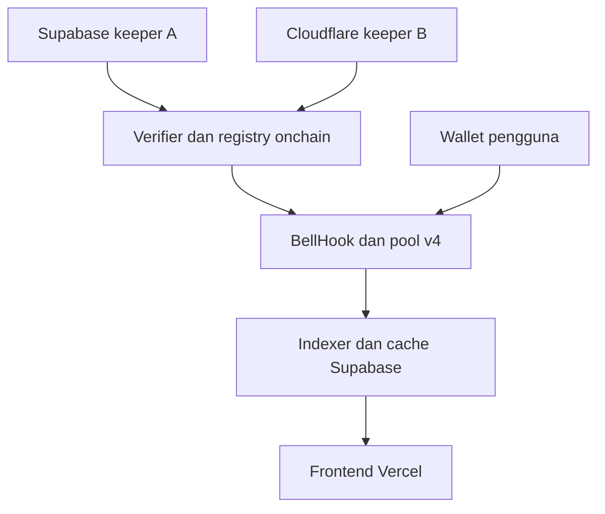

# BELL — Implementation Plan Final

**Tanggal penyusunan:** 24 Oktober 2026  
**Dokumen pendamping:** BELL-Developer-Brief-Final.md, snapshot tersimpan ke-10  
**SHA-256 brief acuan:** `623326e25633d3f8ffb86a81035fdb813d7e724f9daf815684ba1a2f4a92325e`  
**Cakupan rencana:** 16 milestone, 80 task, 40 mapping G, 12 mapping D dan enam release gates.  
**Status:** rencana pelaksanaan lengkap; bukan laporan bahwa kode, deployment, benchmark atau audit sudah selesai.  
**Pemilik produk:** project BELL. Pelaksana coding tidak otomatis menjadi pembayar modal atau pemilik wallet peluncuran token.

Dokumen ini mengubah spesifikasi final menjadi urutan kerja yang dapat ditugaskan, diperiksa, dan ditelusuri. Seluruh pasangan, sesi, weekend, LP publik, factory, dan dua kelas proteksi tetap termasuk deliverable. Pengerjaan bertahap adalah urutan engineering; tidak mengubah produk menjadi pilot REGULAR-only.

Brief menetapkan perilaku dan batas keamanan. Implementation plan menetapkan struktur repo, pembagian modul, urutan pengerjaan, kontrak antarkomponen, pengujian, bukti penerimaan, dan operasi. Jika ditemukan konflik, implementasi tidak memilih aturan yang lebih longgar: tandai temuan, gunakan brief sebagai acuan normatif, lalu selaraskan dokumentasi sebelum membekukan release candidate. Tidak membuat nomor draft produk baru untuk menunda keputusan.

## Daftar isi

1. [Mandat, keluaran, dan batas tanggung jawab](#1-mandat-keluaran-dan-batas-tanggung-jawab)
2. [Arsitektur implementasi yang dikunci](#2-arsitektur-implementasi-yang-dikunci)
3. [Struktur repository dan kepemilikan modul](#3-struktur-repository-dan-kepemilikan-modul)
4. [Lingkungan, toolchain, secrets, dan konfigurasi](#4-lingkungan-toolchain-secrets-dan-konfigurasi)
5. [Urutan milestone dan dependensi](#5-urutan-milestone-dan-dependensi)
6. [Cara menggunakan task dan definition of done](#6-cara-menggunakan-task-dan-definition-of-done)
7. [Rincian tugas M00–M15](#7-rincian-tugas-m00m15)
8. [Kontrak data, database, API, dan runtime](#8-kontrak-data-database-api-dan-runtime)
9. [Parameter dan aturan protokol yang harus dipertahankan](#9-parameter-dan-aturan-protokol-yang-harus-dipertahankan)
10. [Strategi pengujian serta acceptance matrix](#10-strategi-pengujian-serta-acceptance-matrix)
11. [Pengukuran free tier dan admission](#11-pengukuran-free-tier-dan-admission)
12. [CI/CD dan release evidence](#12-cicd-dan-release-evidence)
13. [Deployment, recovery, dan runbook](#13-deployment-recovery-dan-runbook)
14. [Traceability G01–G40, D01–D12, E01–E06](#14-traceability-g01g40-d01d12-e01e06)
15. [Risiko pelaksanaan, urutan mulai, dan checklist serah terima](#15-risiko-pelaksanaan-urutan-mulai-dan-checklist-serah-terima)
16. [Referensi teknis](#16-referensi-teknis)

## 1. Mandat, keluaran, dan batas tanggung jawab

### 1.1 Deliverable akhir

| Area | Hasil yang harus tersedia |
|---|---|
| Kontrak | AssetRegistry, SessionRegistry, CalendarRegistry, SafetyController, adapters, BellHook, BellPoolFactory, BellRouter, TreasuryAdapter dan interfaces/libraries yang diperlukan |
| Eksekusi | Integrasi Uniswap v4 core/periphery yang dipatok; settlement, seed, PUBLIC PositionManager, treasury dan direct swap paths |
| Data | Manifest canonical assets/sources, kalender terkomit, pemilihan stream fase, freshness, multiplier dan corporate handling |
| Backend | Supabase Free schema, RLS, Storage, API, keeper A dan indexer batch |
| Ketahanan | Keeper B mandiri di Cloudflare Free, watchdog, nonce handling, quota meters dan failover |
| Frontend | Next.js di Vercel Free: pool directory, Bell Clock, swap, Create Pool, posisi LP, status layanan dan disclosure |
| Kualitas | Unit/fuzz/invariant/fork/integration/E2E tests, source evidence, capacity traces, backup/restore, independent review dan retest |
| Release | Build reproducible, source/bytecode verification, multisig handover, deployment manifest dan E01–E06 dengan bukti aktual |
| Operasi | Monitoring, gas runway, calendar rollover, incident response, encrypted backup, restore dan recovery yang dilatih |

### 1.2 Hal yang tidak menjadi dependency

- Tidak ada kontrak token platform $BELL, ABI/configuration Pons, wallet tim launch, creator fee, burn/buyback, token gating atau staking discount.
- CA $BELL yang diterima kemudian mengikuti admission token biasa. Metadata CA tidak memberi hak khusus atau mengubah source/profile pool yang sudah immutable.
- Tidak ada public managed vault, pinjaman/leverage atau janji LP untung. Posisi LP publik bersifat noncustodial melalui PositionManager.
- Tidak ada public RPC sebagai fallback backend/keeper/indexer/CI/fork. Local Anvil adalah lingkungan lokal yang sah.
- Tidak ada subscription hosting, VPS, paid storage, paid runtime, paid RPC atau upgrade otomatis untuk mengatasi quota.

### 1.3 Pemisahan biaya

Layanan arsitektur memakai free tier: Vercel, Supabase, Cloudflare, Alchemy, Pinax dan included GitHub Actions. Gas, testing, deployment, modal LP, akses oracle mainnet serta security review dicatat terpisah sebagai kebutuhan mainnet sesuai brief §22.A. Tidak menyebut Chainlink Data Streams mainnet sebagai layanan gratis: aksesnya mengikuti subscription/entitlement resmi. Implementation plan ini tidak membeli layanan, mengaktifkan tagihan, mengirim transaksi atau menunjuk developer sebagai pembayar.

### 1.4 Peran

| Peran | Akuntabilitas |
|---|---|
| Product/release owner | Menetapkan penerimaan produk, cost classification, pemilik akun, operator dan keputusan release berdasarkan bukti |
| Developer contracts | Implementasi Solidity, adapters, math, v4 integration, tests, build/deploy scripts dan artefak audit |
| Developer platform | SDK, API, schema/RLS, keeper/indexer, frontend, migrations dan quota controls |
| Operator | Source/RPC credentials, platform configuration, monitoring, backup/restore, incident drill dan gas runway |
| Governance/guardian | Multisig 2-dari-3, queues, future calendars, pause/resume sesuai kewenangan sempit brief |
| Reviewer independen | Audit scope penuh, temuan, retest dan penilaian commit release |
| Pemilik modal | Persetujuan serta penyediaan dana miliknya untuk deploy/canary/LP; terpisah dari tim token |

Satu orang boleh mengerjakan beberapa peran engineering. Independent review tetap membutuhkan pihak di luar penulis perubahan yang direview. Pemegang governance dan guardian harus memenuhi evidence pemisahan key dalam brief; alamat dan kontak operator tidak ditebak di dokumen.

## 2. Arsitektur implementasi yang dikunci

### 2.1 Penempatan komponen

| Komponen | Implementasi | Otoritas |
|---|---|---|
| Web | Next.js App Router, React, TypeScript, static UI di Vercel Free/Hobby | Menampilkan data dan menyiapkan transaksi; wallet pengguna menandatangani |
| API | Supabase Free Edge Functions; TypeScript dan viem, runtime Deno | Validasi input, baca chain, quote/simulasi; tidak mengesahkan saldo atau membuka guard |
| Database | Supabase Free Postgres | Derived records, metadata, lease, checkpoint; chain mengalahkan cache |
| Storage | Supabase Free private buckets | Arsip terbatas sesuai license, bukan oracle baru |
| Keeper A | Supabase Cron → Edge Function, target 30 detik | Permissionless data submission melalui Alchemy Free |
| Keeper B | Cloudflare Workers Free, SQLite-backed Durable Object dan alarms, target 30 detik | Jalur mandiri melalui Pinax Free; tidak memerlukan Supabase hidup |
| Indexer | Supabase Cron → Edge Function tiap 60 detik | Bounded logs, canonical reconciliation, replay dan rollback |
| Watchdog B | Cloudflare Cron per menit → DO binding | Memastikan alarm ada; pekerjaan berat tetap di DO |
| CI/backup | Included GitHub Actions, standard Linux runner | Test/build/deploy terkontrol, encrypted backup dan restore exercise |
| Kontrak | Solidity/Foundry di Robinhood Chain, Uniswap v4 | Dana, policy, lifecycle, fee, budgets, guards dan governance |

Cloudflare SQLite hanya state internal DO untuk keeper B. Database aplikasi tetap Supabase Postgres. Tidak menambah R2, D1, Redis, external queues, paid KMS, indexer SaaS atau VPS sebagai dependency tersembunyi.

### 2.2 Alur transaksi pengguna

1. Web membaca katalog dan policy dari API; respons memuat block/hash, freshness, class, source mode serta alasan unavailable.
2. API menyimulasikan jumlah dan path aktual melalui RPC autentik pada state yang konsisten.
3. Web memeriksa chain, amount, quote expiry dan disclosure. Pengguna menentukan slippage dan menandatangani lewat wallet.
4. Router/factory/PositionManager menjalankan settlement; hook dan registry mengevaluasi guard onchain saat transaksi dieksekusi.
5. Receipt awal ditampilkan provisional. Indexer mengikuti canonical chain; status finalized memerlukan bukti tag/ancestry yang ditetapkan brief.

Tidak ada jalur API yang mengirim transaksi swap memakai private key pengguna atau menurunkan minOut/maxIn tanpa persetujuan pengguna.

### 2.3 Hubungan kegagalan



Diagram menunjukkan hubungan data, bukan bukti independensi upstream vendor. A dan B membaca sumber dan chain sendiri. Supabase mati dapat membuat API/UI unavailable sementara B tetap submit. Keduanya gagal berarti expiry guard berlaku. Removal/collect tidak digantungkan pada API, oracle health atau kemampuan operator menghidupkan backend.

## 3. Struktur repository dan kepemilikan modul

Gunakan satu monorepo. Nama folder berikut adalah target implementasi; folder/source tersebut belum dianggap sudah dibuat hanya karena tercantum di plan.

| Path target | Isi dan aturan |
|---|---|
| `docs/BELL-Developer-Brief-Final.md` | Salinan normatif brief yang identitas/hash-nya dicatat dalam release |
| `docs/BELL-Implementation-Plan-Final.md` | Dokumen ini, dipelihara berdampingan dengan brief |
| `docs/architecture/` | Keputusan teknis implementasi, dependency boundary, trust assumptions dan diagram |
| `docs/runbooks/` | Deploy, incident, source outage, quota, calendar, backup, restore dan key rotation |
| `contracts/src/interfaces/` | Interfaces normatif dari brief §20.A dan adapter APIs |
| `contracts/src/types/` | Structs, enums, reason bits, events dan errors |
| `contracts/src/libraries/` | Fee, rolling/episode accounting, price-band wide math, hashes dan calendar verification |
| `contracts/src/adapters/` | AggregatorV3 adjusted token, quote source, verified v11 decoder dan reviewed secondary adapter |
| `contracts/src/registries/` | AssetRegistry, SessionRegistry dan CalendarRegistry |
| `contracts/src/BellHook.sol` | Hook immutable per pool dengan permissions mask `0x2cc0` |
| `contracts/src/BellPoolFactory.sol` | Predict/deploy/initialize/seed/activate/service fee atomik |
| `contracts/src/BellRouter.sol` | Direct swaps, payer context, settlement, limits dan refunds |
| `contracts/src/TreasuryAdapter.sol` | Posisi treasury saja; remove/collect in-kind |
| `contracts/src/SafetyController.sol` | Typed governance operations, pause/resume dan role directory |
| `contracts/test/unit/` | Tests per modul dan error boundary |
| `contracts/test/fuzz/` | Boundary casts, amounts, rounding dan source payloads |
| `contracts/test/invariant/` | Stateful handlers, conservation, lifecycle dan budget invariants |
| `contracts/test/integration/` | Core/periphery nyata, public LP, routers dan factory |
| `contracts/test/fork/` | Authenticated pinned mainnet/testnet fork tests |
| `contracts/script/` | Deterministic deploy, address mining, config manifest, verify dan handover |
| `packages/protocol/` | Generated ABIs, enum constants, canonical encoding, policy IDs dan API version |
| `packages/domain/` | Runtime-neutral validation, scheduling, budget meter, decimal/rational utilities |
| `packages/sdk/` | viem clients, typed reads/transactions, decode errors, quote assembly dan receipt state |
| `packages/test-vectors/` | JSON fixtures dari brief/model, schema source, calendars dan expected results |
| `apps/web/` | Next.js UI; tidak menyimpan server signing keys atau menggantikan backend Supabase |
| `supabase/migrations/` | Schema, indexes, RLS, lease functions, retention dan cron installation SQL |
| `supabase/functions/_shared/` | Runtime adapters/imports untuk kode shared yang kompatibel Deno |
| `supabase/functions/bell-api/` | Endpoint router untuk API publik yang dibatasi |
| `supabase/functions/keeper-a/` | Tick A dan checkpoint submission |
| `supabase/functions/indexer/` | Bounded range planner, ingest dan reconciliation |
| `supabase/functions/maintenance/` | Cleanup, safe metadata maintenance dan health summaries |
| `workers/keeper-b/` | Cloudflare Worker, DO class, watchdog, Wrangler config dan runtime tests |
| `scripts/discovery/` | Public metadata fetch, candidate join, source/RPC preflight dan manifest validation |
| `scripts/evidence/` | Build/run aggregation, hashes, gate validation dan release index |
| `scripts/backup/` | Export, object manifest, encryption, upload verification dan restore validation |
| `tests/e2e/` | Browser flows, wallet fixtures, outage states dan accessibility |
| `tests/reference/` | Reproduksi tiga Python models dari brief, bukan pengganti Solidity tests |
| `config/chains/` | Chain IDs, deployment candidates dan source snapshot references, tanpa secrets |
| `config/policy/` | Reviewed machine-readable constants dan hashes |
| `evidence/` | Small manifests/indexes yang aman masuk repo; raw licensed data/large traces tetap private |
| `.github/workflows/` | PR gates, authenticated tests terpisah, release, backup dan restore drill |

Public ABI dan constants berasal dari satu sumber build. Jangan menulis salinan enum yang berbeda di hook, SDK, API dan frontend. Kode shared harus lulus runtime tests Node, Deno dan Workers bila memang diimport ke runtime tersebut; package yang membutuhkan Node-only API tidak dipakai di Edge/DO.

## 4. Lingkungan, toolchain, secrets, dan konfigurasi

### 4.1 Lingkungan

| Lingkungan | Chain/data | Platform | Tujuan |
|---|---|---|---|
| Local | Anvil, fixtures, mock verifier/getters dan local Supabase | Komputer developer, Wrangler local | Pengujian deterministik, reset/replay dan fault injection |
| CI offline | Anvil dan generated fixtures | Standard GitHub-hosted Linux | Reproducible build/test tanpa source/RPC secrets |
| Testnet | Chain 46630 dengan binding tersendiri | Satu Supabase Free project dan DO test namespace | Integrasi live, deployment rehearsals dan source samples |
| Mainnet read-only | Chain 4663, authenticated RPC | Runtime target dengan signing nonaktif | Preflight, source suitability, quota forecast dan historical replay |
| Mainnet funded | Chain 4663, approved release manifest | Satu Supabase Free production project dan DO production namespace | Deployment/canary/public sesudah gates lulus |

Local Supabase dipakai untuk staging tambahan sehingga tidak memerlukan paid branch atau project ketiga. Mainnet/testnet harus punya keys, buckets, signer accounts, deployment manifests dan state namespaces terpisah. Kuota vendor yang berlaku per akun tetap dihitung gabungan; memisahkan environment tidak menggandakan free allowance. Vercel previews menggunakan fixtures/testnet public metadata, tidak mengakses production signing secrets.

### 4.2 Toolchain dan dependency lock

Pada M00, hasilkan `toolchain.lock.json` berisi exact Foundry version/commit, Solidity compiler, optimizer runs, viaIR, EVM target, dependency full commits, Node/pnpm, Deno, Supabase CLI, Wrangler, Next/React/TypeScript/viem dan test runner versions. Pilih compatibility set yang dapat dibangun, lalu bekukan dan simpan checksum/lockfiles. Plan tidak mengarang commit hash atau menjanjikan versi yang belum dibangun bersama.

Core/periphery/OZ hook imports harus cocok dengan source yang dipatok. Compile dan deploy contoh minimal yang memakai transient-storage/core operations di local dan testnet sebelum memilih EVM target final. Perubahan compiler, optimizer, dependency atau linking setelah audit membatalkan artefak build terkait dan memerlukan retest/review sesuai dampak. CI memakai frozen lockfile; tidak membangun dari mutable `main`, floating git tags atau `latest`.

Gunakan Foundry untuk kontrak, pnpm workspace untuk JS/TS, Supabase CLI untuk local/migration/function lifecycle, Wrangler untuk Worker/DO, TypeScript test runner untuk kode shared, Cloudflare Workers Vitest integration untuk DO, dan browser E2E runner untuk web. Coverage/static analyzers dipakai sebagai bukti tambahan, bukan meter tunggal keamanan.

### 4.3 Secret dan konfigurasi runtime

| Konfigurasi | Lokasi | Aturan |
|---|---|---|
| `NEXT_PUBLIC_SUPABASE_URL`, publishable key, chain ID | Web build | Public by design; RLS tetap wajib |
| Authenticated RPC endpoint keys | Supabase/Cloudflare secret store; CI trusted environment bila diperlukan | Berbeda dari key frontend/wallet; redact URL path/query saat error |
| Source API credential A/B | Secret stores masing-masing runtime | Entitlement sah; tidak dibagikan kepada pelanggan atau build preview |
| Keeper A private signing key | Supabase secret store | Permissionless submitter saja, gas account sendiri |
| Keeper B private signing key | Cloudflare secret store | Berbeda dari A, tidak memerlukan Supabase untuk recovery |
| Deployer dan governance keys | Mekanisme pemilik/deployment terpisah | Tidak dipakai oleh cron; multisig/handover dibuktikan |
| Supabase service role / DB credential | Backend/backup job trusted environment | Tidak masuk browser, fixture, artifact backup atau log |
| Backup encryption recipient | CI configuration, public recipient | Private decryption key disimpan pemilik secara offline/terpisah |
| Calendar/source/policy hashes | Repo dan manifest | Public, immutable/reviewed sesuai aturan governance |
| Gas budget dan source access status | Ops manifest | Bukan rahasia private key; status harus sesuai pendanaan nyata |

Nama RPC mengikuti brief: `RH_MAINNET_RPC_PRIMARY`, `RH_MAINNET_WSS_PRIMARY`, `RH_MAINNET_RPC_SECONDARY`, `RH_MAINNET_ARCHIVE_RPC` beserta counterpart testnet. Variabel signing diberi namespace runtime dan chain, tidak memakai nama global sistem. `.env.example` hanya memuat nama dan dummy non-secret. Startup tanpa required secret menghasilkan status disabled/blocked yang jelas, bukan memakai public endpoint atau mock harga pada produksi.

### 4.4 Commands sebagai kontrak tooling

Targetkan task runner root yang seragam. Daftar ini adalah interface yang harus diimplementasikan pada M00; bukan klaim command sudah tersedia sekarang.

| Command target | Hasil |
|---|---|
| `pnpm check` | Format/lint/typecheck dan generated-file consistency |
| `pnpm build` | Package build, web export, Edge bundle validation dan Worker dry-run bundle |
| `pnpm test:unit` | Shared/domain/SDK unit tests |
| `pnpm test:contracts` | Foundry unit/integration suite |
| `pnpm test:invariants` | Stateful invariants dengan seed/runs yang dicatat |
| `pnpm test:reference` | Tiga model Python yang direproduksi dari brief |
| `pnpm test:runtime` | Deno tests, DO/Workers tests, SQL/RLS tests |
| `pnpm test:e2e` | Browser tests pada local stack |
| `pnpm preflight:rpc` | Authenticated capability probes, tanpa broadcast mainnet |
| `pnpm preflight:sources` | Manifest join, report samples dan verification checks |
| `pnpm test:fork` | Pinned block/hash authenticated fork, explicitly fails if prerequisites missing |
| `pnpm evidence:check` | Validate schema/hashes/gates dan missing artifacts |
| `pnpm release:dry-run` | Predicted addresses, exact calldata/config dan cost classification tanpa broadcast |

Pisahkan commands yang read-only, local mutation dan chain broadcast. Tidak membuat command default yang menjalankan mainnet deploy ketika developer hanya meminta build/test. Wallet/private key tidak diberikan melalui argument shell yang mudah masuk process list atau logs.

## 5. Urutan milestone dan dependensi

| Milestone | Fokus | Prasyarat | Gate keluar |
|---|---|---|---|
| M00 | Repo, toolchain, boundaries, CI dasar | Brief dan plan | Build scaffold dan runtime boundaries reproducible |
| M01 | Source/RPC discovery dan suitability | M00 | Metadata join valid; capability/access failures tercatat; evidence collection dimulai |
| M02 | ABI/types, policy hashes, fixtures | M00 | Canonical types/encoding dan shared vectors terkunci |
| M03 | Adapters, registries, calendar, safety | M02; metadata M01 | Source/state/governance unit integration lulus |
| M04 | Math, fee, gross budgets, reference | M02 | Bigint differential dan boundary tests lulus |
| M05 | Hook/lifecycle/closure/recovery | M03, M04 | Seluruh guard paths dan callbacks sesuai brief |
| M06 | Factory, router, public LP, treasury | M05 | Setup/swap/exit settlement atomik lulus |
| M07 | Schema, RLS, leases, Storage | M02 | Local reset/migrate/RLS tests lulus |
| M08 | API/SDK integrasi | M06, M07 | Typed API, simulation dan error mapping lulus |
| M09 | Keeper A/B dan watchdog | M03, M07 | Local runtime/failure tests lulus, signer separation benar |
| M10 | Indexer/canonical replay | M02, M07; ABI M06 | Bounded planner, dedup dan reorg recovery lulus |
| M11 | Frontend penuh | M08, M10 | Seluruh user flows dan disclosure E2E lulus |
| M12 | Backup/restore, monitoring, quota | M09, M10 | Ops drill lokal, quota admission dan restore lulus |
| M13 | Sistem test lengkap dan reproducibility | M06, M08–M12 | Candidate build untuk testnet/security review siap |
| M14 | Testnet, source/capacity capture, audit/retest | M13; akses M01 | E01–E05 lengkap dan candidate tidak punya temuan penghalang |
| M15 | Mainnet deploy, canary, public, handover | M14 dan pemilik modal/release | E06 lulus; full product diterima dan runbooks diserahkan |

M01 dan M02 dapat berjalan setelah M00; M03/M04 dan M07 dapat dikerjakan sebagai jalur berbeda. Frontend dapat memakai fixtures setelah M02, tetapi tidak diberi status selesai sebelum integrasi M11. Pengumpulan data sesi/empat weekend dimulai sedini M01 bila akses tersedia dan dilanjutkan pada candidate di M14. Data dari implementasi yang berubah material tidak otomatis membuktikan candidate baru.

Tidak menetapkan tanggal mainnet fiktif. Critical path mencakup entitlement sumber, validasi heartbeat/freshness, pengukuran 72 jam, minimum empat weekend, audit independen dan retest. Jam tunggu tersebut tidak dapat dihapus dengan menyelesaikan checklist dokumen. Pemecahan task boleh membantu pembagian kerja manusia; plan ini tidak mengasumsikan tim atau reviewer yang belum ditunjuk telah tersedia.

## 6. Cara menggunakan task dan definition of done

Setiap task mempunyai ID stabil, path target, langkah, acceptance dan evidence. Status awal seluruh task implementasi adalah **NOT_STARTED**. Status yang dipakai: NOT_STARTED, IN_PROGRESS, BLOCKED_ACCESS, BLOCKED_DEPENDENCY, IN_REVIEW, DONE. DONE berarti implementasi dan bukti penerimaan task ada pada commit yang dicatat, bukan sekadar file placeholder atau screenshot UI.

Setiap PR/task record memuat: task ID, perubahan perilaku, brief sections/G/D/E yang dipenuhi, validation command/results, artifact paths/hashes, risiko yang masih ada, serta dampak ke generated ABIs/policy/source/DB migrations. Refactor yang mengubah hash/bytecode atau execution semantics harus menandai ulang evidence terkait.

Definition of done umum:

1. Source dan konfigurasi tersimpan dengan dependency lock yang sah; tidak ada secret dalam diff/log/artifact.
2. Perilaku sesuai brief termasuk negative/failure paths, bukan hanya happy path.
3. Tests yang bermakna untuk perilaku tersebut lulus; tidak menambah test yang hanya mengulangi implementation tanpa menguji kontrak perilaku.
4. Generated ABI/types/docs dan migration jika relevan konsisten.
5. Evidence dapat direproduksi dari commit; status yang belum diuji tidak diberi PASS.
6. Review menyatakan konsekuensi pada LP funds, policy, costs, availability dan replay.

## 7. Rincian tugas M00–M15

Bagian ini adalah work breakdown yang dapat langsung dipindah menjadi issue/board. Dependensi level milestone berlaku untuk semua task di dalamnya; dependensi task tambahan ditulis bila diperlukan. Urutan internal default mengikuti nomor task kecuali dinyatakan dapat dikerjakan bersamaan.

### M00 — Foundation dan reproducible workspace

**Prasyarat milestone:** Brief + plan. **Status awal:** NOT_STARTED.

#### M00-01 · Catat baseline dan batas mandat

**Path target:** `docs/`, `config/release-baseline.json`

**Langkah kerja:**

1. Salin dua dokumen berdampingan, catat hash brief dan daftar G/D/E.
2. Tetapkan role boundaries, free architecture, mainnet cost classification dan pemisahan token launch.
3. Buat evidence index awal dengan NOT_RUN/MISSING; jangan mengisi PASS.

**Kriteria selesai:** Baseline dapat dilacak ke brief snapshot yang tepat; seluruh scope produk tetap tercantum dan tidak ada dependency wallet $BELL.

**Evidence dan trace:** baseline-manifest.json; G40/D01/E05.

#### M00-02 · Bekukan compatibility set

**Path target:** `toolchain.lock.json`, `contracts/foundry.toml`, `pnpm-lock.yaml`

**Langkah kerja:**

1. Bangun spike core/periphery/BaseHook yang kompatibel, bukan memilih import dari tutorial lama.
2. Uji compiler/EVM target, transient operations dan optimizer pada local serta testnet bila akses tersedia.
3. Pin exact tool versions dan full dependency commits; catat license/checksum dan jalur pembaruan.

**Kriteria selesai:** Clean checkout membangun bytecode/artifacts identik; ketidaktersediaan testnet tidak disamarkan sebagai lulus compatibility.

**Evidence dan trace:** toolchain-lock + build-hashes; G08/G39/E02.

#### M00-03 · Buat monorepo dan task runner

**Path target:** `pnpm-workspace.yaml`, `apps/`, `packages/`, `contracts/`, `supabase/`, `workers/`

**Langkah kerja:**

1. Buat struktur §3 dan command interface §4.4.
2. Pisahkan commands offline/read-only/testnet/broadcast; gunakan frozen installs.
3. Tambahkan formatting, lint, strict types dan generated-file checks.

**Kriteria selesai:** Commands scaffold gagal jelas bila prerequisites hilang dan tidak pernah broadcast mainnet dari default build/test.

**Evidence dan trace:** workspace-smoke-report; E02.

#### M00-04 · Buktikan runtime-neutral package boundary

**Path target:** `packages/domain/`, `packages/protocol/`, `supabase/functions/_shared/`, `workers/keeper-b/`

**Langkah kerja:**

1. Definisikan clock, fetch, secret access, storage, logger dan RPC ports dengan adapters runtime.
2. Uji import/BigInt/crypto/viem bundle di Node, Deno dan Workers local.
3. Cegah Node filesystem/thread APIs bocor ke Edge; cegah browser mengimport signing module.

**Kriteria selesai:** Satu fixture encoding dan request validation memberi hasil sama pada runtime target; tidak ada hidden paid service.

**Evidence dan trace:** runtime-compatibility-report; D08/E02.

#### M00-05 · Pasang CI minimum dan secret boundary

**Path target:** `.github/workflows/pr.yml`, `.env.example`, `scripts/evidence/`

**Langkah kerja:**

1. Jalankan offline lint/type/build/unit dengan standard Linux runner.
2. Pisahkan fork-PR tanpa secrets dari jobs trusted yang memerlukan RPC.
3. Tetapkan timeout/concurrency/retention dan budget-stop; dokumentasikan branch protection tanpa mengasumsikan fitur paid tersedia.

**Kriteria selesai:** PR untrusted tidak mendapat secrets; CI menghasilkan commit/toolchain/hash manifest dan mengukur minutes/artifact usage.

**Evidence dan trace:** ci-smoke + secret-scan; D01/D11/E02.

### M01 — Source, entitlement dan RPC preflight

**Prasyarat milestone:** M00; dapat bersamaan dengan M02. **Status awal:** NOT_STARTED.

#### M01-01 · Ambil katalog sumber dan verifier

**Path target:** `scripts/discovery/catalog.ts`, `config/sources/`

**Langkah kerja:**

1. Fetch official public Discovery metadata dan verifier tables tanpa public RPC.
2. Join tiga fase AAPL/NVDA/TSLA pada schema v11; simpan retrieval time, source URL, raw-response hash dan status.
3. Bedakan public metadata dari account entitlement; jangan memilih ETH duplicate atau USDG source yang tidak ada secara otomatis.

**Kriteria selesai:** Metadata candidates lengkap dan unik untuk tiap phase; perubahan/decommission menghasilkan temuan eksplisit.

**Evidence dan trace:** catalog-snapshot + join-report; G12/G13/D02/E01.

#### M01-02 · Validasi canonical token dan proxy binding

**Path target:** `scripts/discovery/assets.ts`, `config/assets/`

**Langkah kerja:**

1. Ambil official assets API/registry dan deployment chainId, canonical CA, capability serta decimals.
2. Cocokkan proxy quote/token, multiplier/pause/pending getters dan code identity via dua RPC setelah keys tersedia.
3. Bangun SourceManifest; jangan memakai ticker sebagai identity atau menerapkan multiplier dua kali.

**Kriteria selesai:** Setiap candidate mempunyai explicit token→underlying→proxy/stream binding; hanya VERIFIED_ONCHAIN dapat admitted.

**Evidence dan trace:** source-manifest + common-block reads; G16/G30/G31/D03/E01.

#### M01-03 · Implementasikan authenticated RPC probes

**Path target:** `scripts/discovery/rpc-preflight.ts`, `packages/sdk/rpc/`

**Langkah kerja:**

1. Probe chain/head/hash, code, nonce, gas, historical eth_call, bounded getLogs dan receipt pada kedua provider.
2. Uji 10-block inclusive Alchemy planner, archive state availability dan rate/error semantics.
3. Testnet broadcast hanya pada tahap integrasi yang sesuai; mainnet preflight read-only. Redact secrets dari seluruh output.

**Kriteria selesai:** Capability report membedakan unsupported, auth, quota dan network error; missing access bukan false success atau public fallback.

**Evidence dan trace:** rpc-preflight.json; G35/G36/D05/E01.

#### M01-04 · Catat akses dan batas redistribusi data

**Path target:** `docs/runbooks/source-access.md`, `evidence/access/`

**Langkah kerja:**

1. Pemilik menyediakan source account/credentials A dan B dengan entitlement sah.
2. Catat subscription oracle sebagai biaya mainnet terpisah, serta hak internal use/backups/UI/exports.
3. Default raw licensed reports private; jangan memberi API proxy kepada pihak di luar license.

**Kriteria selesai:** Access/rights matrix mempunyai bukti aktual; harga, sponsor atau license yang belum ada diberi MISSING.

**Evidence dan trace:** rights-matrix + entitlement-status; D01/D04/E01/E05.

#### M01-05 · Mulai trace kesesuaian source/freshness

**Path target:** `scripts/discovery/capture-health.ts`, `evidence/source-health/`

**Langkah kerja:**

1. Rekam updatedAt, observations, input times, market status, multiplier dan phase boundaries.
2. Bandingkan heartbeat metadata 86400 detik dengan BELL max-age yang lebih ketat; hitung halt/eligible opportunities secara jujur.
3. Mulai dataset seluruh sesi dan empat weekend; final candidate perlu pengukuran ulang jika semantics berubah.

**Kriteria selesai:** Trace memisahkan expected closure dari outage dan membuktikan source-fit sebelum funding; tidak mengubah threshold untuk membuat hasil lulus.

**Evidence dan trace:** health-trace + suitability-summary; G15/G38/D06/E01/E03.

### M02 — Types, policy dan shared fixtures

**Prasyarat milestone:** M00; hasil metadata M01 dipakai ketika tersedia. **Status awal:** NOT_STARTED.

#### M02-01 · Implementasikan types/ABI/errors/events normatif

**Path target:** `contracts/src/types/`, `contracts/src/interfaces/`, `packages/protocol/`

**Langkah kerja:**

1. Salin enum values, widths, struct field order dan reason bit priorities dari brief §20.A.
2. Definisikan seluruh interfaces beserta caller/side effects dan typed sourceConfig encoding.
3. Generate ABI/types dari Solidity artifacts; tambahkan ABI snapshot dan decode regression checks.

**Kriteria selesai:** Tidak ada perbedaan enum/field/order antar Solidity, SDK dan API; mask callbacks dan delta flags bisa diuji dari source.

**Evidence dan trace:** abi-contract-report; G01/G02/G08/G37/E02.

#### M02-02 · Bekukan policy constants dan hash encoding

**Path target:** `config/policy/`, `contracts/src/libraries/PolicyConstants.sol`, `packages/protocol/hashes.ts`

**Langkah kerja:**

1. Definisikan fee/freshness/caps/bands/timers/resource bounds dalam sumber machine-readable yang direview.
2. Implementasikan descriptor/config/policy/request hashes tanpa self-reference/circular CREATE2.
3. Uji canonicalTokenId chain+token, domain separation dan chain-specific hash changes.

**Kriteria selesai:** Keccak/ABI vectors sama lintas bahasa; policyId tidak bergantung runtime address instance dan tidak punya admin tuning.

**Evidence dan trace:** hash-vectors + policy-manifest; G03/G23/G26/G33/E02.

#### M02-03 · Port model brief menjadi test vectors

**Path target:** `tests/reference/`, `packages/test-vectors/`

**Langkah kerja:**

1. Reproduksi 45 policy/engineering dan 18 infrastructure model tests dari brief.
2. Ekspor input/expected vectors untuk budget, closure, repricing, seed, quota dan leases.
3. Tambah hostile boundaries yang belum diwakili model, dengan expected behavior ditinjau manual.

**Kriteria selesai:** 63 model tests dapat direproduksi; vectors menyatakan asumsi dan tidak diberi label EVM/audit.

**Evidence dan trace:** reference-report + fixtures-index; G19/G23/G26/D06/E03.

#### M02-04 · Bangun codec SDK dan reason conformance

**Path target:** `packages/sdk/codec/`, `packages/protocol/reasons.ts`

**Langkah kerja:**

1. Implementasikan raw-unit decimal strings, BigInt serialization dan integer range rejection.
2. Encode/decode CreateRequest, SwapRequest, calendar/source payloads dan errors dari ABI generated.
3. Pastikan dominant reason memilih bit prioritas terkecil, sementara UI tetap menerima seluruh reasons.

**Kriteria selesai:** Tidak ada Number conversion untuk nilai >2^53; invalid/trailing/oversized payload ditolak, roundtrip vectors exact.

**Evidence dan trace:** codec-conformance-report; G01/G02/G32/G37/E02.

### M03 — Adapters, registries, kalender dan safety

**Prasyarat milestone:** M02; M01 untuk integrasi sumber nyata. **Status awal:** NOT_STARTED.

#### M03-01 · Buat direct-price adapters

**Path target:** `contracts/src/adapters/AggregatorAdapter.sol`, `contracts/test/unit/adapters/`

**Langkah kerja:**

1. Read proxy decimals/latestRoundData pada staticcall bounds dan cek answer/timestamp/domain.
2. Pisahkan TOKEN_ADJUSTED dari QUOTE_USD; live stock multiplier diterapkan hanya pada underlying stream.
3. Expose fingerprint/configHash dan fail pada wrong kind/readCurrent misuse.

**Kriteria selesai:** Stale/zero/future/overflow/code-change/getter-failure paths teruji; heartbeat bukan asumsi freshness palsu.

**Evidence dan trace:** adapter-unit-results; G16/G31/G34/D03/E03.

#### M03-02 · Buat verified v11 adapter

**Path target:** `contracts/src/adapters/EquityV11Adapter.sol`, `contracts/test/unit/reports/`

**Langkah kerja:**

1. Kirim full report ke pinned VerifierProxy; decode hanya verified body dengan layout yang benar.
2. Gunakan subscription fee metadata kosong, tanpa FeeManager approval atau LP fee payment.
3. Cek feed/schema/units/phase/high-water bounds dan field input freshness terpisah dari report expiry.

**Kriteria selesai:** Forged/replayed/malformed report gagal; nonmonotonic input timestamp yang masih sah tidak dibuang hanya karena urutan harga.

**Evidence dan trace:** verified-report-tests; G12/G13/G14/G22/E01/E03.

#### M03-03 · Implementasikan AssetRegistry append-only

**Path target:** `contracts/src/registries/AssetRegistry.sol`

**Langkah kerja:**

1. Queue canonical descriptor dengan id dihitung kontrak dan SourceWire[] bounded.
2. Bind adapters/code/config/evidence hashes serta governance directory.
3. Activate setelah delay, reject overwrite/duplicate/wrong-chain bindings; expose descriptor views.

**Kriteria selesai:** Existing descriptor tidak dapat diubah lewat governance; unknown source/price class tidak dapat memperoleh admission.

**Evidence dan trace:** asset-registry-tests; G03/G30/G31/G33/E03.

#### M03-04 · Implementasikan SessionRegistry

**Path target:** `contracts/src/registries/SessionRegistry.sol`

**Langkah kerja:**

1. Implement submitReports atomik maksimal enam report dan payload bounds.
2. Simpan high-water, normalized samples dan health; evaluasi old deadline sebelum overwrite.
3. Implement refreshHealth yang mencatat unhealthy outcome sah, bootstrap readiness dan captureClose interface.

**Kriteria selesai:** Duplikat tidak menambah progress; invalid report tidak merusak batch lain melalui partial commit; unhealthy checkpoint tidak hilang oleh revert yang keliru.

**Evidence dan trace:** session-registry-tests; G12–G16/G20/G34/E03.

#### M03-05 · Implementasikan CalendarRegistry dan proof tooling

**Path target:** `contracts/src/registries/CalendarRegistry.sol`, `scripts/calendar/`

**Langkah kerja:**

1. Bangun canonical UTC partition dari source schedules/holidays/DST/capabilities dengan provenance.
2. Implement domain-separated double-hashed leaves, index/count/neighbours dan sorted-pair proofs.
3. Queue future roots +48 jam/+7 hari; cegah overlap, historical overwrite, future-cache overwrite dan root rollover refill.

**Kriteria selesai:** Missing/conflicting coverage menghasilkan halt; proof malformed, DST edges dan adjacent-year neighbours teruji.

**Evidence dan trace:** calendar-proof-vectors + tests; G10/G11/G17/G19/E03.

#### M03-06 · Implementasikan SafetyController

**Path target:** `contracts/src/SafetyController.sol`, `contracts/test/unit/governance/`

**Langkah kerja:**

1. Gunakan typed operations, fixed floor delay 48 jam, expiry/cancel dan pause nonce.
2. Pisahkan governance/guardian/treasury, implement role rotation acceptance dan target namespaces.
3. Cegah arbitrary call, sweep, budget reset, immediate resume atau LP removal gate.

**Kriteria selesai:** Role/cancel/replay/expiry paths lulus; guardian dapat pause tetapi tidak mengambil principal atau menghapus accounting.

**Evidence dan trace:** safety-role-tests; G03/G33/G40/D11/E03/E05.

### M04 — Math, fee, budget dan reference engine

**Prasyarat milestone:** M02; dapat bersamaan dengan M03. **Status awal:** NOT_STARTED.

#### M04-01 · Implementasikan exact wide-price math

**Path target:** `contracts/src/libraries/WidePriceMath.sol`, `contracts/test/fuzz/math/`

**Langkah kerja:**

1. Bangun 768-bit limb multiplication/comparison yang memenuhi domain uint160/uint128/decimals 0–18.
2. Implement inclusive band, reciprocal/currency-order behavior dan repricing direction tanpa float.
3. Differential-test carries/borrows/rounding terhadap Python bigint fixtures dan extreme values.

**Kriteria selesai:** Boundary +/-1, inclusive limits dan kedua currency orders exact; tidak mengandalkan model unbounded integer sebagai bukti limb Solidity.

**Evidence dan trace:** wide-math-differential; G26/G27/E03.

#### M04-02 · Implementasikan fee composition

**Path target:** `contracts/src/libraries/FeePolicy.sol`

**Langkah kerja:**

1. Encode base session fees 500/3000/5000/10000 v4 units.
2. Implement bell decay 300 detik, corporate minimum dan max(base,bell,corporate,repricing).
3. Pisahkan LP fee dari protocol fee core dan jangan mengambil return delta.

**Kriteria selesai:** Nilai t=0/150/300 dan semua kombinasi flags exact; dynamic fee flag/core encoding kompatibel dependency pinned.

**Evidence dan trace:** fee-policy-vectors; G02/G08/G28/E03.

#### M04-03 · Implementasikan rolling gross budget

**Path target:** `contracts/src/libraries/FlowBudget.sol`

**Langkah kerja:**

1. Gunakan current+previous 300-second buckets per currency dengan widened signed delta abs.
2. Terapkan mode-specific floors pada fixed raw caps dan reject nonzero trade bila floor nol.
3. Pertahankan traffic saat limit turun, pause/resume, LP changes dan wallet/router changes.

**Kriteria selesai:** Split orders/two directions/epoch edges tidak melebihi allowed gross; overflow/signed minimum dan revert rollback lulus.

**Evidence dan trace:** rolling-invariants; G23/G24/G25/E03.

#### M04-04 · Implementasikan closure episode ledger

**Path target:** `contracts/src/libraries/ClosureBudget.sol`

**Langkah kerja:**

1. Track closureNonce dan gross kedua currency tanpa reset administratif.
2. Buka ledger sekali pada episode terverifikasi, bukan setiap kalender/hari/report.
3. Bind release ledger ke confirmed joint reopen, bukan satu stock open atau top-up.

**Kriteria selesai:** Partial reopen/midnight/pause/calendar rollover tidak refill; genuine next episode mempunyai nonce baru yang sah.

**Evidence dan trace:** episode-ledger-tests; G19/G20/G25/E03.

#### M04-05 · Implementasikan reference dan class behavior

**Path target:** `contracts/src/libraries/ReferencePolicy.sol`

**Langkah kerja:**

1. Bangun active adjusted stock/direct cross-check dan frozen-stock/live-quote CLOSED reference.
2. Implement PRICE_GUARDED bands versus SESSION_ONLY tanpa fair-price counterasset.
3. Secondary profile hanya jika canonical token dan field timestamp terbukti; tidak auto-fallback ketika source gagal.

**Kriteria selesai:** ETH bergerak saat weekend mengubah ratio dengan benar; stale quote/corporate mismatch halt, SESSION_ONLY tidak menerima price guarantee.

**Evidence dan trace:** reference-class-tests; G15/G16/G21/G22/G29/E03.

### M05 — BellHook dan state machine

**Prasyarat milestone:** M03 + M04. **Status awal:** NOT_STARTED.

#### M05-01 · Bangun immutable hook template

**Path target:** `contracts/src/BellHook.sol`, `contracts/test/unit/hook/`

**Langkah kerja:**

1. Implement constructor validation dan exact callback permissions 0x2cc0.
2. Bind PoolKey/dependencies/configHash, OnlyPoolManager dan pool isolation.
3. Expose config/state/policy views dan refreshState yang berbagi policy evaluator dengan callbacks.

**Kriteria selesai:** Wrong PoolManager/key/context ditolak; return-delta flags false dan tidak ada proxy/delegatecall atau cross-pool budget bleed.

**Evidence dan trace:** hook-permission-tests; G03/G08/G34/E03.

#### M05-02 · Implementasikan lifecycle dan health priority

**Path target:** `contracts/src/BellHook.sol`, `contracts/src/libraries/ModePolicy.sol`

**Langkah kerja:**

1. Enforce DEPLOYED→SEEDING→LIVE dan SETUP before activation.
2. Terapkan reason priority, manual/issuer pause, fingerprints, calendar conflict dan stale data.
3. Pertahankan passive closure accounting walau dominant pause aktif; jangan menghapus counters.

**Kriteria selesai:** Swap sebelum LIVE gagal; getPolicy dan beforeSwap sepakat pada state yang sama; no false healthy response pada dependency failure.

**Evidence dan trace:** mode-transition-tests; G02/G04/G15/G17/G29/E03.

#### M05-03 · Implementasikan planned closure dan joint recovery

**Path target:** `contracts/src/BellHook.sol`, `contracts/test/invariant/closure/`

**Langkah kerja:**

1. Capture anchor sebelum close dalam window sah dan latch maximal contiguous joint closure.
2. Unexpected CLOSED saat kalender open selalu halt tanpa anchor/budget baru.
3. Reopen membutuhkan setiap stock new observation, continuity terhadap deadline lama dan >=60 detik.

**Kriteria selesai:** Dua-stock overlap/flicker/missing anchor/expired 96h/corporate weekend serta root rollover lulus vectors.

**Evidence dan trace:** closure-fsm-results; G17–G20/G25/G28/E03.

#### M05-04 · Implementasikan seed principal callbacks

**Path target:** `contracts/src/BellHook.sol`, `contracts/test/integration/seed/`

**Langkah kerja:**

1. Validate factory executor dan trusted initiator di jalur PUBLIC/TREASURY_ONLY.
2. Di afterAddLiquidity pisahkan actual principal delta dari feesAccrued dengan widened arithmetic.
3. Capture satu positive seed dan enforce closureCap<=min(2T,W,floor(seedPrincipal/10)); activate sekali setelah settlement.

**Kriteria selesai:** Flash/untrusted callback, fee accrual, fake seed, wrong recipient dan zero/rounding bypass tidak dapat mengaktifkan pool.

**Evidence dan trace:** seed-principal-tests; G04–G09/G23/E03.

#### M05-05 · Integrasikan swap pre/post enforcement

**Path target:** `contracts/src/BellHook.sol`, `contracts/test/integration/swaps/`

**Langkah kerja:**

1. Pin reference/config/mode pada beforeSwap dan evaluate actual core BalanceDelta afterSwap.
2. Commit rolling+episode budgets atomik serta exact price path rules setelah tick crossing/partial fill.
3. Terapkan tighter repricing fee/cap dan reject zero fill; jangan membuat band deadlock yang melarang semua corrective path.

**Kriteria selesai:** Exact-input/output, currency order, protocol fee dan settlement revert menjaga accounting; no bypass lewat arbitrary hookData.

**Evidence dan trace:** swap-policy-integration; G23–G27/G34/E03.

### M06 — Factory, router, LP publik dan treasury

**Prasyarat milestone:** M05. **Status awal:** NOT_STARTED.

#### M06-01 · Bangun atomic create-and-seed factory

**Path target:** `contracts/src/BellPoolFactory.sol`

**Langkah kerja:**

1. Implement predict/config validation, creator nonce/deadline, immutable risk profile dan salt namespace.
2. Deploy hook, initialize, mint explicit liquidity, settle, activate dan bayar 49 USDG dalam satu transaksi.
3. Bind amountMax, tick range, sqrtPrice, recipient dan request-specific balance accounting.

**Kriteria selesai:** Kegagalan langkah mana pun rollback semua; service fee ke project saja, tidak memakai principal atau wallet tim launch.

**Evidence dan trace:** factory-atomic-results; G04–G09/G32/G40/E03.

#### M06-02 · Integrasikan PUBLIC PositionManager

**Path target:** `packages/sdk/lp/`, `contracts/test/integration/public-lp/`

**Langkah kerja:**

1. Implement explicit liquidity mint, NFT recipient dan request-bound payer/executor.
2. Implement add/remove/collect memakai PositionManager resmi yang dipatok.
3. Buktikan exit in-kind saat pause, stale source, exhausted budget, CLOSED dan backend down.

**Kriteria selesai:** Posisi milik pengguna, bukan adapter project; public flows nyata diuji dan tidak dinyatakan selesai hanya dari treasury path.

**Evidence dan trace:** public-lp-exit-tests; G05/G06/G07/G29/E03.

#### M06-03 · Implementasikan TreasuryAdapter terbatas

**Path target:** `contracts/src/TreasuryAdapter.sol`

**Langkah kerja:**

1. Bind treasury identity/recipient dan position key pada pool/ticks/salt/adapter.
2. Seed hanya dalam factory context; remove/collect hanya treasury dengan minima/deadline.
3. Pastikan tidak ada custody posisi pelanggan atau generic sweep/arbitrary target.

**Kriteria selesai:** Unauthorized treasury action gagal; treasury exit tidak tergantung oracle dan tidak mengubah budget pool.

**Evidence dan trace:** treasury-access-tests; G06/G09/G32/E03.

#### M06-04 · Implementasikan direct router dan settlement

**Path target:** `contracts/src/BellRouter.sol`, `packages/sdk/swaps/`

**Langkah kerja:**

1. Enforce caller=payer, nonce, deadline, configHash dan exact input/output sign conventions.
2. Implement unlock context, token transfer accounting, amount minima/maxima dan allowance cleanup.
3. Wrap native ETH hanya ke canonical WETH; unwrap/refund eksplisit dengan request-bound balance deltas.

**Kriteria selesai:** Unexpected tax/rebase behavior, context substitution, stale nonce/deadline dan settlement mismatch revert; tidak ada dust sweep milik caller lain.

**Evidence dan trace:** router-settlement-results; G09/G32/G37/E03.

#### M06-05 · Bangun address mining dan deploy manifest tooling

**Path target:** `contracts/script/`, `scripts/evidence/deploy-manifest.ts`

**Langkah kerja:**

1. Mine CREATE2 salt dengan callback mask yang benar dan creator namespace.
2. Pisahkan template creation-bytecode hash, initCode hash dan runtime hash; cegah hash sirkular.
3. Hasilkan constructor args/PoolKey/PoolId/recipient/fee/source/roles preview dan verified-source bundle.

**Kriteria selesai:** Predicted dan deployed addresses cocok pada local/testnet; manifest tidak menggunakan placeholder CA untuk tanda PASS.

**Evidence dan trace:** address-manifest-tests; G03/G08/G39/E02.

### M07 — Supabase database, RLS dan persistence

**Prasyarat milestone:** M02; dapat bersamaan dengan contract work. **Status awal:** NOT_STARTED.

#### M07-01 · Buat schema derived state

**Path target:** `supabase/migrations/`, `packages/domain/db/`

**Langkah kerja:**

1. Implement tables/indexes §8.2, numeric/byte/hash constraints dan versioned migrations.
2. Pisahkan canonical events, derived projections, source/license metadata, job state dan metrics.
3. Gunakan chainId/contract/config identity pada seluruh keys; simpan BigInt tanpa float.

**Kriteria selesai:** Clean local reset dapat membangun schema; unique constraints mendukung idempotent ingest dan reorg rollback.

**Evidence dan trace:** schema-reset-tests; G36/G37/D07/E02.

#### M07-02 · Terapkan RLS dan akses Storage

**Path target:** `supabase/migrations/*rls*`, `supabase/tests/`

**Langkah kerja:**

1. Default-deny exposed tables, pisahkan public sanitized views dari sensitive service tables.
2. Publishable client hanya membaca data yang memang public; secrets tidak disimpan sebagai rows user-readable.
3. Private bucket access lewat service path/signed URL bertenggat sesuai rights.

**Kriteria selesai:** Anonymous/authenticated hostile clients tidak dapat menulis leases/source states atau membaca raw licensed objects/service metadata.

**Evidence dan trace:** rls-storage-negative-tests; D04/D10/E03.

#### M07-03 · Implementasikan atomic leases dan fencing

**Path target:** `supabase/migrations/*leases*`, `packages/domain/jobs/`

**Langkah kerja:**

1. Acquire/renew/release lewat SQL transaction dengan owner, generation/fence dan expiry.
2. Enforce A lease 25 detik, checked after awaits dan sebelum signing.
3. Simpan pending signed bytes/hash/nonce sebagai service-only record sebelum broadcast.

**Kriteria selesai:** Overlapping/expired workers tidak mengirim pekerjaan baru; lost lease tidak menjadi permission melanjutkan sign.

**Evidence dan trace:** lease-race-tests; D09/E03.

#### M07-04 · Implementasikan bounded object archive

**Path target:** `supabase/functions/_shared/archive/`, `scripts/backup/`

**Langkah kerja:**

1. Gunakan immutable versioned object keys dan manifest size/hash/license metadata.
2. Pisahkan active/capture/incident objects dari replayable analytics.
3. Enforce target/stop thresholds dan verified-export-before-prune.

**Kriteria selesai:** Tidak ada public bucket untuk raw reports; duplicate upload/retry tidak menghapus versi yang dibutuhkan restore.

**Evidence dan trace:** object-retention-tests; D04/D10/E03.

#### M07-05 · Susun migrations, cron dan retention install

**Path target:** `supabase/migrations/*jobs*`, `docs/runbooks/migrations.md`

**Langkah kerja:**

1. Pasang cron A 30 detik, indexer 60 detik dan maintenance sebagai konfigurasi versioned.
2. Simpan invocation auth di backend/Vault yang sesuai, bukan SQL plaintext dalam repo.
3. Cleanup cron history sukses 2 hari/gagal 7 hari; gunakan expand/contract dan staging rehearsal.

**Kriteria selesai:** Migrations kompatibel worker versi berjalan; cron install tidak menciptakan duplicate schedules dan downgrade tidak merusak data sumber.

**Evidence dan trace:** migration-cron-rehearsal; D06/D11/E02/E05.

### M08 — API dan SDK yang membaca state nyata

**Prasyarat milestone:** M06 + M07. **Status awal:** NOT_STARTED.

#### M08-01 · Bangun API router dan response schemas

**Path target:** `supabase/functions/bell-api/`, `packages/protocol/api/`

**Langkah kerja:**

1. Pasang HTTP routing untuk endpoint brief §20.K dengan deployment prefix Supabase terpisah dari logical path.
2. Validasi request size, chain/address/hash/amount, JSON decimal strings dan structured errors.
3. Definisikan OpenAPI/schema generation serta SDK transport yang tidak membutuhkan Supabase Auth untuk swap.

**Kriteria selesai:** Malformed input ditolak sebelum RPC; logical endpoint semantics sama di local/hosted dan tidak memberi healthy response saat dependency error.

**Evidence dan trace:** api-schema-conformance; G01/G02/G37/E02.

#### M08-02 · Implementasikan katalog, policy dan transaction reads

**Path target:** `supabase/functions/bell-api/routes/`, `packages/sdk/reads/`

**Langkah kerja:**

1. GET assets/pools memakai sanitized projections dan indexed-through metadata.
2. GET policy membaca state onchain pada block/hash yang konsisten; tampilkan seluruh reason bits/class/reference mode.
3. GET tx memisahkan pending/provisional/confirmed-unfinalized/finalized dan reorg status.

**Kriteria selesai:** Cache lebih tua tidak mengesahkan swap; empty/unavailable/conflict diberi status berbeda dan nomor besar tetap string.

**Evidence dan trace:** read-endpoint-tests; G29/G36/G37/E03.

#### M08-03 · Implementasikan executable quote

**Path target:** `supabase/functions/bell-api/routes/quote.ts`, `packages/sdk/quote/`

**Langkah kerja:**

1. Simulasikan actual amount/path/core execution, fee/caps dan settlement, bukan hanya mid-price.
2. Bind expected configHash, observed block/hash, quote expiry<=30 detik dan deadline tooling<=120 detik.
3. Map real revert data ke canExecute/reasons tanpa mengonsumsi nonce/budget permanen.

**Kriteria selesai:** Exact-output/partial-fill/protocol-fee/price-path cases valid; re-quote tidak menurunkan slippage diam-diam.

**Evidence dan trace:** quote-simulation-tests; G21/G27/G37/E03.

#### M08-04 · Implementasikan create preview dan intake status

**Path target:** `supabase/functions/bell-api/routes/create-preview.ts`, `packages/sdk/factory/`

**Langkah kerja:**

1. Periksa admitted descriptors, class, capability, bootstrap readiness, policy caps dan initial liquidity.
2. Hasilkan predicted hook/PoolId, exact request, service fee, seed maxima dan disclosure.
3. Unknown token CA menghasilkan intake-needed, bukan klaim boleh deploy resmi atau permintaan wallet launch.

**Kriteria selesai:** Preview dan factory prediction sama; non-admitted/incompatible tokens tidak lolos dengan mengubah frontend fields.

**Evidence dan trace:** create-preview-tests; G04/G23/G30/G40/E03.

#### M08-05 · Implementasikan rate/quota enforcement dan RPC proxy

**Path target:** `supabase/functions/bell-api/middleware/`, `packages/domain/quota/`

**Langkah kerja:**

1. Allowlist RPC methods, contracts, sizes dan chain; larang arbitrary signing/deploy/trace flood.
2. Pasang per-IP/global/method concurrency limits, shared monthly meter dan Retry-After.
3. CORS dan request origin hanya lapisan tambahan; otorisasi internal jobs dan service access tidak bergantung origin string.

**Kriteria selesai:** Rate abuse/input amplification tidak menghabiskan reserved keeper quota; missing quota/provider tidak memicu paid/public fallback.

**Evidence dan trace:** api-abuse-quota-tests; G34/G35/D05/D06/E03.

### M09 — Keeper A/B, nonce dan watchdog

**Prasyarat milestone:** M03 + M07; actual source/RPC access M01 untuk live tests. **Status awal:** NOT_STARTED.

#### M09-01 · Implementasikan tick keeper A

**Path target:** `supabase/functions/keeper-a/`, `packages/domain/scheduler/`

**Langkah kerja:**

1. Autentikasi cron caller dan acquire fenced lease.
2. Pilih pekerjaan due, fetch signed reports dengan entitlement A, validate/simulate lalu sign hanya jika masih perlu.
3. Enforce 20-second application deadline, checkpoint per batch dan receipt polling di tick berikutnya.

**Kriteria selesai:** Duplikat invocation tidak memperpanjang freshness atau mengirim transaksi baru setelah lease hilang; no-op tick tidak membakar gas.

**Evidence dan trace:** keeper-a-runtime-tests; G14/G20/D08/D09/E03.

#### M09-02 · Implementasikan keeper B Durable Object

**Path target:** `workers/keeper-b/src/`, `workers/keeper-b/wrangler.jsonc`

**Langkah kerja:**

1. Gunakan SQLite-backed DO pada Workers Free dengan local pending state/config bundle.
2. Baca source dan Pinax langsung, signer berbeda; jangan membaca Supabase untuk memutuskan B boleh bekerja.
3. Submit hanya pada kondisi overdue/expiry/corporate yang ditentukan brief; quota dan timeout tetap berlaku.

**Kriteria selesai:** B tetap melakukan valid submission ketika Supabase di-blackhole; bundle tidak berisi secret yang dibagikan ke client.

**Evidence dan trace:** keeper-b-runtime-tests; D08/D09/E03.

#### M09-03 · Implementasikan nonce/pending transaction reconciliation

**Path target:** `packages/domain/transactions/`, `runtime-specific stores/`

**Langkah kerja:**

1. Record signed bytes/hash/nonce sebelum broadcast; raw tx retry identik saat timeout.
2. Reconcile pending/latest nonce, receipts dan reorg sebelum memilih transaksi berikutnya.
3. Replacement memakai nonce sama dan fee policy eksplisit, maximum retries/gas budget tanpa nonce gap.

**Kriteria selesai:** Restart after-sign/before-broadcast/after-broadcast tidak membuat nonce race atau transaksi baru buta; stale reports tidak dikirim ulang setelah tidak valid.

**Evidence dan trace:** nonce-crash-matrix; G35/D09/E03.

#### M09-04 · Implementasikan earliest-deadline scheduling

**Path target:** `packages/domain/scheduler/`, `packages/test-vectors/scheduler/`

**Langkah kerja:**

1. Prioritaskan pause/corporate, capture/reopen boundaries, validUntil, baru optional housekeeping.
2. Deduplicate per asset/feed/observation/hash dan reuse update lintas pool.
3. Batasi report batch enam, fetch concurrency dan bytes; skip missed ticks agar tidak catch-up storm.

**Kriteria selesai:** Deadline paling mendesak tidak kalah oleh pool volume; stale old-deadline continuity tetap dipertahankan saat data baru masuk.

**Evidence dan trace:** scheduler-fault-vectors; G13/G14/G20/G34/D06/D09/E03.

#### M09-05 · Implementasikan single-alarm watchdog dan liveness

**Path target:** `workers/keeper-b/src/watchdog.ts`, `docs/runbooks/keeper.md`

**Langkah kerja:**

1. Persist next alarm sebelum I/O; constructor tidak menunda existing earlier alarm.
2. Cloudflare Cron per menit memanggil ensureAlarm ringan, heavy work berjalan di DO.
3. Uji generation/runningUntil setelah await, bounded retry/backoff dan duration meter termasuk watchdog/retries.

**Kriteria selesai:** Tidak mengasumsikan dua alarm aktif dalam satu DO; killed handler/restart/late delivery recovery lulus runtime tests tanpa busy loop.

**Evidence dan trace:** alarm-watchdog-tests; D08/D09/D11/E03.

### M10 — Indexer, reorg dan finality

**Prasyarat milestone:** M02 + M07; generated ABI M06. **Status awal:** NOT_STARTED.

#### M10-01 · Bangun bounded log planner

**Path target:** `supabase/functions/indexer/planner.ts`, `packages/domain/indexing/`

**Langkah kerja:**

1. Allowlist project addresses dan core poolId topics dalam maksimal dua filter shards.
2. Mulai dari deploymentBlock, chunk<=10 blok untuk Alchemy, batch maksimum 24 calls per invocation sesuai brief.
3. Pinax larger range hanya dipakai bila entitlement/preflight terbukti; adaptive split pada oversized response, tidak skip satu blok besar.

**Kriteria selesai:** Tidak ada gaps/overlap tak disengaja; measured head rate dan shard volume muat planner. Jika tidak mengejar, admission gagal, bukan menaikkan batas diam-diam.

**Evidence dan trace:** range-planner-tests + catchup-capacity; G34/G36/D05/D07/E03.

#### M10-02 · Implementasikan canonical event ingest

**Path target:** `supabase/functions/indexer/ingest.ts`, `supabase/migrations/`

**Langkah kerja:**

1. Decode ABIs generated, simpan raw log identity dan projection updates dalam transaksi DB.
2. Unique identity chainId/blockHash/txHash/logIndex; checkpoint hanya setelah batch commit.
3. Simpan per-block hash/parent dan indexed-through metadata untuk consistency.

**Kriteria selesai:** Retry batch tidak double-count fees/positions; partial DB failure tidak memajukan checkpoint atau menyembunyikan missing event.

**Evidence dan trace:** idempotent-ingest-tests; G36/D07/E03.

#### M10-03 · Implementasikan reorg reconciliation

**Path target:** `supabase/functions/indexer/reorg.ts`, `tests/indexer/`

**Langkah kerja:**

1. Bandingkan checkpoint hash dengan common healthy provider chain dan cari last common ancestor.
2. Hapus/tandai orphan events, rollback projections lalu replay bounded canonical ranges.
3. Reconcile close captures, positions dan transaction states; unresolved provider disagreement menghentikan signing yang mensyaratkan agreement.

**Kriteria selesai:** Reorg multi-block dan crash saat rollback/replay pulih tanpa stale finalized invoice/analytics atau budget cache palsu.

**Evidence dan trace:** reorg-replay-results; G35/G36/D07/E03.

#### M10-04 · Implementasikan receipt/finality projection

**Path target:** `packages/sdk/receipts/`, `supabase/functions/indexer/finality.ts`

**Langkah kerja:**

1. Pisahkan receipt mined dari finalized ancestry yang disepakati dua provider.
2. Jika finalized tag tidak tersedia, tetap CONFIRMED_UNFINALIZED; tidak mengarang confirmations.
3. Teruskan reverted/replaced/orphaned state ke API/UI dan tahan side effects yang butuh finality.

**Kriteria selesai:** Tidak ada transaction finalized hanya karena satu receipt atau jumlah blok lokal; UI state mengikuti canonical evidence.

**Evidence dan trace:** finality-state-tests; G36/G37/E03.

#### M10-05 · Implementasikan lag/catch-up quota control

**Path target:** `supabase/functions/indexer/budget.ts`, `docs/runbooks/indexer.md`

**Langkah kerja:**

1. Ukur calls/bytes/block rate/shards dan prediksi backlog clearing di bawah runtime/Free quota.
2. Reserve keeper budget, batasi backfill dan beri INDEX_LAGGING saat >120 detik.
3. Uji gangguan panjang, missing archive dan satu-blok logs oversized; catat blocked volume secara eksplisit.

**Kriteria selesai:** Planner 24 calls/60 detik tidak diklaim cukup untuk skenario 48 small-range calls/menit. Larger Pinax range harus dibuktikan atau gate gagal; tidak ada paid fallback.

**Evidence dan trace:** catchup-forecast + lag-drill; G35/G36/D06/D07/E05.

### M11 — Frontend produk penuh

**Prasyarat milestone:** M08 + M10; fixture work dapat dimulai sesudah M02. **Status awal:** NOT_STARTED.

#### M11-01 · Bangun shell, wallet dan chain guard

**Path target:** `apps/web/app/`, `apps/web/components/wallet/`

**Langkah kerja:**

1. Gunakan Next.js static UI dengan client wallet adapter EIP-1193/viem, routing yang mendukung pool dinamis tanpa server API baru.
2. Pisahkan public config dan backend secrets; provider subdomain gratis.
3. Pasang wrong-chain/read-only/offline/error boundary, accessible navigation dan loading states.

**Kriteria selesai:** Build/export berjalan di Vercel Free; tidak ada token launch login, API signing key atau mandatory Supabase Auth untuk swap/LP.

**Evidence dan trace:** web-build + wallet-e2e; G32/G40/E02.

#### M11-02 · Bangun pool directory dan Bell Clock

**Path target:** `apps/web/app/pools/`, `apps/web/app/pool/`, `apps/web/components/policy/`

**Langkah kerja:**

1. Tampilkan per-stock phase, class, lifecycle, fee, flags, source live/frozen, age, budgets dan recovery timer.
2. Tampilkan indexed-through block/hash serta source/quota/outage status.
3. Pisahkan SESSION_ONLY inventory/fee unit dari PRICE_GUARDED reference valuation; jangan tampilkan fake USD NAV.

**Kriteria selesai:** Seluruh required policy fields muncul sebelum pengguna menandatangani; CLOSED tidak dilabeli harga saham live.

**Evidence dan trace:** policy-ui-snapshots + a11y; G21/G29/G37/E03.

#### M11-03 · Bangun swap flow lengkap

**Path target:** `apps/web/app/swap/`, `packages/sdk/swaps/`

**Langkah kerja:**

1. Exact-input/output, quote amount/path aktual, slippage, deadline dan fee breakdown.
2. Invalidate/re-quote saat config/state/deadline berubah, tanpa mengubah minima pengguna.
3. Tampilkan wallet approval/submit/replacement/receipt/finality/revert reasons dengan chain-specific explorer link.

**Kriteria selesai:** User dapat membatalkan; stale quote/wrong chain/outage tidak berubah menjadi transaksi dengan perlindungan lebih lemah.

**Evidence dan trace:** swap-browser-e2e; G27/G32/G37/E03.

#### M11-04 · Bangun Create Pool dan token intake UX

**Path target:** `apps/web/app/create/`, `packages/sdk/factory/`

**Langkah kerja:**

1. Pilih canonical pair, immutable class/reference/liquidity mode serta raw caps.
2. Preview seed/initial price/ticks, predicted hook/PoolId, recipient, service fee 49 USDG dan atomic transaction.
3. Unknown CA masuk intake state; biaya/config tidak disamarkan dan $BELL tidak mendapat bypass.

**Kriteria selesai:** UI request encoding persis factory preview; creator memahami class/caps/seed sebelum signature dan menerima NFT miliknya.

**Evidence dan trace:** create-browser-e2e; G04/G23/G30/G40/E03.

#### M11-05 · Bangun LP positions dan exit UX

**Path target:** `apps/web/app/positions/`, `apps/web/components/lp/`

**Langkah kerja:**

1. List position ownership, balances, accrued fees, add/remove/collect dan in-kind outputs.
2. Pertahankan jalur exit ketika swap halted; sediakan contract/SDK instructions jika API unavailable.
3. Tampilkan risk disclosures dan measured PnL yang benar, tanpa klaim cap=asuransi kerugian.

**Kriteria selesai:** Public LP exit tested pada pause/weekend/budget exhaustion; tidak diarahkan ke treasury custody atau memerlukan token launch wallet.

**Evidence dan trace:** lp-browser-e2e + exit-guide; G23/G29/G37/E03.

### M12 — Operasi, backup dan free-tier admission

**Prasyarat milestone:** M09 + M10; integrasi UI M11. **Status awal:** NOT_STARTED.

#### M12-01 · Implementasikan encrypted backup rotation

**Path target:** `scripts/backup/export.ts`, `.github/workflows/backup.yml`

**Langkah kerja:**

1. Export non-replayable data, critical Storage bytes dan immutable manifest tanpa private credentials.
2. Encrypt ke recovery public recipient; enforce bundle<=100 MB dan peak upload/retained artifacts<=400 MB internal.
3. Verifikasi upload/hash/size sebelum pruning, simpan dua verified copies dan jangan hapus last good copy saat gagal.

**Kriteria selesai:** Corrupt/missing candidate tidak menggantikan backup sah; daily job<=10 menit dan artifact/Packages/cache metering benar.

**Evidence dan trace:** backup-rotation-results; D10/E05.

#### M12-02 · Implementasikan restore dan RPO/RTO exercise

**Path target:** `scripts/backup/restore.ts`, `docs/runbooks/restore.md`

**Langkah kerja:**

1. Decrypt dalam isolated local environment, verify object hashes, restore schema/data/Storage dan RLS.
2. Replay chain index dari checkpoint via authenticated provider tanpa menyalakan signing.
3. Ukur missing records/objects, RPO/RTO dan operator steps; uji backup dengan file bytes sengaja hilang.

**Kriteria selesai:** Missing=0 pada restore valid; DB-only dump gagal completeness check; signing tetap disabled sampai health/reconciliation benar.

**Evidence dan trace:** restore-drill-report; D10/D11/E05.

#### M12-03 · Implementasikan health metrics dan alerts

**Path target:** `supabase/functions/maintenance/`, `workers/keeper-b/src/metrics/`, `apps/web/status/`

**Langkah kerja:**

1. Ukur scheduler latency, source age, validUntil, RPC disagreement, index lag, quota forecast, backup age dan gas runway.
2. Gunakan dashboard/GitHub notification bawaan serta operator contact yang dikonfigurasi pemilik.
3. Pasang BACKUP_DEGRADED>26 jam, quota/lag admission stop dan incident dedup.

**Kriteria selesai:** Failure yang diinjeksi muncul pada metrics/status; target detect/ack memiliki actual operator drill, bukan alert route yang kosong.

**Evidence dan trace:** monitoring-drill + operator-map; D11/E05.

#### M12-04 · Susun runbook governance dan incident

**Path target:** `docs/runbooks/`, `scripts/ops/`

**Langkah kerja:**

1. Latih pause, queued resume dengan nonce, role rotation, calendar future root dan corporate incident.
2. Pisahkan incident action dari budget/source reset yang dilarang.
3. Rehearse independent platform outage, compromised keeper key dan source entitlement expiry tanpa akses tim token.

**Kriteria selesai:** Operator dapat menghentikan kerusakan tanpa mengambil LP funds; wrong-role/stale-op execution ditolak dan bukti exit tersedia.

**Evidence dan trace:** incident-tabletop + action-traces; G33/D08/D11/E05.

#### M12-05 · Implementasikan quota/admission dashboard

**Path target:** `packages/domain/quota/`, `scripts/evidence/capacity.ts`, `apps/web/status/`

**Langkah kerja:**

1. Meter semua environments/shared account usage, method CU, retries, DO duration, egress dan GitHub minutes.
2. Enforce ceiling enam stocks/delapan priced quotes/24 pools plus measured throughput/source-fit gates.
3. Stop optional jobs/new intake dulu, pertahankan reserves; tidak ada automatic paid upgrade atau account sharding untuk mengelak limits.

**Kriteria selesai:** Forecast>=80%, inadequate source/runtime atau unknown quota tidak menghasilkan admission baru; vendor Free setting/budget stop dibuktikan.

**Evidence dan trace:** quota-admission-tests + plan-snapshot; D01/D06/E05.

### M13 — Verifikasi sistem dan candidate build

**Prasyarat milestone:** M06 + M08 + M09 + M10 + M11 + M12. **Status awal:** NOT_STARTED.

#### M13-01 · Lengkapi contract unit/fuzz boundaries

**Path target:** `contracts/test/unit/`, `contracts/test/fuzz/`

**Langkah kerja:**

1. Cover errors/events/callers dan integer/encoding/provider boundary matrix §10.
2. Fuzz both currency orders, decimals, exact modes, partial fills dan unexpected token behavior.
3. Jalankan static analysis, dependency/import review dan inspect generated deployed bytecode sizes.

**Kriteria selesai:** Critical paths punya positive/negative assertions; unexpected warning/failure ditriase, bukan disembunyikan lewat exclude global.

**Evidence dan trace:** unit-fuzz-static-report; G01–G34/E03.

#### M13-02 · Jalankan stateful/economic invariants

**Path target:** `contracts/test/invariant/`, `tests/economics/`

**Langkah kerja:**

1. Gunakan real pinned v4 core/periphery dan hostile actors/router/LP operations.
2. Check conservation, cap monotonicity, no refill, seed limits, class isolation, exit dan repricing progress.
3. Replay all-session datasets, measured gas/blocked swaps/LP inventory dan compare fair baseline tanpa mengarang market data weekend.

**Kriteria selesai:** Tidak ada invariant failure unresolved; parameter suitability memenuhi brief §20.M pada dataset yang didefinisikan sebelumnya.

**Evidence dan trace:** invariant + economics-report; G19–G29/G38/E03.

#### M13-03 · Jalankan authenticated fork integration

**Path target:** `contracts/test/fork/`, `scripts/evidence/fork.ts`

**Langkah kerja:**

1. Pin block number/hash dan periksa code/source manifests terhadap dua provider.
2. Uji real token getter/approval/PositionManager/fee/proxy/source behavior, tidak hanya mock ABI.
3. Bedakan fork capability failure dari assertion failure; prerequisites missing tetap BLOCKED, bukan skipped-green release.

**Kriteria selesai:** Fork results reproducible dengan exact provider capability/build hash; no public endpoint, no fabricated production success.

**Evidence dan trace:** fork-evidence; G30/G31/G35/G36/E01/E03.

#### M13-04 · Jalankan cross-runtime, DB dan browser system tests

**Path target:** `tests/e2e/`, `supabase/tests/`, `workers/keeper-b/test/`

**Langkah kerja:**

1. Exercise local stack end-to-end: create, seed, swap, sessions, weekend, corporate, exit dan reorg.
2. Inject API/RPC/source/DB/platform quota failures, delays dan duplicate invocations.
3. Uji browser security boundaries, wrong-chain states, RLS, licensed data privacy dan structured outage UI.

**Kriteria selesai:** All required matrix rows mempunyai evidence per class/session/path; mock tests tidak diberi label live source tests.

**Evidence dan trace:** system-e2e-report; G29/G32/G36/G37/D08–D11/E03.

#### M13-05 · Buat release candidate dan evidence index

**Path target:** `scripts/evidence/`, `evidence/releases/`, `docs/security/`

**Langkah kerja:**

1. Clean-build semua artifacts, hashes, ABI/storage layout/source manifests dan deployment previews.
2. Assemble E01–E06 index beserta task/commit/test/result provenance.
3. Triase seluruh open findings dan beri candidate status tanpa mengubah missing evidence menjadi PASS.

**Kriteria selesai:** Review bundle dapat dibuka reviewer tanpa percakapan ini; source/bytecode/dependencies dan all-scope acceptance bisa ditelusuri.

**Evidence dan trace:** candidate-bundle + gate-report; G39/D12/E02–E05.

### M14 — Testnet, live evidence, audit dan retest

**Prasyarat milestone:** M13; entitlement/keys M01. **Status awal:** NOT_STARTED.

#### M14-01 · Deploy candidate ke testnet dan rehearse handover

**Path target:** `contracts/script/DeployTestnet.s.sol`, `config/chains/testnet/`

**Langkah kerja:**

1. Gunakan chain 46630 bindings sendiri, verifier/token sources yang sesuai dan funded test accounts.
2. Verify constructor/code/pool/config/roles serta public PositionManager integration.
3. Rehearse factory setup, PUBLIC LP, keeper roles, pause/resume/calendar queues dan exit.

**Kriteria selesai:** Testnet tidak meminjam mainnet CA dan seluruh tx/hash/receipts/costs dicatat; deployer privilege dilepas sesuai model.

**Evidence dan trace:** testnet-deployment-manifest; E01/E02/E03/E05.

#### M14-02 · Selesaikan source/capacity/session evidence

**Path target:** `evidence/source-health/`, `evidence/capacity/`, `evidence/weekends/`

**Langkah kerja:**

1. Jalankan minimum 72 jam dari runtime deployment target dan seluruh matrix sesi.
2. Selesaikan minimum empat weekend/holiday coverage dengan source timestamps, anchor capture, budgets dan reopen.
3. Ukur API/keeper/indexer/DO/Free quotas terhadap candidate, termasuk fallback/catchup source-fit restrictions.

**Kriteria selesai:** SLO/source-fit/admission lulus tanpa threshold tuning diam-diam; failure memblokir release candidate, bukan menurunkan scope.

**Evidence dan trace:** live-acceptance-summary; G35/G38/D06/E01/E03/E05.

#### M14-03 · Serahkan full-scope independent security review

**Path target:** `docs/security/audit-scope.md`, `evidence/audit/`

**Langkah kerja:**

1. Berikan pinned contracts, adapters, factory/router/LP, offchain signing/nonce, governance, quota dan ops threat model.
2. Sertakan 768-bit math, seed fee separation, joint closure dan funds/withdrawal invariants sebagai focus areas.
3. Catat reviewer/commit/findings secara nyata, bukan menganggap core/OZ audits mencakup BELL.

**Kriteria selesai:** Scope tidak mengecualikan public LP/weekend/MEME/session behavior atau source trust; audit dapat menelusuri build yang direview.

**Evidence dan trace:** audit-scope + actual audit-report; G39/E04.

#### M14-04 · Perbaiki temuan dan retest audited commit

**Path target:** `contracts/`, `apps/`, `packages/`, `evidence/audit/retest/`

**Langkah kerja:**

1. Triage severity/exploitability; fix dengan regression evidence yang relevan.
2. Rebuild/re-run impacted source/capacity/invariant tests dan bandingkan bytecode/policy manifests.
3. Dapatkan independent retest commit yang benar-benar akan dideploy.

**Kriteria selesai:** Tidak ada unresolved critical/high/fund-integrity medium; code/config drift sesudah retest menyebabkan gate invalid.

**Evidence dan trace:** remediation + retest-report; G39/E03/E04.

#### M14-05 · Jalankan mainnet readiness review

**Path target:** `scripts/evidence/gates.ts`, `evidence/releases/`

**Langkah kerja:**

1. Check E01–E05 actual artifacts, permissions, Free settings, source license, gas ownership dan operator readiness.
2. Verify all classes/sessions/callbacks/public LP dan no $BELL launch dependency.
3. Catat release owner/security reviewer assessment dan exact candidate commit.

**Kriteria selesai:** Tidak ada gate MISSING/NOT_RUN/BLOCKED yang dianggap GO; keputusan pendanaan/deploy memakai concrete review bundle.

**Evidence dan trace:** readiness-report; D12/E01–E05.

### M15 — Mainnet, canary, public acceptance dan handover

**Prasyarat milestone:** M14 lulus; pemilik modal/release siap. **Status awal:** NOT_STARTED.

#### M15-01 · Bekukan exact mainnet dry-run bundle

**Path target:** `contracts/script/DeployMainnet.s.sol`, `evidence/releases/mainnet/`

**Langkah kerja:**

1. Periksa chain 4663, canonical dependencies, salt/address predictions dan gas/review cost classification.
2. Simulasikan exact deploy/init/roles/calendars/seed calldata pada pinned authenticated fork.
3. Bekukan artifact hashes dan broadcast manifest; tidak memindahkan privileged actions ke frontend.

**Kriteria selesai:** Apa yang direview sama dengan apa yang akan dibroadcast; signer/recipient/fee/source binding jelas dan tidak memakai wallet tim token.

**Evidence dan trace:** mainnet-dry-run-manifest; E01/E02/E03/E05.

#### M15-02 · Deploy, verify dan handover privileges

**Path target:** `contracts/script/`, `config/chains/mainnet/`, `scripts/ops/`

**Langkah kerja:**

1. Broadcast exact reviewed manifest dengan pendanaan sah dan catat tx/nonce/receipts.
2. Verify source/runtime/constructor/hook mask, dependencies dan multisig/timelock.
3. Handover roles dan lepaskan deployer authority; enable runtime dengan production secrets setelah onchain checks.

**Kriteria selesai:** Deployed bytes/config/roles sesuai audited candidate; partial deployment punya documented resume/abandon path, bukan claim atomic lintas semua tx.

**Evidence dan trace:** mainnet-deployment + role-evidence; E02/E04/E05.

#### M15-03 · Jalankan treasury canary tanpa mengurangi produk

**Path target:** `docs/runbooks/canary.md`, `evidence/canary/`

**Langkah kerja:**

1. Gunakan modal project yang disetujui pemilik, caps sesuai deployed policy dan posisi treasury terpisah.
2. Observe source/keeper/bell/closed/corporate/budget/exit pada actual runtime; jangan membuka public funding sebelum gates.
3. Reconcile fees, gas, balances, receipts dan incident behavior; abort jika acceptance gagal.

**Kriteria selesai:** Canary adalah tahap verifikasi deployment, bukan pengganti coding/testing seluruh kelas/pasangan/sesi atau public LP path.

**Evidence dan trace:** canary-report; E06.

#### M15-04 · Buka public flows sesuai acceptance

**Path target:** `apps/web/`, `config/feature-admission/`, `evidence/public/`

**Langkah kerja:**

1. Pastikan PUBLIC paths/all declared classes dan session behavior telah diimplementasikan, diuji dan direview.
2. Publish exact contracts/risk class/source labels/fees/exit guide; admission tetap bounded Free quotas.
3. Enable public UI/routes hanya untuk admitted profiles dan ukur actual user-attempt results secara transparan.

**Kriteria selesai:** Tidak mengklaim 24/7 unlimited fills atau fair-price SESSION_ONLY; tidak memberi fake supported badge pada pool yang belum admitted.

**Evidence dan trace:** public-acceptance-report; G29/G37/G40/E06.

#### M15-05 · Serahkan operasi dan repository lengkap

**Path target:** `docs/`, `evidence/releases/`, `config/`, `handover checklist`

**Langkah kerja:**

1. Serahkan source/build instructions, manifests, ABI/SDK, runbooks, owner/role map dan known residual risks.
2. Latih operator menjalankan backup/restore, key replacement, source outage, calendar rollover dan permissionless exit.
3. Tutup task board memakai bukti, bukan screenshot; simpan reviewer signoff serta recovery ownership.

**Kriteria selesai:** Penerima dapat membangun, memeriksa dan mengoperasikan sistem tanpa chat ini atau akses wallet tim launch.

**Evidence dan trace:** handover-index + acceptance-record; D11/D12/E06.

## 8. Kontrak data, database, API, dan runtime

### 8.1 Sources of truth dan konsistensi

| Data | Sumber otoritatif | Cara cache diperlakukan |
|---|---|---|
| Saldo/posisi/principal/fees | Kontrak token/core/PositionManager | Reconcile canonical chain; DB tidak boleh mengesahkan withdrawal |
| Policy/config/caps/profile | Immutable pool config dan code | Bind configHash/policyId; cached value bukan override |
| Accepted source samples/health | Verified registry state | Raw API response belum accepted onchain |
| Session eligibility/closure | Calendar commitment + kemampuan aset + verified reports | Timestamp frontend atau hari lokal bukan bukti market state |
| Canonical token identity | Registry/contracts resmi yang diverifikasi | Ticker/logo/nama hanya display metadata |
| Nonce dan pending submitter | Chain + durable signer-local state | Timeout tidak berarti tx gagal/tidak terkirim |
| Histori transaksi | Canonical logs/receipts/ancestry | Orphan records dibatalkan atau direplay, tidak dilabeli final |
| Hak data/entitlement | Account/service agreement aktual | Metadata publik tidak memberi license report/redistribusi |
| Kuota | Account vendor dan local predictive meter | Reconcile dashboard; meter lokal bukan satu-satunya pengaman tagihan |

Reads yang saling bergantung menggunakan common block number/hash. Jangan menyatukan harga `latest` dari provider A dengan multiplier dari head berbeda pada provider B. Jika EIP-1898/blockHash read tidak didukung, gunakan block number yang dipastikan hash-nya sebelum/sesudah rangkaian read. Unresolved common-block disagreement menghentikan signing yang memerlukan agreement.

### 8.2 Schema database minimum

Gunakan `bytea` dengan length checks untuk address/hash, bukan string bebas. Public API mengeluarkan normalized hex. Uint256 disimpan sebagai `numeric(78,0)` dengan range check; uint128 dapat memakai `numeric(39,0)`. Timestamp/nonce/block values yang mewakili uint64 memakai integer decimal domain yang memuat seluruh nilai yang didukung, bukan float. JavaScript memakai BigInt/string, bukan Number untuk raw amounts.

| Table/view | Primary/unique identity | Isi penting dan kebijakan |
|---|---|---|
| `chains` | chain_id | Chain config, deployment boundary, source manifest hash; bukan tempat secrets |
| `asset_descriptors` | chain_id + descriptor_id | Canonical token, source IDs/phase, class capabilities, config/evidence hash; append-only projection |
| `source_catalog_snapshots` | snapshot_hash | Retrieval timestamps/URLs/status, metadata, rights visibility; raw licensed data tidak terbuka |
| `pool_configs` | chain_id + pool_id | Hook/PoolKey, class, immutable caps, reference/liquidity mode, policy/config hash |
| `pool_snapshots` | chain_id + pool_id + block_hash | Observed state/policy, source hashes, reasons, budgets; boleh dipangkas bila replayable |
| `chain_blocks` | chain_id + block_hash | Number, parent, canonical/finality state; partial unique canonical number |
| `chain_events` | chain_id + block_hash + tx_hash + log_index | Address/topics/data, decoded event/version dan canonical state |
| `indexer_checkpoints` | chain_id + shard_id | Last committed block/hash, replay boundary, lag, lease generation |
| `positions` | chain_id + position_manager + token_id | Owner/position key/ticks/liquidity, source event identity dan projection state |
| `transactions` | chain_id + tx_hash | Sender/nonce, requested action, receipt/block, replacement/reorg/finality; no user private key |
| `source_samples` | chain_id + feed_id + report_hash | Provider timestamps, normalized fields, accepted tx/hash, object reference dan license scope |
| `calendar_commitments` | chain_id + asset_id + root | Coverage/count/hash/provenance, queue/activate evidence; historical version tidak ditimpa |
| `calendar_intervals` | chain_id + asset_id + root + index | UTC leaf/neighbours/proof references dan coverage status |
| `job_leases` | chain_id + job_kind | Owner token, monotonic fence/generation, expires_at dan last result |
| `pending_submissions` | chain_id + signer + nonce | Signed bytes/hash/report identity, attempts, first broadcast, receipt/replacement; service-only |
| `quota_counters` | account_scope + resource + period | Estimated/observed usage, reserved allowance dan reconciliation time |
| `service_metrics` | metric_name + runtime + bucket | Aggregated latency/failure/lag/age/bytes; avoid unbounded per-request rows |
| `incident_records` | incident_id | Detection/ack/actions/recovery, affected code/config/source hashes; private ops access |
| `backup_manifests` | backup_id | Snapshot/object hashes, sizes, encryption recipient ID, upload verification and restore-test timestamp |
| `public_assets`, `public_pools`, `public_status` | sanitized views | Fields yang boleh diakses publishable client, tanpa service tables/raw licensed reports |

Indexes mengikuti query utama: chain/pool/canonical block, position owner, tx sender+nonce, feed observation, pending job expiry, root coverage dan metric bucket. Jangan mengindeks seluruh JSON payload tanpa bukti query need. Ukuran database dihitung termasuk indexes, cron history dan maintenance overhead.

### 8.3 RLS, roles dan write ownership

- Anonymous/publishable access hanya ke views/data yang disetujui; tidak ada anonymous update/insert pada registry projections, quota, jobs, pending transactions atau evidence.
- API yang memakai service role tetap melakukan validation/authorization sendiri; service role bukan alasan mempercayai caller-supplied identifiers.
- Indexer satu-satunya penulis canonical projections; source jobs menulis samples/jobs, backup hanya menulis metadata backup; pisahkan code paths dan minimal privileges bila platform mendukungnya.
- Browser tidak mendapat DB password, service role, signing/source/RPC backend keys. CORS bukan kontrol otorisasi untuk internal jobs.
- Bucket private secara default; signed URLs hanya untuk objek yang hak aksesnya sesuai, dengan TTL, batas ukuran/egress dan audit metadata.
- `SECURITY DEFINER` SQL functions yang dipakai lease/meter harus memiliki explicit search_path, parameter validation dan grants minimum. Periksa race melalui SQL transaction tests.

### 8.4 API contract dan error semantics

Deployment Supabase boleh menambah prefix `/functions/v1/bell-api`; path logis di bawah mengikuti brief. Semua respons mempunyai `apiVersion`, `chainId`, `observedAt`, `observedBlockNumber`, `observedBlockHash`, `status` dan `requestId` bila relevan. Policy/quote menambah configHash/stateHash/policyId, class/lifecycle/reference mode, timestamps, fees/caps/reasons. Envelope tidak boleh mengisi block/hash palsu ketika dependency unavailable.

| Endpoint | Input utama | Output / acceptance |
|---|---|---|
| `GET /assets` | chain, cursor, bounded limit | Admitted/candidate distinction, canonical identities, capabilities, source metadata yang public |
| `GET /pools` | chain, cursor, bounded filters | Immutable config summary, indexed-through, class dan lifecycle; pagination deterministik |
| `GET /pools/{id}/policy` | canonical pool identity | Runtime policy dari chain, all reasons/flags, fee, references, budgets, expiry; canSwap bukan amount guarantee |
| `POST /quote` | SwapRequest-compatible amounts/direction/recipient/limits | Simulated executable result, actual fees/caps/path, canExecute/revert, quote expiry dan calldata candidate |
| `POST /create-preview` | CreateRequest-compatible config/seed/ticks/maxima | Admission/bootstrap checks, predicted hook/PoolId/request hash, service fee dan exact review fields |
| `GET /tx/{hash}` | chain + transaction hash | Pending/provisional/replaced/reverted/confirmed-unfinalized/finalized/orphaned, receipt evidence |

Quote expiry maksimal 30 detik dan tidak melewati validUntil source/anchor/session. Deadline transaksi tooling maksimal 120 detik sesuai brief. State dapat berubah sebelum execution: response tidak menjamin fill atau fee final. Slippage adalah jumlah raw yang dipilih pengguna, bukan nilai yang diganti API ketika re-quote.

| Kondisi | HTTP/structured behavior |
|---|---|
| Input salah atau di luar domain | 400 dengan field/code, tanpa network/signing work |
| Resource/pool tidak dikenal | 404, bukan empty healthy policy |
| Quote simulasi valid tetapi eksekusi ditolak policy | Response typed `canExecute=false` dengan revert/reason sesuai kontrak; jangan memakai network 503 untuk setiap valid policy halt |
| Nonce/config/state yang harus direview sudah berubah | 409 atau typed re-quote-required; actual contract tetap penentu final |
| Rate/global budget tidak tersedia | 429 dan retryAfter yang masuk akal; no automatic paid fallback |
| RPC/source/platform unavailable | 503 dengan reason dan provenance yang masih diketahui; jangan mengganti harga dengan cache stale yang dilabeli live |
| Internal error | 500 dengan request ID; private endpoint/key/payload tidak bocor |

Public SDK API mencakup reads, quote/create preview, transaction builders, receipt tracking dan error decode. SDK tidak menyimpan private key pengguna. Raw report delivery dan private source archives bukan bagian API publik.

### 8.5 Frontend route dan state contract

Pilih static UI agar Vercel tidak menjadi backend kedua. Pool/asset yang dinamis memakai halaman seperti `/pool?chainId=4663&poolId=...` dan `/asset?chainId=4663&id=...`; tidak bergantung build-time enumeration seluruh pool masa depan. Query parsing divalidasi dan loading client search params dibungkus sesuai kebutuhan Next build. Routes utama: `/`, `/pools`, `/pool`, `/swap`, `/create`, `/positions`, `/status`, `/docs`.

UI state minimum: CONNECT_WALLET, WRONG_CHAIN, LOADING, READY, QUOTE_EXPIRED, POLICY_BLOCKED, APPROVAL_PENDING, WALLET_REJECTED, TX_PENDING, TX_REPLACED, TX_REVERTED, CONFIRMED_UNFINALIZED, FINALIZED, ORPHANED, INDEX_LAGGING, SOURCE_UNAVAILABLE, QUOTA_EXHAUSTED dan BACKUP_DEGRADED. Status API down tidak boleh menyembunyikan informasi kontrak/exit guide yang tersedia secara statis.

Native ETH input dibungkus menjadi WETH melalui router yang ditetapkan; tidak mencampur native currency pool baru ke scope ERC-20 tanpa desain/review tambahan. UI menampilkan recipient, chain, exact token CA, raw/display amounts dan approvals yang diperlukan. Token symbol/logo tidak cukup untuk mengesahkan target transaksi.

### 8.6 Public report exposure dan analytics

Halaman Bell Clock boleh menampilkan policy, phase, report/input ages, source identity, hash dan status yang memang public/diizinkan. Data Pro/export/Gap Report tidak otomatis boleh menjual ulang raw signed reports karena aplikasi mempunyai subscription internal. License failures mematikan data product terkait, bukan mematikan kebijakan kontrak atau membuat report proxy tanpa izin.

SESSION_ONLY menampilkan inventory dan fee per currency, bukan USD APR/NAV counterasset dari spot pool itu sendiri. PRICE_GUARDED valuation menandai frozen stock reference pada CLOSED. Historical performance memisahkan real fills, hypothetical baseline, gas, rejected trades dan risk class.

## 9. Parameter dan aturan protokol yang harus dipertahankan

Tabel ini membantu implementasi dan review. Jika detail ringkas berbeda dari brief §20, brief normatif yang digunakan; perubahan konstanta harus melalui source/policy hash baru dan pengujian ulang, bukan runtime admin toggle.

| Aspek | Aturan normatif untuk implementasi |
|---|---|
| Pool instances | Template sama, instance hook immutable per pool; tidak memakai upgradeable proxy/delegatecall |
| Callback flags | beforeInitialize, beforeAddLiquidity, afterAddLiquidity, beforeSwap, afterSwap; mask `0x2cc0`; semua return-delta false |
| Seed lifecycle | Tidak ada swap sebelum settlement dan activatePool; actual seed principal dipisahkan dari feesAccrued |
| Initial episode cap | `C_i <= min(2*T_i, W_i, floor(seedPrincipal_i/10))`; cap tetap absolut setelah setup |
| Base LP fees | REGULAR 500, PRE/POST 3000, OVERNIGHT 5000, CLOSED 10000; protocol fee core terpisah |
| Bell | 300 detik menuju base fee dengan ceil formula brief; duplikat tidak reset |
| Corporate | Pause/multiplier/pending action checks; invalidasi anchor lama, setelah sehat fee minimum 1% selama 1800 detik sesuai event semantics |
| Rolling budgets | Current+previous epoch 300 detik; gross kedua arah/per currency; amounts dari actual BalanceDelta |
| Session factors | Regular T/W=1/1; pre/post=1/2 dan 1/2; overnight=1/4 dan 1/4; closed=1/5 dan 1/4; guard minima=1/5 dan 1/4 |
| Closed episode | Satu latch/nonce sampai seluruh stock confirmed reopen; midnight, top-up, pause, root change atau partial reopen tidak refill |
| Anchor | Capture lima menit sebelum planned close, historical max age 96 jam dari input; tidak membuat anchor saat unexpected closure |
| Reopen/recovery | Dua fresh observations untuk setiap stock, >=60 detik continuity; deadline lama diperiksa sebelum overwrite |
| Active freshness | Report<=120 detik dengan expiry/boundary; input regular<=60, pre/post<=120, overnight<=300; direct feed sesuai strict policy maximum dan heartbeat metadata |
| Stock reference | Underlying verified price × live multiplier; direct token feed sudah adjusted dan hanya cross-check, jangan dikalikan dua kali |
| Price bands | Active ±200 bps; frozen-stock reference ±500 bps; exact wide comparison dan direction-only corrective repricing |
| Source batch | Maksimum enam reports, 16.384 bytes/report, 98.304 bytes total; atomic validation |
| Source read bounds | Maksimum dua stocks per pool, bounded static reads; return bytes/gas/proof bounds sesuai brief |
| Governance | Typed queue, fixed min 48 jam, expiry/cancel/nonces; future calendar coverage diumumkan >=7 hari |
| Factory fee | 49 USDG ke service recipient project yang dikunci, atomik sesudah activation; tidak ada token-launch split |
| Exit | Public LP remove/collect in-kind terpisah dari swap health/pause/oracle guard |
| Hosting/RPC | Free tiers terpilih, no public RPC/no paid auto-upgrade; quota failure menjadi status unavailable yang jujur |

### 9.1 Urutan evaluasi yang diuji

1. Validate caller/PoolKey/lifecycle dan configuration identity.
2. Read pause/issuer/multiplier/fingerprint serta committed calendar state.
3. Bedakan planned CLOSED branch dari active stale/unexpected closure. Expected closed exception hanya berlaku untuk stock yang memang closed.
4. Evaluate anchors/live quotes/other active stocks, corporate/recovery continuity dan class-specific reference requirements.
5. Compose effective fees/caps/flags; snapshot quote-relevant reference untuk swap.
6. Setelah swap, gunakan actual delta untuk caps dan exact final price path; commit seluruh accounting atomik atau revert.

Passive checkpoint tidak boleh hilang hanya karena dominant error lain aktif. Sebaliknya checkpoint tidak boleh membuka swap atau mereset budget ketika guard belum pulih.

## 10. Strategi pengujian serta acceptance matrix

### 10.1 Lapisan bukti

| Lapisan | Yang dibuktikan | Yang tidak dibuktikan |
|---|---|---|
| Python reference models | Expected policy/state/math/quota relationships; baseline 63 tests dari brief | Solidity limb carry, actual verifier, EVM rollback atau provider SLA |
| Solidity unit/fuzz | Contract branches, casts, access, boundaries dan error/event semantics | Kondisi economic/live source seluruh sesi |
| Stateful invariants | Kebenaran antar operasi adversarial panjang pada EVM/core nyata | Tidak ada risiko ekonomi/bug di luar assumptions |
| Core/periphery integration | Actual callback context, principal/fees, settlement, NFT ownership dan router behavior | Real canonical tokens/feeds bila masih mock |
| Authenticated fork | Deployed dependency behavior pada exact block/hash | Live provider availability atau masa depan issuer changes |
| Runtime/SQL tests | DO alarms/storage, Deno jobs, lease, RLS, migrations dan retries | Uptime hosted free tiers |
| Browser E2E | User flow, transaction fields, quote invalidation, disclosure dan outage UX | Audit keamanan kontrak |
| Live trace/drill | Source-fit, capacities, failover, backup/restore dan observed availability | Jaminan semua future market/vendor failures |
| Independent audit/retest | Review commit tertentu dan remediation hasil temuan | Sertifikat bahwa tidak mungkin ada bug |

### 10.2 Fixtures minimum

| Fixture group | Cases wajib |
|---|---|
| Token quantities | Decimals 0/6/8/18, zero, max supported widths, wrong sign/order, overflow intermediate dan rounding ke nol |
| Reports | V11 regular/extended/overnight, wrong feed/schema, malformed/trailing/oversized payload, expired/future/duplicate, observation progression dengan input timestamp nonmonotonik |
| Direct price | Positive/zero/negative, updatedAt stale/future, adjusted token versus underlying, heartbeat metadata 86400, getter failure dan implementation change |
| Calendar | DST spring/fall, early close, holiday, Friday/Sunday, unsupported session, missing/overlap/adjacent-year coverage dan wrong neighbour proof |
| Closure | Planned one-stock, two-stock union, anchor missing/expired, unexpected CLOSED, one stock reopen lalu close lagi, report flicker dan continuous joint reopen |
| Seed | Actual principal versus accrued fee, explicit liquidity, zero seed, wrong executor/initiator/recipient, fake callback, refund/dust/factory fee failure |
| Swap | Exact-input/output, both directions, partial fill, ticks, protocol fee, zero fill, price outside band menuju/menjauh/overshoot reference |
| Corporate | Immediate/pending multiplier, issuer pause, weekend change, stale post-action data, duplicate event state dan two-stock maximum timer |
| Ops | A/B provider fail/lag/disagree, nonce broadcast timeout, handler crash, lease lost, DO late alarm, quota exhausted dan backup/restore corruption |

### 10.3 Invariant yang tidak boleh dilanggar

1. Tidak ada successful swap sebelum LIVE atau ketika policy onchain menolak eksekusi.
2. Setiap successful swap memenuhi actual per-trade, rolling dan episode limits kedua currency secara atomik.
3. Gross counter tidak berkurang dalam bucket/episode yang sama; split wallets/router/reverse trade tidak memberikan refund budget.
4. New LP, donation, withdraw, pause/resume dan calendar rollover tidak menaikkan fixed caps atau mereset episode.
5. Closed latch berakhir hanya setelah seluruh stocks memenuhi recovery; partial reopen tidak menciptakan budget baru.
6. Report duplicate/replay tidak memperpanjang source expiry, healthySince atau recovery evidence.
7. Seed activation membutuhkan actual settled principal dan callback context sah; fee accrual tidak dihitung sebagai funding seed.
8. Public posisi LP dimiliki recipient yang benar; guardian/keeper tidak dapat mengambil principal.
9. Source/calendar/control failures tidak menjadi oracle harga baru; cache atau client time tidak mengalahkan canonical policy.
10. Wide math dan unit normalization sesuai bigint reference pada domain yang dinyatakan.
11. Router/factory tidak membelanjakan saldo request lain; refund/allowance/fee accounting dapat direkonsiliasi.
12. Exit in-kind tidak diputus oleh swap guard BELL; failure token issuer/core tetap dilaporkan sebagai dependency risk.
13. Nonce/account state durable; retry identik tidak diperlakukan sebagai tx baru yang boleh melewatkan accounting.
14. Reorg tidak meninggalkan projection/orphan receipt yang dilabeli finalized atau menagih side effects salah.
15. Free quota meter tidak mengaktifkan paid fallback, menghapus safety guard atau menyembunyikan source unavailable.
16. CLASS dan source mode tidak dapat dipromosikan oleh UI/admin toggle tanpa deployment profile baru yang sah.

### 10.4 Matrix penerimaan produk

| Area | Kombinasi minimum | Bukti utama |
|---|---|---|
| Pasangan | USDG/stock, WETH/stock, MEME/stock SESSION_ONLY, stock/stock PRICE_GUARDED | Contract integration + E2E + source evidence |
| Currency order | Kedua token orders pada semua formula/router paths | Fuzz + wide math differential |
| Sessions | REGULAR, PRE, POST, OVERNIGHT, CLOSED, UNKNOWN/HALTED | State machine + live traces |
| LP modes | PUBLIC dan TREASURY_ONLY; benar-benar berbeda aksesnya | Integration + unauthorized negatives |
| References | Active, historical stock/live quote, optional secondary only if proven | Source normalization + path checks |
| Weekend | Normal closure, libur panjang melewati max anchor age, corporate weekend dan exhausted budget | Closure tests + minimum empat weekend capture |
| Exact execution | Exact input/output, partial fills, core fees, user deadlines dan slippage | Real core integration |
| Security | Forged reports/proofs, replay, context substitution, donation/flash liquidity, malicious token behavior | Adversarial unit/fuzz/invariant |
| Operations | Supabase down, Cloudflare down, both down, RPC disagreement, quota exhaustion, gas low | Runtime drills dan user status evidence |
| Recovery | Restart/broadcast retry/reorg, backup restore, calendar renewal dan key replacement | Incident/restore rehearsal |

Seluruh baris matrix harus mempunyai evidence paths dan candidate commit. Tidak menyatakan full scope lulus karena satu USDG/NVDA regular pool berhasil. Fitur opsional SECONDARY_REFERENCE tidak diiklankan aktif bila field freshness/canonical binding belum terbukti; default weekend tidak bergantung padanya.

### 10.5 Reproducibility dan CI profiles

Gunakan profile PR offline yang terbatas, nightly/trusted stress yang memakai account budget, dan release profile lebih luas. Parameter fuzz/invariant runs, seeds, timeouts, dataset hashes dan toolchain dicatat dalam evidence. Failure corpus disimpan agar dapat direplay pada regression. Threshold runs bukan pengganti review: seluruh security-critical uncovered branches harus ditriase sebelum release.

Sebagai baseline engineering, PR menjalankan unit/integration dan bounded fuzz; release menjalankan setidaknya 100.000 wide-math differential cases, 100.000 randomized rolling-flow proposals dan 50.000 lifecycle/model operations yang setara cakupan brief, ditambah EVM stateful campaign dengan konfigurasi yang dicatat. Angka model tidak boleh dilaporkan seolah jumlah successful onchain/fork operations. CI quota membatasi scheduling, bukan alasan memberi PASS pada suite yang tidak dijalankan.

## 11. Pengukuran free tier dan admission

### 11.1 Anggaran operasi

| Resource | Target/batas internal dari brief | Perlakuan saat mendekati batas |
|---|---|---|
| Supabase function | A<=100.000, indexer<=50.000, total<=400.000 invocation/bulan | Kurangi optional jobs/intake, rate-limit API; tidak duplicate cron per pool |
| Runtime Supabase | P95 CPU<=1,5 detik; heap<=192 MB; app wall<=20 detik | Kurangi batch/concurrency dan buktikan deadline masih tercapai; jika tidak, admission gagal |
| Database | Target 350 MB, stop growth/admission 425 MB dari 500 MB | Cleanup replayable/history setelah backup sah, jangan hapus evidence kritis |
| Storage | Target 700 MB, stop intake 850 MB dari 1 GB | Bounded retention/rights/export; track egress terpisah |
| Alchemy | 24 juta CU dari 30 juta Free | Reserved keeper first; API/backfill mendapat limit budget |
| Pinax | 20 equivalent included usage dari allowance 25, bukan tagihan | Hitung method/resource sebenarnya; tidak Pro upgrade |
| DO | 80.000 requests dan 10.400 GB-s/hari internal ceiling | Include other environments, retries, watchdog dan storage SQL quotas |
| GitHub | Internal 1.600 Linux minutes/bulan; artifacts/Packages<=400 MB peak internal | Stop paid overage, standard runners, prune safe candidates dan control CI schedule |
| Egress | <=80% allowance akun aktual sebelum delivery | Reserve control plane, cap exports, pagination/cache yang bounded |
| Admission | Maksimum enam stocks, delapan priced quote assets dan 24 indexed pools | Ceiling, bukan klaim semua jumlah tersebut pasti memenuhi runtime; measured capacity tetap wajib |

Provider quotas dapat berubah. M01/M12 menyimpan plan snapshot aktual dan membandingkan dengan budget konservatif. Free plan baru yang lebih kecil memicu revalidation/limited availability; tidak otomatis mengganti provider menjadi berbayar atau menggandakan akun untuk mengelak limit.

### 11.2 Metode capacity test

1. Definisikan workload sebelum pengukuran: asset/pool count, phases, report sizes, logs per block, shards, API/quote load, source reads, retry scenarios dan relevant update deadlines.
2. Ukur baseline masing-masing runtime dengan cold/warm starts, CPU/heap/wall, total network wait, RPC CU/requests, DB writes/index size, object bytes dan egress.
3. Jalankan target admission workload dan fault scenarios selama minimal 72 jam dari runtime/region target. Sertakan catch-up setelah outage dan source phases yang nyata.
4. Catat daily/monthly extrapolation dengan headroom serta vendor dashboard reconciliation, bukan hanya local successful requests.
5. Cocokkan source-fit: active freshness/report/quote timestamps, capture/reopen opportunities dan eligibility rate. Capacity yang cukup tidak memperbaiki feed yang terlalu jarang update.
6. Admission hanya bila seluruh required SLO, resource ceilings, source rights dan runtime deadlines terpenuhi. Kegagalan menolak intake/release candidate; tidak menurunkan guard.

SLO internal brief: valid RPC success>=99,9%, P95 key RPC<=1 detik, head lag P95<=2 detik pada common healthy head; WSS reconnect<=10 detik hanya bila WSS dipakai. Index lag P95<=120 detik dan maximum<=300 detik tanpa incident; di atas batas API menandai lag dan intake dihentikan. Source/capture/swap availability kriteria brief §20.M dinilai pada eligible opportunities yang didefinisikan sebelumnya.

### 11.3 Perhitungan yang harus direproduksi

Pada bulan 31 hari, A setiap 30 detik menghasilkan 89.280 invocation dan indexer setiap 60 detik 44.640. Angka tersebut belum termasuk API, retries dan maintenance. HTTP JSON batching tidak mengurangi compute-unit cost per metode. DO 2.880 ticks/hari pada wall 20 detik dan conservative .128 GB memakai 7.372,8 GB-s sebelum overhead; batas duration sama pentingnya dengan request count.

Ada batas implementasi yang harus diberi perhatian khusus: **24 indexer RPC calls per invocation/60 detik** dalam brief tidak cukup untuk contoh 240 blok/menit × dua shards × 10 blok per request, karena contoh itu memerlukan 48 calls/menit. Contoh perhitungan bukan hasil throughput. Plan tetap mempertahankan batas brief: M10 harus membuktikan range Pinax yang lebih besar pada Free entitlement, atau measured workload yang cukup kecil. Jika tidak dapat mengejar head, capacity gate gagal dan full operation belum layak pada konfigurasi itu. Tidak mengklaim masalah hilang dengan pagination, tidak menaikkan call limit diam-diam, dan tidak menyatakan paid VPS sebagai solusi default.

Demikian pula heartbeat metadata 86.400 detik tidak berarti feed memenuhi active max-age 600 detik. M01/M14 harus menunjukkan actual timestamps/availability. Kedua hal ini adalah syarat terukur untuk kandidat, bukan alasan mengarang compatibility atau PASS.

### 11.4 Degradation order

Urutan saat sumber daya menipis: hentikan backfill/analytics/export opsional → hentikan new-pool/asset admission → rate-limit API memakai remaining budget → pertahankan reserved source/keeper control work selama kuota masih ada → bila required update tidak bisa dilakukan, status unavailable dan onchain expiry guards berlaku. Jangan menjanjikan API/UI/keeper selalu hidup pada free tiers. LP exit tetap menggunakan kontrak; API unavailable diberi static recovery/exit instructions.

## 12. CI/CD dan release evidence

### 12.1 Workflow matrix

| Workflow target | Trigger | Secrets | Checks / output |
|---|---|---|---|
| `pr.yml` | PR dan push branch | Tidak untuk untrusted/fork PR | Format/lint/typecheck, ABI drift, offline unit/contract/runtime tests dan web build |
| `stress.yml` | Trusted manual/scheduled dalam allowance | RPC hanya bila suite memerlukan | Fuzz/invariant campaign, replay corpus, static analysis, metrics dan capped artifacts |
| `preflight.yml` | Trusted manual | Authenticated RPC/source read keys | Capability/source/rights status, no mainnet broadcast, no raw report leakage |
| `testnet.yml` | Reviewed testnet release | Testnet deploy/runtime keys terpisah | Migration rehearsal, deploy/verify, smoke/E2E dan manifest |
| `candidate.yml` | Reviewed candidate commit/tag | Minimum read credentials | Clean build, artifacts hashes, evidence schema/gate check dan audit bundle |
| `release.yml` | Exact reviewed release manifest | Production deployment credentials sesuai pemilik | Dry-run dahulu; langkah broadcast terpisah dan terkendali |
| `backup.yml` | Harian 03:17 UTC / manual | Minimal export access + public encryption recipient | Bundle<=100 MB, encrypted upload integrity, safe rotation dan age metrics |
| `restore-drill.yml` | Trusted manual/bulanan | Recovery material tidak disebar ke PR | Isolated restore/replay evidence; decryption private key dikelola pemilik, tidak otomatis diberikan ke semua CI jobs |

Workflow steps dan dependency versions dipatok. GitHub Actions permissions default read-only; tambah scope per job yang memerlukan deploy/artifact management. Protected production environment atau approval UI yang tidak tersedia pada Free plan tidak diasumsikan ada: gunakan separation of credentials dan exact-manifest execution oleh pemilik, tanpa membeli fitur berbayar. Security gates adalah kewajiban brief; mekanisme CI tidak boleh menandai gates lulus sendiri hanya dari build green.

Cadence stress/CI direkonsiliasi dengan budget internal 1.600 Linux minutes. Misalnya backup 10 menit ×31 hari memakai paling banyak 310 menit; sisanya dibagi PR, stress, testnet dan restore. Kalau account allowance sudah dipakai repo lain, plan harus menurunkan cadence atau menjalankan pemeriksaan lokal yang sah dan mengunggah bukti kecil; tidak menyatakan required test telah dijalankan karena scheduled job tidak mendapat kuota. Tidak menjalankan daemon keeper pada Actions runner.

### 12.2 Evidence layout

| Artefak | Isi minimum |
|---|---|
| `baseline.json` | Brief/plan hashes, toolchain/lock hashes, build commit, chain, scope/version identifiers |
| `source-manifest.json` | Canonical bindings, source IDs/schema/phase, metadata snapshot hashes, code/getter/report verification dan rights status |
| `rpc-preflight.json` | Provider/plan snapshot, method results, historical state proof, errors, block/hash dan time window |
| `build-manifest.json` | Compiler/EVM/optimizer/deps, bytecode/ABI hashes, constructor args dan predicted addresses |
| `test-index.json` | Suite/command/config/seed/dataset/commit/results, skipped/blocked tests dan report paths |
| `capacity-summary.json` | 72-hour trace identity, workload, latency/CPU/heap, quota forecast, index lag, source-fit dan failure scenarios |
| `ops-drills.json` | A/B outages, nonce crash, provider disagree, quota, calendar, pause/resume dan operator ack |
| `backup-restore.json` | Manifest/object sizes/hashes, upload integrity, actual restore-test timestamp, missing count, RPO/RTO |
| `audit-index.json` | Reviewer/scope/commit/findings/retest, unresolved severity dan deployed commit match |
| `deployment.json` | Exact tx/calldata/signer identity/nonce/receipts, deployed code/config/roles dan source verification |
| `acceptance.json` | E01–E06 status, reason, artifact refs, reviewedBy, reviewedAt dan decision provenance |

Evidence record membedakan DOCUMENTED metadata, VERIFIED_ACCESS, VERIFIED_ONCHAIN dan actual DEPLOYED/FINALIZED status. Tidak menempatkan private keys, source credentials, raw licensed payloads atau secret-bearing RPC URLs pada repo/evidence public.

### 12.3 Gate evaluator

Release script memvalidasi struktur/hash/existence, lalu menyajikan hasil kepada release owner/reviewer. Ia tidak menggantikan independent audit atau legal/rights review. Gate dianggap tidak lulus bila ada MISSING, NOT_RUN, BLOCKED_ACCESS, failed test, invalid hash, audit commit mismatch, unresolved prohibited finding, source-fit failure atau capacity failure.

Contoh bentuk record awal berikut sengaja belum lulus:

```json
{
  "chainId": 4663,
  "buildCommit": null,
  "briefSha256": "623326e25633d3f8ffb86a81035fdb813d7e724f9daf815684ba1a2f4a92325e",
  "artifactHashes": {},
  "sourceManifestHash": null,
  "gates": {
    "E01": "NOT_RUN",
    "E02": "NOT_RUN",
    "E03": "NOT_RUN",
    "E04": "NOT_RUN",
    "E05": "NOT_RUN",
    "E06": "NOT_RUN"
  },
  "mainnetFundingAllowed": false,
  "publicReleaseAllowed": false,
  "reviewedBy": []
}
```

Ini contoh schema plan, bukan perubahan terhadap evidence historis yang memang ada di brief: 63 reference-model tests tetap tercatat lulus, tetapi belum sama dengan E03 production EVM/economics completion. Gate records aktual mengacu artefak yang dibangun pada tahap implementasi.

### 12.4 Change control setelah candidate dibekukan

| Jenis perubahan | Evidence yang harus diperiksa ulang |
|---|---|
| Solidity/compiler/optimizer/dependency/linking | Build/bytecode, impacted tests, gas dan security retest; update manifest |
| Policy constants/profile/source binding | Policy/config hash, source-fit, economics/fork tests dan review; existing immutable pool tidak diubah |
| Calendar dataset/provenance | Proof vectors, coverage/conflict/DST checks, governance notice/delay dan future-root activation |
| Schema/Edge/DO runtime | Migration/RLS/runtime, nonce/reorg/failover, capacity dan backup compatibility |
| UI/SDK encoding | ABI/codec/schema checks, quote/slippage/transaction fields dan browser E2E |
| Quota/provider plan | Account snapshot, historical capability, 72-hour affected SLO dan workload admission |

Tidak ada silent hotfix yang mengubah immutable deployed hook. Jika kontrak bermasalah, jalur operasionalnya pause terbatas dan migrasi sukarela ke deployment baru yang telah diretest/review; withdrawal LP tidak diambil alih admin.

## 13. Deployment, recovery, dan runbook

### 13.1 Urutan deployment local/testnet

1. Validate toolchain/chain/source manifest dan funded account ownership untuk environment tersebut.
2. Deploy SafetyController dengan role assignments yang ditinjau; deploy adapters dan registries dengan immutable dependency bindings yang sudah jelas.
3. Queue/activate asset descriptors dan future calendar roots melalui typed operations; hormati fixed delay dan publication notice. Local tests boleh time-warp untuk membuktikan aturan; testnet/mainnet tidak melewati delay.
4. Deploy factory/router/treasury adapter menurut dependency order yang eksplisit dalam deploy script; cegah constructor references yang sirkular. Bila alamat saling dibutuhkan, gunakan deterministic address prediction yang diverifikasi sebelum broadcast, bukan temporary arbitrary setters.
5. Verify code, constructor args, callback mask, source bindings dan governance directory. Hasilkan generated SDK config dari manifest.
6. Load valid reports/checkpoints dan prove bootstrap readiness, termasuk recovery history yang dibutuhkan sebelum pengguna melakukan Create Pool.
7. Rehearse create-and-seed PUBLIC dan treasury, both-direction swaps, LP add/remove/collect serta pause/closed/recovery.
8. Enable API/indexer/keeper tanpa mengaktifkan live signing pada environment/chain yang salah. Publish UI hanya ke config yang sudah diverifikasi.

Satu create-and-seed request atomik. Seluruh deployment sistem lintas banyak transaksi bukan satu transaksi atomik: simpan per-step tx/receipt/config, dan sebelum resume periksa code/hash/status yang sudah ada. Failed partial deployment dapat dilanjutkan hanya jika exact manifest masih cocok; bila tidak, abandon deployment yang tidak didanai dan buat manifest baru melalui review.

### 13.2 Read-only mainnet preflight

Sebelum mainnet broadcast, periksa canonical dependencies, verifier/source samples, tokens/getters, common block/hash, archive/fork, source rights, Free plan settings, predicted hook address, intended recipients, roles dan gas estimate. Simulasikan exact reviewed calldata pada pinned fork, termasuk mint/settlement/fee/refund/exit. Tidak menyiarkan transaksi hanya untuk menguji apakah private key atau endpoint bekerja.

Pastikan source freshness maximum yang ketat benar-benar cocok dengan observed feed behavior. Jika tidak, readiness tetap NO-GO; mainnet gas tersedia bukan alasan melewati unsuitable oracle. Ownership multisig, deployment recipient dan treasury berbeda dari wallet tim launch $BELL.

### 13.3 Mainnet deployment dan kalender pertama

1. Pastikan E01–E05 lulus pada exact candidate, pemilik modal/release menerima concrete deployment bundle, dan actual gas ownership jelas.
2. Broadcast exact manifest; monitor tx/receipt pada kedua provider dan verifikasi deployed code/constructor/source hashes.
3. Publikasikan/queue kalender untuk coverage masa depan. **Calendar notice minimal tujuh hari dan timelock 48 jam juga diperhitungkan untuk readiness coverage pertama**; tidak membuat bootstrap exception tanpa aturan brief. Registry dapat disiapkan lebih awal, sedangkan seed/trading menunggu coverage sah.
4. Handover governance/guardian ke multisig yang benar dan lepaskan privilege deployer. Keeper accounts hanya permissionless submitters.
5. Siapkan report/health warm-up, capture/reopen readiness dan account gas runway. Aktifkan source/API/indexer dan A/B dengan chain/config manifest yang benar.
6. Jalankan treasury canary sesuai modal yang diotorisasi; reconcile balances/fees/gas/status. Full product implementation tetap scope; canary tidak menjadi alasan menghapus paths yang belum selesai.
7. Setelah E06 terpenuhi, buka public routes/admission untuk profiles yang lulus; terbitkan contract identities, class/disclosure, measured limitations dan exit guide.

Budget gas untuk tujuh hari operasi adalah target runway brief dan diukur dari real submission rate/verification gas, bukan angka biaya oracle yang dikarang. Peringatan gas low muncul sebelum update tidak bisa dikirim; keeper tidak memakai modal LP untuk top-up dirinya.

### 13.4 Runbook incident matrix

| Pemicu | Deteksi | Tindakan aman | Bukti recovery |
|---|---|---|---|
| Source basi saat market harus aktif | Price/report input age dan expected phase | Halt sesuai onchain guards; jangan menganggap weekend atau membuat anchor baru | New samples, continuity old deadline, confirmed recovery >=60 detik |
| Expected weekend/libur | Committed closure + anchor sah | CLOSED mode, historical labels, live quote checks dan episode budgets | Joint healthy reopen tanpa reset lewat flicker |
| Issuer pause/multiplier berubah | Live getters + checkpoint | Invalidate anchor yang tidak konsisten; corporate guard, tidak auto-scale anchor buta | Harga/direct cross-check dan post-action data sehat |
| RPC 401/403/429 | Auth/quota/method-specific error metrics | Backoff, reserve priorities, authenticated failover bila consistent; no public/paid fallback | Successful account-capability reads dan common hash agreement |
| Provider disagree | Same block/hash/code/state mismatch | Stop affected signing, preserve evidence, reconcile | Repeated agreement pada common block yang valid |
| Supabase unavailable/paused | B probes/runtime/API status | B tetap source+chain direct; UI/API unavailable; owner melakukan resume bila perlu | DB health, replay, RLS/leases, A restart tanpa duplicate schedule |
| Cloudflare/DO unavailable | Missing B/alarms/watchdog | A terus berjalan; jangan mematikan guards karena redundancy berkurang | Alarm/pending/nonce state reconciled sebelum B sign lagi |
| Both keepers unavailable | Update age/validUntil | Swap expiry guards; exit in-kind tetap contract path | Source/chain recovery dan ordinary warm-up |
| Indexer lag/reorg | Checkpoint/hash/parent/lag | Stop new intake, label lag, rollback/replay bounded | Canonical projection reconciliation dan lag dalam target |
| Quota mendekati habis | Forecast/account counters | Stop optional workload/intake, reserve keeper; tidak upgrade | Dashboard reconciliation dan admission re-evaluation |
| Keeper key compromised | Unexpected nonce/tx/submission behavior | Disable compromised runtime/credential, rotate submission key; guardian dapat pause bila diperlukan | New signer, pending tx reconciliation dan account-scope review |
| Backup tua/corrupt | Age>26 jam/hash/missing object | BACKUP_DEGRADED, stop admission, pertahankan last good copies | Verified upload dan restore completeness |
| Kontrak immutable bermasalah | Invariant/audit/incident evidence | Pause terbatas sesuai role, publish exit/migration instructions; tidak sweep principal | Reviewed replacement deployment dan migrasi sukarela |

### 13.5 Restore runbook

1. Stop local/target test workers dan keep signing disabled. Catat incident boundary dan backup yang dipilih.
2. Pemilik menyediakan recovery decryption key pada environment terisolasi; CI public recipient saja tidak cukup untuk dekripsi.
3. Verify ciphertext hash/size, decrypt, verify manifest dan seluruh object content hashes. Upload integrity dan restore-tested status dicatat terpisah.
4. Restore versioned schema/data, required roles/RLS, buckets/object metadata serta actual bytes. Jangan menganggap DB dump memuat Storage files.
5. Reconcile deployment/source/config identities dengan canonical chain. Pending signed transaction harus diperiksa terhadap chain nonce/receipts; jangan langsung mengirim ulang semua pending rows.
6. Replay derived index dari last verified checkpoint dengan budget/range limits. Catat missing/orphan/duplicate outcomes.
7. Periksa source health/calendar/corporate state, fresh recovery checkpoints dan A/B coordination. Enable per komponen setelah masing-masing valid.
8. Ukur actual RPO/RTO dan missing critical records/objects=0. Jika target gagal, record failed drill; tidak memberi PASS agar checklist lengkap.

### 13.6 Calendar rollover dan source lifecycle

Operator memonitor coverageEnd dan decommission metadata setiap hari. Siapkan future coverage dengan lead time operasional sekurangnya 30 hari agar 7-day notice/timelock tidak dikejar pada hari terakhir. Interval yang sudah committed tidak diubah; root baru hanya coverage masa depan yang tidak overlap sesuai brief. Expiry coverage menyebabkan UNKNOWN/HALT sampai coverage sah tersedia, bukan default OPEN.

Jika source/provider/token proxy berubah, capture fingerprint dan review. Existing immutable profile tidak dialihkan ke descriptor baru diam-diam. Descriptor/pool baru dapat dibuat setelah intake/review dan pengguna memilih migrasi. Rights expiry untuk data product ditangani tanpa re-serving raw reports kepada konsumen tak berhak.

## 14. Traceability G01–G40, D01–D12, E01–E06

Tabel berikut menghubungkan keputusan brief dengan pekerjaan dan bukti. Status CLOSED_SPEC/DESIGN_LOCKED dalam brief tidak berarti task implementasi di sini DONE. Seluruh task awal NOT_STARTED; evidence gates tetap bergantung pada hasil implementasi aktual.


### 14.1 G01–G40

| Brief ID | Cakupan | Task penanggung implementasi |
|---|---|---|
| G01 | API, types, units | `M02-01`, `M02-04` |
| G02 | Reason/error/event priorities | `M02-01`, `M05-02` |
| G03 | Immutable/mutable boundary | `M02-02`, `M03-03`, `M03-06`, `M05-01` |
| G04 | Deployment/seed/live lifecycle | `M05-02`, `M05-04`, `M06-01` |
| G05 | Actual seed principal | `M05-04`, `M06-02` |
| G06 | Seed executor/initiator | `M05-04`, `M06-02`, `M06-03` |
| G07 | Mint liquidity/recipient/slippage | `M06-01`, `M06-02` |
| G08 | Callback flags/address mask | `M05-01`, `M06-05` |
| G09 | Atomic failure/refund/fee | `M06-01`, `M06-04` |
| G10 | Calendar proof shape | `M03-05` |
| G11 | Coverage/root/conflict | `M03-05`, `M12-04` |
| G12 | Eligible phase stream selection | `M01-01`, `M03-02`, `M03-04` |
| G13 | Report bounds/validation | `M03-02`, `M03-04`, `M09-04` |
| G14 | Timestamp/replay/progress | `M03-04`, `M09-04` |
| G15 | Active versus CLOSED freshness | `M01-05`, `M04-05`, `M05-02` |
| G16 | Price/multiplier normalization | `M01-02`, `M03-01`, `M03-02`, `M04-05` |
| G17 | Unexpected closure halt | `M05-03` |
| G18 | Anchor capture/freeze | `M03-04`, `M05-03` |
| G19 | Joint closure/overlap ledger | `M04-04`, `M05-03` |
| G20 | Reopen/recovery continuity | `M03-04`, `M05-03`, `M09-04` |
| G21 | Frozen stock/live ETH reference | `M04-05`, `M08-03`, `M11-02` |
| G22 | Secondary canonical field freshness | `M03-02`, `M04-05` |
| G23 | Fixed raw caps/10% initial seed | `M04-03`, `M04-04`, `M05-04` |
| G24 | Rolling buckets/mode changes | `M04-03`, `M05-05` |
| G25 | No closure budget refill | `M04-04`, `M05-03` |
| G26 | Wide math/overflow/inverse | `M04-01`, `M13-01`, `M13-02` |
| G27 | Corrective repricing path | `M04-01`, `M05-05`, `M08-03` |
| G28 | Corporate/pending/two-stock guard | `M05-03`, `M09-04` |
| G29 | Risk class guarantees/LP UX | `M04-05`, `M11-02`, `M11-05` |
| G30 | Token/source admission | `M01-02`, `M03-03`, `M08-04`, `M11-04` |
| G31 | Fingerprint/proxy behavior changes | `M01-02`, `M03-01`, `M13-03` |
| G32 | Payer/nonce/allowance/native ETH | `M02-04`, `M06-04`, `M11-03` |
| G33 | Governance/rotation/pause/resume | `M03-06`, `M12-04`, `M15-02` |
| G34 | Bounded resource/amplification | `M03-02`, `M05-05`, `M08-05`, `M09-04`, `M10-01` |
| G35 | RPC capability/SLO/failover | `M01-03`, `M13-03`, `M14-02` |
| G36 | Indexer/reorg/finality | `M10-02`, `M10-03`, `M10-04`, `M13-04` |
| G37 | Quote/API/UI contract | `M08-01`, `M08-03`, `M11-03` |
| G38 | Calibration/source suitability | `M01-05`, `M13-02`, `M14-02` |
| G39 | Tests/audit/release evidence | `M13-05`, `M14-03`, `M14-04`, `M14-05` |
| G40 | Revenue/funding/token separation | `M00-01`, `M06-01`, `M15-01` |

### 14.2 D01–D12

| Brief ID | Cakupan | Task penanggung implementasi |
|---|---|---|
| D01 | Free hosting/mainnet cost categories | `M00-01`, `M00-05`, `M12-05` |
| D02 | Discovery/phases/verifier | `M01-01`, `M03-02` |
| D03 | Canonical/quote source binding | `M01-02`, `M03-01` |
| D04 | Rights/subscription/non-redistribution | `M01-04`, `M07-02`, `M12-01` |
| D05 | RPC feature/range planner | `M01-03`, `M10-01` |
| D06 | Capacity/quota/admission | `M01-05`, `M10-05`, `M12-05`, `M14-02` |
| D07 | Bounded canonical index/reorg | `M10-01`, `M10-02`, `M10-03`, `M10-04`, `M10-05` |
| D08 | Independent keeper/watchdog | `M09-02`, `M09-05`, `M12-04` |
| D09 | Leases/nonces/deadlines | `M07-03`, `M09-03`, `M09-04`, `M09-05` |
| D10 | Bounded encrypted backups | `M07-04`, `M12-01`, `M12-02` |
| D11 | Operator/restore/monitoring | `M12-03`, `M12-04`, `M15-05` |
| D12 | Honest mainnet evidence gates | `M13-05`, `M14-05`, `M15-05` |

### 14.3 E01–E06

| Gate | Task utama | Artefak penerimaan | Kapan harus lulus |
|---|---|---|---|
| E01 Source/access manifest | M01-01–M01-05, M13-03, M14-02 | Actual canonical/source/RPC bindings, sample verification dan rights/entitlement | Sebelum funded mainnet |
| E02 Reproducible production code | M00, M02, M06-05, M13-05 | Full source, ABI, toolchain, bytecode/constructor/build hashes | Sebelum funded mainnet |
| E03 EVM/economics evidence | M03–M06, M08–M13, M14-02 | All-class/session matrix, invariants/fork/math, exit/seed, source-fit dan capacity | Sebelum funded mainnet |
| E04 Independent security review | M14-03, M14-04 | Full-scope audit dan retest exact candidate, no unresolved prohibited findings | Sebelum funded mainnet |
| E05 Operations/legal/commercial | M12, M14-02, M14-05 | Free plan/account snapshots, ops/rights/role/restore/SLO dan actual cost classification | Sebelum funded mainnet |
| E06 Canary/public acceptance | M15-03–M15-05 | Observed canary, public flows/disclosures dan handover | Sebelum public release |

### 14.4 Task coverage policy

Satu task dapat menghasilkan bukti untuk beberapa G/D/E, tetapi tidak boleh menyatakan gate lulus hanya dari coverage mapping. Mapping yang lengkap berarti pekerjaan telah direncanakan, bukan implementasinya telah berjalan. Task board perlu menyimpan actual commit dan artifact refs saat task berpindah ke DONE. Scope testnet/canary yang lebih sempit tidak menghapus matrix full product dari E03/E04/E06.

## 15. Risiko pelaksanaan, urutan mulai, dan checklist serah terima

### 15.1 Risiko dan respons yang telah ditetapkan

| Risiko | Mengapa material | Respons dalam plan |
|---|---|---|
| Direct feed heartbeat lebih jarang dari policy max-age | PRICE_GUARDED dapat halt meski sumber resmi | M01-05/M14-02 mengukur actual source-fit; tidak melonggarkan policy untuk membuat PASS |
| Entitlement reports/redistribution belum ada | Katalog publik tidak memberi akses aplikasi | M01-04; internal credentials sah, raw reports private, data product gated |
| Free RPC range/throughput tidak mengejar chain | Indexer bisa tertinggal permanen | M10-01/M10-05 mengukur ranges/shards/head rate; unknown larger range tidak dianggap tersedia |
| Edge CPU/DO duration melebihi budget | Invocation count rendah tetap bisa gagal quota | M09/M12-05 mengukur CPU/wall/duration, bounded work dan admission |
| 768-bit math atau units salah | Harga/caps dapat salah walau UI terlihat normal | M04-01, cross-language vectors, EVM differential dan audit khusus |
| Callback executor/seed principal salah | Activation/cap dapat dibypass lewat LP operations | M05-04 + real PositionManager integration, fee separation dan unauthorized tests |
| Joint closure/recovery salah | Partial reopen/midnight dapat menciptakan budget baru | M04-04/M05-03/M13-02 stateful long sequences |
| Immutable deployed bug | Tidak ada proxy hotfix | Full audit/retest, bounded pause, noncustodial exit dan migrasi sukarela |
| Backup gratis berukuran terbatas/retensi pendek | Tidak semua histori dapat dicadangkan tanpa batas | Critical/replayable separation, bundle caps, two good copies dan restore drills |
| Free platform pause/outage/quota change | Tidak ada jaminan uptime | A/B terpisah, expiry guards, honest status dan no paid auto-upgrade |
| Key/role ownership tidak jelas | Deployment atau incident action bisa salah pihak | M00 role map, secret separation, verified multisig handover dan deploy manifest |
| Scope dianggap selesai dari satu pilot | Public LP/weekend/MEME bisa terlewat | Traceability, all-class/session matrix dan independent audit scope penuh |

Residual risks yang tidak hilang: oracle signed tetapi ekonominya salah, issuer token pause/blacklist/upgrade, sequencer/chain failures, budget griefing, MEV/arbitrase, harga historis weekend, dan keterbatasan license/market access. UI dan release docs menyatakan risiko yang relevan tanpa menjual cap sebagai loss insurance atau mengganti SESSION_ONLY menjadi fair-price protection.

### 15.2 Urutan mulai yang langsung dapat dikerjakan

1. M00-01: jadikan dua dokumen baseline repo dan buat evidence/task index awal.
2. M00-02/M00-03: pilih compatibility set, pin toolchain/dependencies dan jalankan clean scaffold build.
3. M00-04/M00-05: prove shared runtime boundaries dan CI/secret/budget settings.
4. M01-01/M01-02: materialize public source snapshots dan canonical candidate manifests; jangan langsung admitted.
5. M01-03/M01-04: jalankan capability/access checks ketika credentials sah tersedia. Jika belum, catat BLOCKED_ACCESS sambil melanjutkan tasks offline yang tidak bergantung padanya.
6. M01-05: mulai actual source suitability capture sedini mungkin, karena empat weekend membutuhkan waktu kalender.
7. M02: types/ABIs/policy hashes/fixtures/codec menjadi kontrak kerja bersama.
8. M03 dan M04: registries/adapters/calendar/safety serta math/fee/budget/reference dengan tests masing-masing.
9. M05/M06: integrasikan hook dan settlement nyata sebelum menyatakan core produk selesai.
10. Jalur M07–M12 berjalan sesuai dependensi, lalu M13–M15 mengikuti gates yang telah ditetapkan.

Tidak perlu meminta ulang keputusan framework/provider/paid VPS/pemisahan token; semuanya sudah ditetapkan. Akses akun, alamat role nyata dan bukti test bukan hal yang bisa diisi dengan asumsi. Hal itu ditangani oleh named task dan owner, bukan menjadi alasan menunda pekerjaan offline yang sudah jelas.

### 15.3 Checklist serah terima engineering

- [ ] Dua dokumen berdampingan di `docs/`, hash baseline dan generated traceability index sesuai.
- [ ] Source seluruh kontrak/runtime/web tersedia, dependencies dan toolchain terkunci, clean build reproducible.
- [ ] Canonical asset/source/chain/deployment manifests lengkap dan di-hash; tidak ada secret di repo/artifacts.
- [ ] Seluruh 80 task mempunyai status aktual, commit, evidence dan review; blocked items tidak disembunyikan.
- [ ] Seluruh G01–G40 dan D01–D12 mempunyai implementation/evidence links yang valid.
- [ ] Generated ABIs/SDK/API schemas/UI encoding konsisten dan current.
- [ ] Unit/fuzz/invariant/fork/runtime/SQL/browser/economics matrix lulus pada candidate yang benar.
- [ ] Source rights/access, strict freshness suitability dan seluruh declared sessions dibuktikan.
- [ ] Free-tier plan/quotas/no-overage settings serta capacity forecast dibuktikan pada akun/runtime aktual.
- [ ] A/B independence, nonce/restart/reorg, alerts/operator acknowledgement dan gas runway diuji.
- [ ] Backup upload integrity, actual restore completeness, RPO/RTO dan recovery key ownership dibuktikan.
- [ ] Audit full scope dan independent retest mengacu exact deployed candidate tanpa unresolved prohibited findings.
- [ ] Deployed code/config/constructor/roles/callback mask sesuai manifest dan privilege deployer dilepas.
- [ ] Canary dan public acceptance tidak menghapus scope, custody boundaries atau disclosures.
- [ ] Pemilik/operator dapat menjalankan build, verify, deploy rehearsal, exit, incident dan restore tanpa akses tim launch $BELL.

### 15.4 Status pekerjaan saat plan ini disusun

Yang selesai pada penyusunan dokumen ini: membaca brief current, merinci 16 milestone/80 tasks, menetapkan repo/runtime/data/API/ops/test contracts dalam plan, dan memeriksa konsistensi rujukan/traceability dokumen. Brief mencatat 63 reference-model tests yang telah dijalankan pada pekerjaan sebelumnya.

Yang tidak diklaim selesai oleh implementation plan: repository produksi, dependency lock aktual, source/RPC authenticated probes baru, compiled/deployed contracts, hosted backend, 72-hour runtime test, empat-weekend candidate observations, actual backup/restore, audit, mainnet funding/deployment atau E01–E06. Pekerjaan tersebut adalah task implementasi yang terdefinisi, bukan hasil yang boleh difabrikasi lewat dokumentasi.

## 16. Referensi teknis

Dokumen normatif pertama adalah `BELL-Developer-Brief-Final.md`, terutama §13/§20/§22, G01–G40, D01–D12 dan E01–E06. Snapshot rujukan plan dicatat pada awal dokumen. Gunakan R1–R45 dalam brief untuk source identities, v4/Chainlink semantics, RPC/free quotas dan resource constraints. Source snapshots bukan pengganti revalidation akun/state chain saat implementasi.

Referensi implementasi tambahan berikut adalah sumber primer yang diperiksa untuk workflow/tooling; exact package/tool versions tetap ditetapkan melalui task M00-02 dan lockfile, bukan dari contoh versi pada halaman dokumentasi:

| Ref | Sumber primer | Penggunaan |
|---|---|---|
| I01 | https://nextjs.org/docs/app/getting-started/installation | Next/React/TypeScript project setup dan App Router |
| I02 | https://nextjs.org/docs/app/guides/static-exports | Static export dan batas dynamic routing yang memengaruhi web-only Vercel architecture |
| I03 | https://getfoundry.sh/reference/config/solidity-compiler | Compiler/optimizer/EVM target config dan reproducible build |
| I04 | https://supabase.com/docs/guides/local-development | Local Supabase sebagai development/test environment |
| I05 | https://supabase.com/docs/guides/local-development/database-migrations | Versioned SQL migrations, reset/rehearsal dan hosted deployment workflow |
| I06 | https://supabase.com/docs/guides/functions/secrets | Runtime environment/secret boundaries; browser public values berbeda dari backend secrets |
| I07 | https://developers.cloudflare.com/durable-objects/examples/testing-with-durable-objects/ | Workers runtime integration tests, storage dan alarm testing |
| I08 | https://developers.cloudflare.com/workers/testing/ | Unit/runtime Worker tests dan binding behavior |
| I09 | https://docs.github.com/en/actions/reference/limits | Included runner minutes, artifact storage dan cache allowances yang dibedakan |

Plan ini adalah satu acuan pelaksanaan final yang mendampingi brief. Perubahan selama coding harus dapat ditelusuri terhadap source/commit/evidence; istilah final tidak memberi izin melewati hasil pengujian yang gagal.
