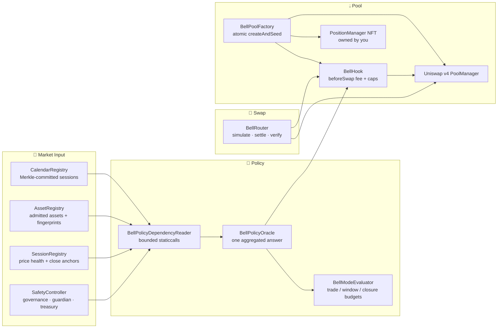

<div align="center">

# BELL PROTOCOL

**Session-Aware AMM for Robinhood Chain Stock Tokens**

*Fees follow the session. Limits hold the line.*

🌊 **Pools:** [`/pools`](apps/web/app/(app)/pools/page.tsx) · ➕ **Create:** [`/create`](apps/web/app/(app)/create/page.tsx) · 🔄 **Swap:** [`/swap`](apps/web/app/(app)/swap/page.tsx) · 💼 **Positions:** [`/positions`](apps/web/app/(app)/positions/page.tsx) · 📜 **Protocol:** [`/protocol`](apps/web/app/(app)/protocol/page.tsx) · 📖 **Brief:** [`docs/BELL-Developer-Brief-Final.md`](docs/BELL-Developer-Brief-Final.md)

*Uniswap v4 pools whose fees and flow limits are set by the exchange session, enforced onchain by an immutable hook. Every limit is a contract check, not a policy promise.*

[](#-live-robinhood-mainnet-deployments-chain-id-4663)
[](#-tech-stack)
[](#-protocol-architecture)
[](#-smart-contracts)
[](#-testing--verification)
[](#-admitted-assets)
[](#-license)

</div>

---

## ⚡ Overview

**BELL** is a session-aware automated market maker for stock tokens on Robinhood Chain (4663). It is built on Uniswap v4 and ships its entire trading policy as an immutable hook:

1. **Session-priced fees.** The base LP fee is chosen by the verified exchange session: `0.05%` in regular hours, `0.30%` in pre-market and after-hours, `0.50%` overnight, `1.00%` in a planned close. The hook returns that fee via `beforeSwap`, so it applies to the swap itself rather than to a config nobody enforces.
2. **Two-sided flow limits.** Every trade is checked against a per-swap cap, then cumulative gross flow against a rolling window cap. Capacity returns only as older swaps age out; a deposit or a midnight rollover does not reset it.
3. **Two ways to price a pool.** A **market-price** pool prices from its own liquidity and trades in every session. A **checked** pool follows a live external price while it is healthy and steps aside to its own market when it is not — with a higher fee and the tightest caps while it does.
4. **User-owned liquidity.** Pools are seeded in one atomic `createAndSeed` transaction. The position is an ERC-721 in your wallet, transferable, withdrawable in kind at any time.
5. **Fail-closed, never guessed.** A dependency read that fails is a recorded blocking reason. The hook never substitutes a healthy default for a read it could not complete.

---

## 🏛️ Core Value Proposition

* **The session is the fee schedule.** A single immutable hook reads the committed exchange calendar and returns `lpFeeUnits` per swap. There is no admin call that quietly widens a fee mid-session.
* **Limits are structural, not discretionary.** `tradeCap`, `windowCap` and `closureCap` are bound at pool creation and hashed into the config. A swap that would exceed them reverts; nobody can approve an exception.
* **Closure is a budget, not an outage.** A scheduled close runs against a proven close anchor and a finite episode budget derived from the pool's own principal — never an unbounded window.
* **Market-price pools are always open.** They need no external feed, so they keep trading through every session including overnight and weekends. That is a deliberate product choice, not a fallback.
* **Policy is one STATICCALL away.** `BellPolicyOracle` aggregates every dependency reason into a single answer; the hook cannot diverge between what it displays and what it enforces.
* **Your exit is never gated.** The hook does not take `beforeRemoveLiquidity`. No policy state, pause, or closure can block an in-kind withdrawal.

---

## 🔬 Protocol Architecture



### Swap pipeline, stage by stage

1. **Stage 1 — Read the market.** The hook reads the calendar leaf, the asset descriptor and the feed timestamp. All three must describe the same supported session, or the swap does not proceed.
2. **Stage 2 — Price for that session.** The verified session selects the base LP fee. Quieter hours carry a higher fee and tighter gross-flow limits.
3. **Stage 3 — Bound the flow.** The trade is checked against its per-swap cap, then cumulative gross flow against the pool's rolling window.
4. **Stage 4 — Execute or block.** The hook applies the fee and every active guard in the same transaction, then settles. One guard short and the swap is blocked; the transaction reverts and nothing moves.

---

## 🔀 Pool Classes

| Feature | Market Price (`poolClass=1`) | Checked Price (`poolClass=0`) |
|---|---|---|
| **Price source** | The pool's own liquidity | Live external reference, in-band check |
| **Feed required** | None | Both legs need a configured adapter |
| **Off-hours** | Trades in every session | Steps aside to own market with 1% fee and tightest caps |
| **Admission** | Stock token + any admitted counterasset | Both legs must have a reference adapter |
| **Creation cost** | Seed + 49 USDG service fee | Seed + 49 USDG service fee |

Both classes are **fixed at creation** and hashed into `configHash`. A pool cannot switch class afterwards.

---

## 🖥️ Platform Interfaces

### 1. Pool Directory (`/pools`)
Reads live `PoolCreated` events from the factory and, for each pool, reads **real depth from PoolManager storage** — not just the event. A pool whose liquidity was fully withdrawn shows `No liquidity` instead of advertising itself as tradable.

### 2. Pool Details (`/pool`)
Per-pool policy surface: lifecycle, mode, phase, effective caps, rolling room, closure remaining, hook address and pool id, all read from chain.

### 3. Create and Seed (`/create`)
Four steps: pair → pool class → seed → review. Shows the predicted hook address, pool id, tick range and the exact caps that will be bound before you sign. Approvals and the atomic `createAndSeed` are separate wallet confirmations.

### 4. Swap (`/swap`)
Exact-input and exact-output quoting against the live router, with slippage bounds. Approve is driven by the allowance itself, so a fresh pool works on the first try. A pool with no liquidity disables the action and says why.

### 5. Positions (`/positions`)
Your position NFTs, verified against the live pool directory. Add liquidity, remove in kind with a nonzero minimum on both legs, and collect fees — all sent directly from your wallet.

### 6. Protocol (`/protocol`)
The rules the contracts enforce, written for readers rather than auditors.

---

## 📁 Repository Structure

```text
bell/
├── apps/web/                          # Next.js 16 App Router frontend
│   ├── app/
│   │   ├── (app)/                     # Product surfaces
│   │   │   ├── pools/                 # Live directory, reads real pool depth
│   │   │   ├── pool/                  # Single-pool policy detail
│   │   │   ├── create/                # Four-step create and seed wizard
│   │   │   ├── swap/                  # Exact-in / exact-out swap desk
│   │   │   ├── positions/             # NFT positions, add / remove / collect
│   │   │   ├── protocol/              # Policy explained
│   │   │   └── terms/ privacy/ cookies/
│   │   └── page.tsx                   # Landing
│   ├── components/
│   │   ├── landing/gyevo/             # Scroll-driven landing (Three.js + GSAP)
│   │   ├── app/                       # Shell, loading states, status banners
│   │   ├── create/ swap/ positions/   # Flow components + progress modals
│   │   └── ui/                        # Primitives, token marks, selects
│   ├── lib/                           # Browser-safe protocol helpers
│   │   ├── mainnet-live.ts            # Pool + position directory reads
│   │   ├── mainnet-create-flow.ts     # Create wizard orchestration
│   │   ├── mainnet-pool-config.mjs    # Config, TickMath, SqrtPriceMath, caps
│   │   ├── swap-quote.mjs             # Slippage bounds
│   │   └── wallet.tsx                 # viem clients pinned to 4663
│   └── test/                          # 31 node:test files
├── contracts/                         # Solidity 0.8.26 (Cancun)
│   ├── src/
│   │   ├── BellPoolFactory.sol        # Atomic create → seed → activate
│   │   ├── BellRouter.sol             # Swap entry point, settle + verify
│   │   ├── BellHook.sol               # Session fee + flow caps per pool
│   │   ├── BellHookDeployer.sol       # Deterministic hook mining
│   │   ├── BellPolicyOracle.sol       # Single aggregated policy answer
│   │   ├── BellModeEvaluator.sol      # Budgets from pool principal
│   │   ├── BellPolicyDependencyReader.sol
│   │   ├── registries/                # Asset · Calendar · Session
│   │   ├── adapters/                  # Chainlink · Equity · Yahoo sources
│   │   └── libraries/                 # ModePolicy · FlowBudget · ClosureBudget
│   ├── test/                          # 36 suites, 429 tests
│   └── lib/v4-core, v4-periphery/     # Pinned Uniswap v4
├── packages/
│   ├── domain/                        # Runtime-neutral domain logic
│   ├── protocol/                      # ABIs, codecs, calendar, swap codec
│   └── test-vectors/                  # Shared fixtures
├── workers/keeper-b/                  # Cloudflare Worker
│   ├── src/index.ts                   # /quote /pools /positions /status
│   ├── src/tick-policy.mjs            # Session windows, close capture
│   └── src/calendar-maintenance.mjs   # Merkle proof construction
├── scripts/
│   ├── deploy/                        # Mainnet + testnet deployment
│   ├── calendar/                      # Session dataset builder
│   ├── evidence/                      # Manifest + ABI generation
│   └── tooling/                       # Compile, salt mining, guards
├── evidence/deploy/                   # Manifests and verification records
├── docs/                              # Brief, plan, runbooks, decisions
└── tests/reference/                   # Python engineering + infra checks
```

---

## 🛠️ Tech Stack

- **Framework:** Next.js 16.4.3 (App Router) + React 19.3.1 + TypeScript 7.0.2
- **Styling:** Tailwind CSS v4 + Three.js 0.186 + GSAP 3.15 + Lenis smooth scroll
- **Web3 client:** Viem 2.57 + Wagmi 2.19 + RainbowKit 2.2
- **AMM:** Uniswap v4 Core + v4 Periphery (pinned submodules)
- **Contracts:** Solidity `0.8.26` (Cancun), Foundry for tests, native `solc` for artifacts
- **Oracle:** Chainlink AggregatorV3 onchain feeds, with a BELL EIP-712 reporter path
- **Runtime:** Cloudflare Workers (keeper), Durable Object state
- **Testing:** `forge` (429) + `node:test` (484) + `vitest` (80) = **993**

---

## 🚀 Quickstart & Local Development

### Prerequisites

- **Node.js** `v24.x` · **pnpm** `9.15` · **Foundry** (for contract tests)

### 1. Install

```bash
pnpm install
```

### 2. Compile contracts

```bash
pnpm compile:solidity
```

Compiles with the Cancun EVM target, enforces EIP-170 code size, and regenerates TypeScript / ESM artifacts.

### 3. Generate and check ABI + policy constants

```bash
pnpm abi:generate && pnpm abi:check
pnpm policy:generate && pnpm policy:check
```

### 4. Run the frontend

```bash
pnpm --filter @bell/web dev
```

Serves on `http://localhost:3100`, pointed at Robinhood Chain mainnet 4663.

### 5. Run the worker locally

```bash
pnpm --filter @bell/keeper-b dev
```

### 6. Run every test

```bash
pnpm test:contracts      # forge, 429 tests
pnpm test:unit           # node:test, 484 tests
pnpm test:workers        # vitest, 80 tests
pnpm check               # the full gate, including reference checks
```

### 7. Build

```bash
pnpm build
```

---

## 📜 Smart Contracts

BELL contracts are built for verifiability: the hook never custodies funds, the router verifies what actually moved, and every limit is a contract check.

* **`BellPoolFactory.sol`** — Deploys the hook at a mined address, initialises the pool, seeds it, verifies the position NFT and activates the pool in **one atomic transaction**. Verifies the spend against the seed principal before refunding the remainder.
* **`BellRouter.sol`** — The only swap entry point. Validates recipient, deadline, nonce, config hash and amounts, then unlocks the PoolManager, settles, and verifies the pool is clean afterwards.
* **`BellHook.sol`** — Immutable per-pool hook. Returns the session fee from `beforeSwap`, enforces per-trade and rolling-window caps in `afterSwap`, and takes no `beforeRemoveLiquidity` permission so exits are never gated.
* **`BellPolicyOracle.sol`** — Aggregates every dependency reason into one `Output`. STATICCALL only: it can answer, never mutate or authorise.
* **`BellModeEvaluator.sol`** — Derives `maximumClosureCap` and settles swap budgets from the pool's own principal, so a closure budget cannot exceed what the pool actually holds.
* **`BellPolicyDependencyReader.sol`** — Every external read is bounded and every failure becomes a recorded `ReasonBits` entry rather than a healthy default.
* **`CalendarRegistry.sol`** — Merkle-committed market sessions. Advances only with a valid proof; `currentInterval` returns zero rather than a stale leaf.
* **`AssetRegistry.sol`** — Admitted assets with code fingerprints, capability masks and evidence hashes. A descriptor change is a new admission, not an edit.
* **`SessionRegistry.sol`** — Price health, close anchors and per-asset observation state.
* **`SafetyController.sol`** — Pause authority split across governance, guardian and treasury, three distinct addresses.

---

## 🌐 Live Robinhood Mainnet Deployments (Chain ID: 4663)

**Core deployment range:** blocks 103,948,123–103,948,148 · **verified at block** 103,948,602

Every address below was read back from chain and its deployed bytecode size matched the recorded deployment.

| Contract | Address | Bytes |
|---|---|---|
| **BellPoolFactory** | [`0xf677edc6346be53686E6DD42374A744cab9d0A5B`](https://robinhoodchain.blockscout.com/address/0xf677edc6346be53686E6DD42374A744cab9d0A5B) | 22,652 |
| **BellRouter** | [`0x178d78419e8b7cd1f5e1e4a65f71d86c7f6516d5`](https://robinhoodchain.blockscout.com/address/0x178d78419e8b7cd1f5e1e4a65f71d86c7f6516d5) | 9,505 |
| **BellHookDeployer** | [`0x3e5cEBb068ac71D742f700Db918908a15B8c45C5`](https://robinhoodchain.blockscout.com/address/0x3e5cEBb068ac71D742f700Db918908a15B8c45C5) | 3,305 |
| **BellPolicyOracle** | [`0x908bea5cd3C5297Ad69aCb19279c413d594cd335`](https://robinhoodchain.blockscout.com/address/0x908bea5cd3C5297Ad69aCb19279c413d594cd335) | 18,807 |
| **BellModeEvaluator** | [`0xEBDb2291f07F10490E7f34a5cD5C37dF95F877F4`](https://robinhoodchain.blockscout.com/address/0xEBDb2291f07F10490E7f34a5cD5C37dF95F877F4) | 15,254 |
| **BellPolicyDependencyReader** | [`0x2354D314c1Dbd9fc7BE9a4b568D6024C6A05408f`](https://robinhoodchain.blockscout.com/address/0x2354D314c1Dbd9fc7BE9a4b568D6024C6A05408f) | 10,064 |
| **SafetyController** | [`0x7243cf13f0308edd4a0397551042fea3cf9da179`](https://robinhoodchain.blockscout.com/address/0x7243cf13f0308edd4a0397551042fea3cf9da179) | 5,292 |
| **AssetRegistry** | [`0x0d9c0c8b2065b08a8ad4abc861eb128385ef18c6`](https://robinhoodchain.blockscout.com/address/0x0d9c0c8b2065b08a8ad4abc861eb128385ef18c6) | 12,798 |
| **CalendarRegistry** | [`0x394983bff2715d57197389f323d807b0d61c05a3`](https://robinhoodchain.blockscout.com/address/0x394983bff2715d57197389f323d807b0d61c05a3) | 10,849 |
| **SessionRegistry** | [`0x5f1b0212dc6167cbc1883f910640a685b1243795`](https://robinhoodchain.blockscout.com/address/0x5f1b0212dc6167cbc1883f910640a685b1243795) | 23,800 |

### Deploy transactions (core range)

| Contract | Deploy Tx | Block |
|---|---|---|
| BellPolicyOracle | [`0xcb958a22…ec6a`](https://robinhoodchain.blockscout.com/tx/0xcb958a22707a7492c374a2f41f6e481c821836466e471cf73baa21601657ec6a) | 103,948,123 |
| BellModeEvaluator | [`0x4c6a3a0e…d1b4`](https://robinhoodchain.blockscout.com/tx/0x4c6a3a0e3ea4d67b34ea37b4a9333ee6aab07c5df402b48b0f864ba9dbbfd1b4) | 103,948,132 |
| BellHookDeployer | [`0xeb656b64…beb7`](https://robinhoodchain.blockscout.com/tx/0xeb656b64ee49cb4664bbdd45386f3aece09d2b5b83b1180b2918282bf531beb7) | 103,948,141 |
| BellPoolFactory | [`0x5d0a42cd…b99f`](https://robinhoodchain.blockscout.com/tx/0x5d0a42cd499c2a08da3a04f1173432c8f698a300118a4030b282c0e871fbb99f) | 103,948,148 |

> Router, dependency reader and the four registries are reused from the earlier deployment and therefore have no creation transaction inside this block range.

### Canonical dependencies

| Contract | Address |
|---|---|
| **Uniswap v4 PoolManager** | [`0x8b26FEfa276860592D45114Cb30B335DdDd87B56`](https://robinhoodchain.blockscout.com/address/0x8b26FEfa276860592D45114Cb30B335DdDd87B56) |
| **Uniswap v4 PositionManager** | [`0x84da249Aafa359886C6A2Ae1ebDC78a6059B662D`](https://robinhoodchain.blockscout.com/address/0x84da249Aafa359886C6A2Ae1ebDC78a6059B662D) |
| **Permit2** | [`0x000000000022D473030F116dDEE9F6B43aC78BA3`](https://robinhoodchain.blockscout.com/address/0x000000000022D473030F116dDEE9F6B43aC78BA3) |
| **WETH** | [`0x0Bd7D308f8E1639FAb988df18A8011f41EAcAD73`](https://robinhoodchain.blockscout.com/address/0x0Bd7D308f8E1639FAb988df18A8011f41EAcAD73) |
| **USDG** (6 decimals, fee token) | [`0x5fc5360D0400a0Fd4f2af552ADD042D716F1d168`](https://robinhoodchain.blockscout.com/address/0x5fc5360D0400a0Fd4f2af552ADD042D716F1d168) |

### Roles

Governance, guardian and treasury are three distinct addresses.

| Role | Address |
|---|---|
| Governance | `0x6C3659988bd5f9E94F927B3FD7d0Ee3746f8d399` |
| Guardian | `0x072f9d4165DccBD9172023601d07bCE2FCF37072` |
| Treasury | `0xF6e272FBF862AE055949C61BC41E6395dfE20841` |
| Service recipient | `0x58Cd82a008cB9a6c0c605991b40a09BD6aa1a6fC` |

Service fee: **49 USDG** per pool creation, paid to the service recipient, separate from the seed.

---

## 🪙 Admitted Assets

| Asset | Token | Decimals | Capability mask | Calendar |
|---|---|---|---|---|
| **AAPL** | [`0xaF3D76f1834A1d425780943C99Ea8A608f8a93f9`](https://robinhoodchain.blockscout.com/address/0xaF3D76f1834A1d425780943C99Ea8A608f8a93f9) | 18 | 30 | PRE · REGULAR · POST · OVERNIGHT |
| **NVDA** | [`0xd0601CE157Db5bdC3162BbaC2a2C8aF5320D9EEC`](https://robinhoodchain.blockscout.com/address/0xd0601CE157Db5bdC3162BbaC2a2C8aF5320D9EEC) | 18 | 30 | PRE · REGULAR · POST · OVERNIGHT |
| **TSLA** | [`0x322F0929c4625eD5bAd873c95208D54E1c003b2d`](https://robinhoodchain.blockscout.com/address/0x322F0929c4625eD5bAd873c95208D54E1c003b2d) | 18 | 30 | PRE · REGULAR · POST · OVERNIGHT |
| **MEME** | [`0x385F4f8ae47651ce5F58F5265395a669f8281e18`](https://robinhoodchain.blockscout.com/address/0x385F4f8ae47651ce5F58F5265395a669f8281e18) | 18 | 0 | none (own-market) |
| **USDG** | [`0x5fc5360D0400a0Fd4f2af552ADD042D716F1d168`](https://robinhoodchain.blockscout.com/address/0x5fc5360D0400a0Fd4f2af552ADD042D716F1d168) | 6 | 0 | none |
| **WETH** | [`0x0Bd7D308f8E1639FAb988df18A8011f41EAcAD73`](https://robinhoodchain.blockscout.com/address/0x0Bd7D308f8E1639FAb988df18A8011f41EAcAD73) | 18 | 0 | none |

### Asset descriptor IDs

```
AAPL  0x846db71c8d321ca12d7708c8158112a62f5c770799bbb1e9786beb977c0e6746
NVDA  0x8be195d306480811443a54e01bb2e8dc85444fa62a7addc55c347ca50ee3fe8b
TSLA  0x9bd48cfd4fa29ebe281de6e1ec774a799d39a914d380ac07bf9a3119eaeb7ae8
MEME  0x13c864074b482dc9f85395e5f47f0a9464dd3444ea3784e8bfc19ef578403a03
USDG  0xcbb99b58d6eec6885449965262a1f4372f95e2b26ca874ca5ae3a30a277dd864
WETH  0x97ee8f8dffff3c09ee5b72aeabc111f64385e66e447d860bd9b9677c788b5d58
```

### Price adapters

AAPL, NVDA and TSLA each carry four adapters — direct, regular, extended and overnight — reading Chainlink AggregatorV3 feeds. MEME, USDG and WETH carry none: they are admitted without an external price source and price from pool liquidity only.

---

## 🧪 Testing & Verification

| Suite | Count | Command |
|---|---|---|
| Contract tests (Foundry) | **429** | `pnpm test:contracts` |
| Unit tests (node:test) | **484** | `pnpm test:unit` |
| Worker tests (Vitest) | **80** | `pnpm test:workers` |
| **Total** | **993** | `pnpm check` |

### Loss-of-funds audit

`contracts/test/integration/factory/LossOfFundsIndex.t.sol` indexes 27 loss-of-funds scenarios — double-spend, reentrancy, settlement mismatch, cap bypass, closure overrun, refund shortfall — each with the test that proves it cannot occur.

### Deployment verification

`evidence/deploy/mainnet-4663-verification.json` records, for every contract: address, deployed bytecode size, bytecode hash, and every wiring pointer read back from the deployed contract rather than from the manifest.

### Responsive audit

Every product surface was rendered at 375, 393, 430, 768, 1024, 1280, 1440 and 1920 px and checked for horizontal overflow. `documentElement.scrollWidth` equals `clientWidth` at every size.

---

## 🔐 Security Model

**What the contracts guarantee**

- The hook never holds funds. `createAndSeed` funds, mints, verifies and refunds in one transaction.
- The router verifies the pool is clean after settlement; a swap that leaves residue reverts.
- Withdrawals cannot be blocked. The hook takes no `beforeRemoveLiquidity` permission, so no policy state can gate an exit.
- A failed dependency read is a blocking reason, never a healthy default.
- Flow caps are bound at creation and hashed into `configHash`. Changing them means creating a new pool.

**What this repository does not claim**

- Neither pool class guarantees a fixed or maximum loss. AMM liquidity, price divergence, arbitrage and market depth remain economic risks.
- The deployed profile is `PUBLIC` only. The treasury-only liquidity path has no live deployment.
- A pool still requires admitted assets, a valid calendar, seed funds and available swap liquidity before it can trade.
- An independent third-party security review has not been completed. The contract suite and the 27-scenario loss-of-funds index are internal evidence, not a substitute for one.

---

## 🌊 Session Model

| Session | Code | Base LP fee | Flow limits |
|---|---|---|---|
| Pre-market | `PRE` | 0.30% | Tightest |
| Regular | `REGULAR` | 0.05% | Widest |
| After-hours | `POST` | 0.30% | Tight |
| Overnight | `OVERNIGHT` | 0.50% | Tight |
| Scheduled close | `CLOSED` | 1.00% | Finite episode budget |

A market-price pool trades in every session and needs no external feed. A checked pool follows a live external price while it is healthy and steps aside to its own market when it is not, with a 1% fee and the strictest caps while it does.

---

## 📚 Documentation

| Document | Contents |
|---|---|
| [`docs/BELL-Developer-Brief-Final.md`](docs/BELL-Developer-Brief-Final.md) | Normative specification (hash-pinned) |
| [`docs/BELL-Implementation-Plan-Final.md`](docs/BELL-Implementation-Plan-Final.md) | Milestone and task plan (hash-pinned) |
| [`docs/CURRENT-STATE.md`](docs/CURRENT-STATE.md) | What is live, what is not, and the evidence |
| [`docs/MAINNET-DEPLOY.md`](docs/MAINNET-DEPLOY.md) | Mainnet deployment runbook |
| [`docs/runbooks/keeper.md`](docs/runbooks/keeper.md) | Worker design, crons and session windows |
| [`docs/runbooks/indexer.md`](docs/runbooks/indexer.md) | Directory indexing and subrequest budget |
| [`docs/runbooks/recovery.md`](docs/runbooks/recovery.md) | Recovery and closure procedures |
| [`evidence/task-status.json`](evidence/task-status.json) | Per-task ledger |
| [`evidence/deploy/`](evidence/deploy/) | Manifests and verification records |

If any document conflicts with `docs/CURRENT-STATE.md`, that document is out of date.

---

## 🤝 Contributing

1. Read `docs/CURRENT-STATE.md` first — it is the source of truth for what is deployed.
2. Every change to policy constants must pass `pnpm policy:check`; the generated file is checked in.
3. Every ABI change must pass `pnpm abi:check`.
4. Contract changes require a test in `contracts/test/` and, for anything touching value movement, an entry in `LossOfFundsIndex.t.sol`.
5. Run `pnpm check` before opening a pull request.

---

## 📄 License

MIT

---

<div align="center">

**BELL Protocol** · Robinhood Chain Mainnet 4663

*Fees follow the session. Limits hold the line.*

</div>
